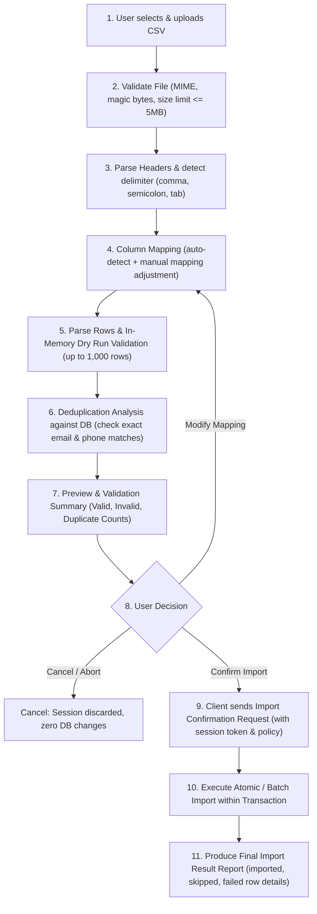

# ANTIGRAVITY — SPRINT 3 / PHASE 2 DESIGN SPECIFICATION
## Contact Import Architecture, Data Contracts & Threat Model

**Author:** Staff Software Engineer & Security Architect  
**Project:** VoicePilot AI CRM  
**Status:** **PROPOSED & PENDING REVIEW (ACCEPTANCE GATE)**  
**Target Module:** Contact CSV Import Subsystem (`com.voicepilot.contacts.importing`)

---

## 1. Inspection of Existing Baseline Implementation

Before designing the import subsystem, a rigorous inspection of the current VoicePilot AI architecture was conducted:

### 1.1 Contact Entity & Database Mapping
- **Entity:** [`Contact.java`](file:///c:/Users/manoz/OneDrive/Desktop/VoicePilot-AI/backend/src/main/java/com/voicepilot/contacts/model/Contact.java) mapped to table `crm_contacts`.
- **Fields:**
  - `id`: `BIGINT AUTO_INCREMENT PRIMARY KEY`
  - `first_name`: `VARCHAR(80) NOT NULL` (Bean Validation `@NotBlank`, `@Size(max=80)`)
  - `last_name`: `VARCHAR(80) NOT NULL` (Bean Validation `@NotBlank`, `@Size(max=80)`)
  - `email`: `VARCHAR(160) NOT NULL` (Bean Validation `@NotBlank`, `@Email`, `@Size(max=160)`). **Critical finding:** Email has an index `idx_crm_contacts_email`, but **no unique constraint** in Flyway `V2__init_crm_schema.sql`. Sprint 2 explicitly permits duplicate emails.
  - `phone`: `VARCHAR(32) NULL` (Bean Validation `@Size(max=32)`)
  - `job_title`: `VARCHAR(100) NULL` (Bean Validation `@Size(max=100)`)
  - `status`: `VARCHAR(32) NOT NULL DEFAULT 'LEAD'` enum (`LEAD`, `PROSPECT`, `CUSTOMER`, `CHURNED`)
  - `notes`: `TEXT NULL`
  - `account_id`: `BIGINT NULL` foreign key referencing `crm_accounts(id)` with `ON DELETE SET NULL`.
  - `created_at`, `updated_at`: `TIMESTAMP NOT NULL DEFAULT CURRENT_TIMESTAMP`

### 1.2 Account Relationship
- Contacts can be standalone (`account_id IS NULL`) or associated with an Account entity (`crm_accounts`).
- Lookup strategies: Accounts can be matched by `name` or `domain` or explicit `id`.

### 1.3 Existing API & Envelope Conventions
- Standard JSON envelope: `ApiResponse<T>` containing `success: boolean`, `data: T`, `message?: string`, `timestamp: Instant`.
- Errors: Handled uniformly by `GlobalExceptionHandler` returning `ErrorResponse` (`code`, `message`, `details?: [{ field, issue }]`, `timestamp`).
- Pagination: `PageResponse<T>` (`content`, `page`, `size`, `totalElements`, `totalPages`, `first`, `last`).

### 1.4 Authentication, Authorization & Multitenancy Reality Check
- **Current State:** The backend has **no Spring Security starter** installed (`pom.xml` contains web, validation, data-jpa, flyway, springdoc, mysql, h2, actuator).
- `WebCorsConfig` restricts origins to `http://localhost:5173`.
- There is **no tenant isolation column** (`tenant_id` or `workspace_id`) in `crm_contacts` or `crm_accounts` yet.
- **Architectural Directive:** We must not fabricate claims of multi-tenant row-level isolation or OAuth/JWT token scopes. The design must accommodate the current single-tenant workspace architecture while ensuring future tenant boundaries can be injected via standard Spring interceptors.

---

## 2. End-to-End Import Lifecycle Workflow

The import workflow is designed as a **two-phase, human-in-the-loop lifecycle** that guarantees zero unwanted mutations, complete transparency, and explicit user consent.



### Detailed Lifecycle Phases:

1. **Upload & Initial Inspection (`POST /api/v1/contacts/import/preview`)**:
   - Client uploads CSV as `multipart/form-data`.
   - File size checked (max 5 MB / approx 5,000 rows max; recommended batch: 1,000).
   - Validates MIME type (`text/csv`, `text/plain`, `application/vnd.ms-excel`) and UTF-8 / ASCII encoding with BOM stripping.
   - Header row parsed and normalized.
2. **Column Mapping Engine**:
   - Server provides intelligent alias matching (e.g. `First Name`, `first_name`, `fname`, `Given Name` -> `firstName`).
   - Client can optionally submit custom header mappings.
3. **Validation & Duplicate Candidate Detection (Dry Run)**:
   - Evaluates row constraints without writing to `crm_contacts`.
   - Checks database for collision candidates (based on email and/or phone).
   - Assigns a short-lived `importSessionId` (stored in-memory cache/Caffeine with 15-minute TTL, containing parsed & sanitized DTOs).
4. **Interactive Summary Presentation**:
   - Returns preview breakdown:
     - `totalRows`: e.g. 50
     - `validRows`: e.g. 45
     - `invalidRows`: e.g. 3 (with line numbers and field-level reasons)
     - `duplicateCandidates`: e.g. 2 (with existing contact IDs)
     - Sample preview: First 5-10 normalized rows.
5. **Explicit Confirmation & Policy Selection (`POST /api/v1/contacts/import/execute`)**:
   - User reviews the report in UI.
   - User selects duplicate strategy (`SKIP`, `REJECT`, `UPDATE`).
   - User clicks **"Execute Import"** or **"Cancel"**.
   - If user cancels or navigates away, the session naturally expires or is destroyed via `DELETE /api/v1/contacts/import/{sessionId}`. Zero database pollution occurs.
6. **Execution & Report Generation**:
   - Server processes the records in the active transaction.
   - Returns an itemized `ImportResultReport`.

---

## 3. Data Contract & Validation Matrix

### 3.1 Field Specifications

| Field Name | Target Property | CSV Header Aliases | Required? | Max Length | Format / Normalization Rule |
| :--- | :--- | :--- | :---: | :---: | :--- |
| **First Name** | `firstName` | `first_name`, `firstname`, `first`, `given_name` | **YES** | 80 chars | Stripped leading/trailing whitespace. Formula-sanitized. |
| **Last Name** | `lastName` | `last_name`, `lastname`, `last`, `surname`, `family_name` | **YES** | 80 chars | Stripped leading/trailing whitespace. Formula-sanitized. |
| **Email** | `email` | `email`, `e-mail`, `email_address`, `work_email` | **YES** | 160 chars | Lowercased, trimmed, validated against standard email regex (`RFC 5322` subset). |
| **Phone** | `phone` | `phone`, `telephone`, `mobile`, `cell`, `phone_number` | NO | 32 chars | Stripped non-numeric chars except leading `+`, parentheses, dots, spaces, hyphens. E.164 normalization attempted. |
| **Job Title** | `jobTitle` | `job_title`, `jobtitle`, `title`, `position`, `role` | NO | 100 chars | Trimmed string. |
| **Status** | `status` | `status`, `contact_status`, `lifecycle_status`, `stage` | NO | 32 chars | Case-insensitive match to `LEAD`, `PROSPECT`, `CUSTOMER`, `CHURNED`. Defaults to `LEAD` if omitted or empty. |
| **Notes** | `notes` | `notes`, `description`, `comments`, `memo` | NO | 4,000 chars | Trimmed text. |
| **Account Name / Domain** | `account` | `account`, `company`, `organization`, `account_name`, `company_name`, `domain` | NO | 160 chars | Looked up via `crm_accounts` by exact name or domain. If found, associated. If not found, behavior defined by policy (leave unassigned or create prospect account). |

### 3.2 Account Matching Behavior
- When an account identifier or company name is present in CSV:
  1. Attempt match on `crm_accounts.domain` (if input looks like a domain).
  2. Attempt match on `crm_accounts.name` (case-insensitive exact match).
  3. If matched, link `contact.account_id = account.id`.
  4. If unmatched: Default policy is **Unassigned** (`account_id = null`), preserving the row with an informational warning: `"Account 'Acme' not found; contact imported as unassigned"`.

### 3.3 Invalid Row Handling
- **Non-blocking per-row failures:** If a CSV row fails validation (e.g. missing last name, invalid email format), that specific row is flagged as `FAILED` with line number and specific error reason.
- The remaining valid rows can still be imported according to user preference, or the user can choose to cancel and fix their CSV file.
- **Never silently truncate or drop columns.**

---

## 4. Duplicate Handling Policies

Because Sprint 2 explicitly permits duplicate emails in `crm_contacts`, duplicate handling must be configurable and transparent.

### 4.1 Duplicate Candidate Criteria
A row is considered a **Duplicate Candidate** if:
1. `crm_contacts.email` matches (case-insensitive) an existing record, OR
2. `crm_contacts.phone` matches (non-empty canonical E.164) an existing record.

### 4.2 Supported Policies

| Policy | Description | Behavior |
| :--- | :--- | :--- |
| `SKIP` *(Default)* | Ignores duplicate rows; imports all other valid rows. | Duplicate rows are recorded in the summary as `SKIPPED (Duplicate detected: ID #123)`. Existing record is untouched. |
| `REJECT_ALL` | Aborts the entire import if any duplicates exist. | If any row is a duplicate candidate, no rows are committed. Returns HTTP 409 with list of conflicting lines. |
| `UPDATE` | Updates existing record fields with non-empty CSV values. | **Safe updates only:** Requires matching on single unambiguous existing record by email. Replaces provided fields (`phone`, `jobTitle`, `notes`, `status`). **Never automatically merges multiple conflicting records.** |
| `ALLOW_DUPLICATES` | Inserts the row as a new record regardless of existing matches. | Creates a new contact with distinct ID. Useful when contacts share a corporate address or multi-agent lead intake. |

---

## 5. Security Architecture & Threat Model

### 5.1 Threat Model (STRIDE)

| Threat Category | Potential Attack Vector | Impact | Mitigation Strategy |
| :--- | :--- | :--- | :--- |
| **Spoofing / Auth** | Unauthenticated user uploads rogue CSV | Unauthorized data insertion | Enforce CORS and prepare controller for future Spring Security token principal filter. |
| **Tampering** | CSV Formula Injection (Excel / Google Sheets DDE attacks) | Remote Code Execution or credential theft when admin exports/views CSV | **Formula Neutralization:** If any text cell begins with `=`, `+`, `-`, `@`, `\t`, or `\r`, prepend a single quote `'` or strip leading operator before storage/export. |
| **Information Disclosure** | Error messages echoing full database stack traces or private notes | PII leak in logs / HTTP response | Sanitized error responses via `GlobalExceptionHandler`. Logs do not print raw CSV payloads or full PII; log only line counts, file size, and sanitized error keys. |
| **Denial of Service (DoS)** | 500MB bomb file, ZIP bombs, endless regex backtrack | Memory exhaustion (OOM), CPU starvation | 1. Bounded upload limit (Max 5MB enforced by Spring multipart config).<br>2. Bounded row limit (Max 1,000 rows per standard import batch; 5,000 absolute cap).<br>3. Streaming parser (Apache Commons CSV or OpenCSV) reading line-by-line rather than buffering entire dataset as strings.<br>4. Hard timeout of 30s on preview/execution. |
| **Elevation of Privilege** | Path traversal in uploaded filename (`../../etc/passwd`) | Arbitrary file overwrite on server | **Zero Disk Persistence:** Parse directly from `InputStream` in memory or use disposable Java `File.createTempFile` with immediate `deleteOnExit()` / `try-with-resources` cleanup. Never trust `file.getOriginalFilename()`. |

### 5.2 Parser Reliability & Encoding
- **Encoding:** Accept UTF-8 and ISO-8859-1. Handle UTF-8 Byte Order Mark (BOM: `\uFEFF`) transparently by stripping it before parsing headers.
- **Malformed Lines:** Unescaped quotes or mismatched delimiters are caught at line level, marking that specific line invalid without crashing the parser.

---

## 6. Architecture & System Boundaries

### 6.1 Modular Monolith Integration
We avoid introducing external message queues (Kafka/RabbitMQ) or distributed object storage (AWS S3). For VoicePilot AI CRM's current operational scale (B2B SaaS managing thousands of leads):
- Use **Apache Commons CSV** (lightweight, robust, battle-tested, no native memory leaks).
- Keep import execution synchronous or pseudo-asynchronous using Spring's task executor if batches exceed 2,000 rows.
- Store short-lived preview sessions in an in-memory `ConcurrentHashMap` with TTL eviction or Caffeine cache (`ImportSessionRegistry`).

```
com.voicepilot.contacts.
├── controller/
│   └── ContactImportController.java      # REST endpoints (/import/preview, /import/execute)
├── service/
│   ├── ContactImportService.java         # Orchestrates parse, validate, and execute
│   └── CsvParserService.java             # Low-level streaming parser & formula sanitizer
├── dto.importing/
│   ├── ImportPreviewRequest.java         # Multipart file + custom column mapping
│   ├── ImportPreviewResponse.java        # Stats, duplicate candidates, sample records
│   ├── ImportExecutionRequest.java       # Session ID + selected duplicate policy
│   ├── ImportResultReport.java           # Final itemized success/failure report
│   └── ImportErrorDetail.java            # Line number, raw value, specific reason
└── model/
    └── Contact.java                      # Existing domain entity
```

---

## 7. API Specification Contracts

### 7.1 POST `/api/v1/contacts/import/preview`
- **Content-Type:** `multipart/form-data`
- **Request Body:**
  - `file`: CSV binary file (max 5 MB).
  - `mappingOverrides`: Optional JSON string mapping CSV headers to target fields.
- **Success Response (HTTP 200):**
```json
{
  "success": true,
  "data": {
    "sessionId": "imp_9a7b2c8f-3d1e-4c5b-8f9a-1b2c3d4e5f6a",
    "fileName": "leads_q4.csv",
    "totalRows": 25,
    "validRowCount": 22,
    "invalidRowCount": 2,
    "duplicateCount": 1,
    "detectedHeaders": ["First Name", "Last Name", "Email Address", "Phone", "Account"],
    "mappedFields": {
      "First Name": "firstName",
      "Last Name": "lastName",
      "Email Address": "email",
      "Phone": "phone",
      "Account": "account"
    },
    "sampleRows": [
      {
        "rowNumber": 2,
        "firstName": "Bruce",
        "lastName": "Wayne",
        "email": "bruce@wayne.corp",
        "phone": "+1-555-0199",
        "account": "Wayne Enterprises",
        "status": "VALID",
        "isDuplicate": true,
        "matchedContactId": 10
      }
    ],
    "validationErrors": [
      {
        "rowNumber": 14,
        "field": "email",
        "rawValue": "invalid-email-string",
        "issue": "Email must be valid"
      }
    ]
  },
  "timestamp": "2026-11-02T07:48:00Z"
}
```

### 7.2 POST `/api/v1/contacts/import/execute`
- **Content-Type:** `application/json`
- **Request Body:**
```json
{
  "sessionId": "imp_9a7b2c8f-3d1e-4c5b-8f9a-1b2c3d4e5f6a",
  "duplicatePolicy": "SKIP",
  "skipInvalidRows": true
}
```
- **Success Response (HTTP 200):**
```json
{
  "success": true,
  "message": "Import completed successfully",
  "data": {
    "totalProcessed": 25,
    "importedCount": 22,
    "skippedCount": 1,
    "failedCount": 2,
    "durationMs": 142,
    "importedIds": [101, 102, 103],
    "errors": [
      {
        "rowNumber": 14,
        "field": "email",
        "issue": "Email must be valid"
      }
    ]
  },
  "timestamp": "2026-11-02T07:48:05Z"
}
```

---

## 8. Proposed Database Changes

**Verdict:** **No schema migration required for initial implementation.**
- Current `crm_contacts` table supports all required nullable and non-nullable fields.
- `idx_crm_contacts_email` and `idx_crm_contacts_names` already exist for efficient duplicate candidate checks.
- If persistent audit logs for import histories are required in Sprint 4, a future `crm_import_jobs` table can be scheduled via Flyway V3.

---

## 9. Comprehensive Test Strategy

### 9.1 Unit Tests
- `CsvParserServiceTest`: Delimiter detection (`,` vs `;` vs `\t`), BOM handling, quoted commas, multiline notes, formula injection escaping.
- `ContactImportServiceTest`: Duplicate evaluation logic (`SKIP`, `REJECT`, `UPDATE`), account resolution, row validation.

### 9.2 Integration Tests
- `ContactImportControllerIntegrationTest`: End-to-end `POST /preview` with test CSVs (valid, empty, malformed, oversized).
- MockMvc testing for execution with transaction rollback verification.

### 9.3 Security Tests
- Formula injection payloads (`=cmd|' /C calc'!A0`, `+SUM(A1:A10)`).
- Oversized file upload rejection (HTTP 413 or 400).
- Malformed CSV with unmatched quotes.

---

## 10. Acceptance Gate Review

> [!IMPORTANT]
> **Implementation Hold Notice**: In compliance with Sprint 3 Phase 2 instructions, no import implementation code or UI modifications have been performed. Implementation will commence only after user review and approval of this architectural specification and threat model.

