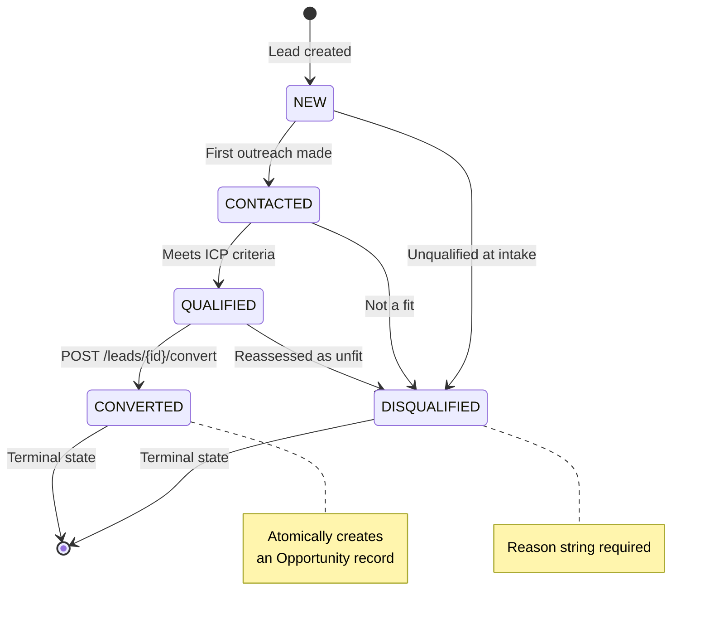
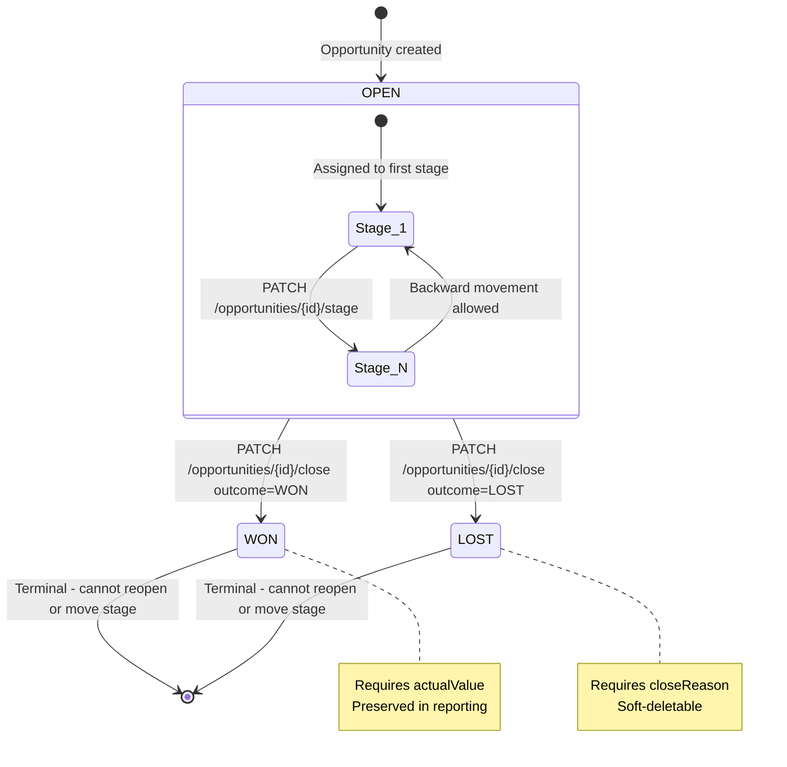

# SPRINT 4 — API Contracts

**Project:** VoicePilot AI  
**Version:** v1  
**Base URL:** `https://api.voicepilot.ai/api/v1`  
**Last Updated:** 2026-11-03  
**Status:** Canonical — do not modify without an ADR

---

## Global Conventions

### Response Envelope

Every non-error response is wrapped in `ApiResponse<T>`:

```json
{
  "success": true,
  "data": { },
  "message": null,
  "timestamp": "2026-11-03T16:00:00Z"
}
```

Every error response uses `ErrorResponse`:

```json
{
  "success": false,
  "error": "DOMAIN_ERROR_CODE",
  "message": "Human-readable explanation.",
  "timestamp": "2026-11-03T16:00:00Z"
}
```

Paginated responses wrap a `PageResponse<T>` inside `data`:

```json
{
  "success": true,
  "data": {
    "content": [],
    "page": 0,
    "size": 20,
    "totalElements": 142,
    "totalPages": 8
  },
  "message": null,
  "timestamp": "2026-11-03T16:00:00Z"
}
```

### Tenant Scoping

> [!IMPORTANT]
> The `workspaceId` is **never** accepted from the request body or path variables for resource operations. It is extracted exclusively from the JWT principal claim `workspace_id`. The active workspace is switched via `POST /api/v1/workspaces/switch`, which issues a new token.

### Authentication

All protected endpoints require:

```
Authorization: Bearer <access_token>
```

Access tokens are short-lived JWTs (15 minutes). Refresh tokens are stored in an `HttpOnly`, `Secure`, `SameSite=Strict` cookie named `__vp_rt`.

### Pagination Query Parameters

| Parameter | Type | Default | Description |
|-----------|------|---------|-------------|
| `page` | int | 0 | Zero-indexed page number |
| `size` | int | 20 | Page size (max 100) |
| `sort` | string | varies | `field,asc\|desc` (e.g., `createdAt,desc`) |

### Common Validation Rules

| Rule | Applies To |
|------|-----------|
| Email must be RFC 5322 compliant | All email fields |
| Passwords: min 8 chars, ≥1 uppercase, ≥1 digit, ≥1 special char (`[!@#$%^&*]`) | Auth |
| String IDs: UUID v4 format | All `id` fields |
| `displayName`: 2–100 characters, no leading/trailing whitespace | User, Workspace |
| All timestamps: ISO 8601 UTC (`yyyy-MM-dd'T'HH:mm:ss'Z'`) | All date/time fields |

---

## 1. Auth Module — `/api/v1/auth`

---

### POST /api/v1/auth/register

**Description:** Register a new user account. Atomically creates the user record, a default personal workspace, and a `WORKSPACE_ADMIN` membership. Issues an access token and sets the refresh cookie.

**Auth:** Public

**Request Body:**

```json
{
  "email": "jane.doe@example.com",
  "password": "Str0ng!Pass",
  "displayName": "Jane Doe"
}
```

| Field | Type | Required | Validation |
|-------|------|----------|------------|
| `email` | string | ✓ | RFC 5322, max 254 chars, must be unique |
| `password` | string | ✓ | Min 8 chars, ≥1 uppercase, ≥1 digit, ≥1 special char |
| `displayName` | string | ✓ | 2–100 chars, trimmed |

**Response 201:**

```json
{
  "success": true,
  "data": {
    "accessToken": "eyJhbGciOiJSUzI1NiJ9...",
    "tokenType": "Bearer",
    "expiresIn": 900,
    "user": {
      "id": "a1b2c3d4-e5f6-7890-abcd-ef1234567890",
      "email": "jane.doe@example.com",
      "displayName": "Jane Doe",
      "createdAt": "2026-11-03T16:00:00Z"
    },
    "workspace": {
      "id": "w1b2c3d4-e5f6-7890-abcd-ef1234567890",
      "name": "Jane Doe's Workspace",
      "role": "WORKSPACE_ADMIN"
    }
  },
  "message": "Registration successful.",
  "timestamp": "2026-11-03T16:00:00Z"
}
```

> [!NOTE]
> The refresh token is set as a `Set-Cookie` response header, not in the body:
> `Set-Cookie: __vp_rt=<token>; HttpOnly; Secure; SameSite=Strict; Path=/api/v1/auth/refresh; Max-Age=2592000`

**Response 400 — Validation failure:**

```json
{
  "success": false,
  "error": "VALIDATION_FAILED",
  "message": "password: must contain at least one special character.",
  "timestamp": "2026-11-03T16:00:00Z"
}
```

**Response 409 — Email already registered:**

```json
{
  "success": false,
  "error": "EMAIL_ALREADY_EXISTS",
  "message": "An account with this email address already exists.",
  "timestamp": "2026-11-03T16:00:00Z"
}
```

---

### POST /api/v1/auth/login

**Description:** Authenticate with email and password. Returns an access token and sets the refresh cookie. This endpoint is rate-limited.

**Auth:** Public

**Rate Limit:** 10 requests per minute per IP; 5 failed attempts per 15 minutes per email triggers a 15-minute soft lock.

**Request Body:**

```json
{
  "email": "jane.doe@example.com",
  "password": "Str0ng!Pass"
}
```

| Field | Type | Required | Validation |
|-------|------|----------|------------|
| `email` | string | ✓ | RFC 5322 |
| `password` | string | ✓ | Non-blank |

**Response 200:**

```json
{
  "success": true,
  "data": {
    "accessToken": "eyJhbGciOiJSUzI1NiJ9...",
    "tokenType": "Bearer",
    "expiresIn": 900,
    "user": {
      "id": "a1b2c3d4-e5f6-7890-abcd-ef1234567890",
      "email": "jane.doe@example.com",
      "displayName": "Jane Doe"
    },
    "activeWorkspace": {
      "id": "w1b2c3d4-e5f6-7890-abcd-ef1234567890",
      "name": "Jane Doe's Workspace",
      "role": "WORKSPACE_ADMIN"
    }
  },
  "message": null,
  "timestamp": "2026-11-03T16:00:01Z"
}
```

**Response 401 — Bad credentials:**

```json
{
  "success": false,
  "error": "INVALID_CREDENTIALS",
  "message": "Email or password is incorrect.",
  "timestamp": "2026-11-03T16:00:01Z"
}
```

**Response 423 — Account soft-locked:**

```json
{
  "success": false,
  "error": "ACCOUNT_TEMPORARILY_LOCKED",
  "message": "Too many failed login attempts. Try again after 2026-11-03T16:15:00Z.",
  "timestamp": "2026-11-03T16:00:01Z"
}
```

**Response 429 — Rate limit exceeded:**

```json
{
  "success": false,
  "error": "RATE_LIMIT_EXCEEDED",
  "message": "Too many requests. Retry after 60 seconds.",
  "timestamp": "2026-11-03T16:00:01Z"
}
```

> [!NOTE]
> On a successful login, the failed-attempt counter for that email is reset.

---

### POST /api/v1/auth/refresh

**Description:** Uses the `__vp_rt` HttpOnly cookie to issue a new access token. Implements refresh token rotation — the old refresh token is invalidated and a new one is set in the cookie.

**Auth:** Public (cookie required)

**Request Body:** None

**Response 200:**

```json
{
  "success": true,
  "data": {
    "accessToken": "eyJhbGciOiJSUzI1NiJ9...",
    "tokenType": "Bearer",
    "expiresIn": 900
  },
  "message": null,
  "timestamp": "2026-11-03T16:14:55Z"
}
```

**Response 401 — Missing or expired cookie:**

```json
{
  "success": false,
  "error": "REFRESH_TOKEN_INVALID",
  "message": "Refresh token is missing, expired, or has been revoked.",
  "timestamp": "2026-11-03T16:14:55Z"
}
```

**Response 401 — Reuse of a rotated token (theft detection):**

```json
{
  "success": false,
  "error": "REFRESH_TOKEN_REUSE_DETECTED",
  "message": "Token reuse detected. All sessions for this user have been terminated.",
  "timestamp": "2026-11-03T16:14:55Z"
}
```

> [!CAUTION]
> On reuse detection, ALL refresh tokens for the affected user MUST be revoked immediately and the event logged to the audit table as `AUTH_TOKEN_THEFT_SUSPECTED`.

---

### POST /api/v1/auth/logout

**Description:** Revokes the current refresh token. The access token's `jti` claim is added to the in-memory blocklist (valid until the token's natural expiry). Clears the refresh cookie.

**Auth:** Bearer token required

**Request Body:** None

**Response 200:**

```json
{
  "success": true,
  "data": null,
  "message": "Logged out successfully.",
  "timestamp": "2026-11-03T16:15:00Z"
}
```

> [!NOTE]
> Response includes `Set-Cookie: __vp_rt=; HttpOnly; Secure; Max-Age=0` to clear the cookie.

**Response 401 — Not authenticated:**

```json
{
  "success": false,
  "error": "UNAUTHORIZED",
  "message": "Authentication required.",
  "timestamp": "2026-11-03T16:15:00Z"
}
```

---

### GET /api/v1/auth/me

**Description:** Returns the currently authenticated user's profile, including all workspace memberships.

**Auth:** Bearer token required

**Response 200:**

```json
{
  "success": true,
  "data": {
    "id": "a1b2c3d4-e5f6-7890-abcd-ef1234567890",
    "email": "jane.doe@example.com",
    "displayName": "Jane Doe",
    "createdAt": "2026-11-01T09:00:00Z",
    "activeWorkspaceId": "w1b2c3d4-e5f6-7890-abcd-ef1234567890",
    "workspaceMemberships": [
      {
        "workspaceId": "w1b2c3d4-e5f6-7890-abcd-ef1234567890",
        "workspaceName": "Jane Doe's Workspace",
        "role": "WORKSPACE_ADMIN",
        "joinedAt": "2026-11-01T09:00:00Z"
      },
      {
        "workspaceId": "w9x8y7z6-a5b4-3210-cdef-fedcba987654",
        "workspaceName": "Acme Corp CRM",
        "role": "WORKSPACE_MEMBER",
        "joinedAt": "2026-11-02T14:30:00Z"
      }
    ]
  },
  "message": null,
  "timestamp": "2026-11-03T16:15:00Z"
}
```

**Response 401:**

```json
{
  "success": false,
  "error": "UNAUTHORIZED",
  "message": "Authentication required.",
  "timestamp": "2026-11-03T16:15:00Z"
}
```

---

## 2. Workspace Module — `/api/v1/workspaces`

---

### GET /api/v1/workspaces

**Description:** Returns a list of all workspaces the authenticated user is a member of.

**Auth:** Bearer token required

**Response 200:**

```json
{
  "success": true,
  "data": [
    {
      "id": "w1b2c3d4-e5f6-7890-abcd-ef1234567890",
      "name": "Jane Doe's Workspace",
      "role": "WORKSPACE_ADMIN",
      "memberCount": 1,
      "createdAt": "2026-11-01T09:00:00Z"
    },
    {
      "id": "w9x8y7z6-a5b4-3210-cdef-fedcba987654",
      "name": "Acme Corp CRM",
      "role": "WORKSPACE_MEMBER",
      "memberCount": 12,
      "createdAt": "2026-10-15T08:00:00Z"
    }
  ],
  "message": null,
  "timestamp": "2026-11-03T16:15:00Z"
}
```

---

### POST /api/v1/workspaces

**Description:** Creates a new workspace. The authenticated user automatically becomes the `WORKSPACE_ADMIN` of the new workspace. Does not change the user's active workspace JWT context.

**Auth:** Bearer token required (any authenticated user)

**Request Body:**

```json
{
  "name": "Acme Corp CRM"
}
```

| Field | Type | Required | Validation |
|-------|------|----------|------------|
| `name` | string | ✓ | 2–100 chars, trimmed |

**Response 201:**

```json
{
  "success": true,
  "data": {
    "id": "w9x8y7z6-a5b4-3210-cdef-fedcba987654",
    "name": "Acme Corp CRM",
    "role": "WORKSPACE_ADMIN",
    "memberCount": 1,
    "createdAt": "2026-11-03T16:15:00Z"
  },
  "message": "Workspace created. Use POST /workspaces/switch to activate it.",
  "timestamp": "2026-11-03T16:15:00Z"
}
```

**Response 400:**

```json
{
  "success": false,
  "error": "VALIDATION_FAILED",
  "message": "name: must not be blank.",
  "timestamp": "2026-11-03T16:15:00Z"
}
```

---

### GET /api/v1/workspaces/{workspaceId}

**Description:** Returns details for a specific workspace. The caller must be a member of the target workspace.

**Auth:** Bearer token required (must be a member of `workspaceId`)

**Path Variables:**

| Variable | Type | Description |
|----------|------|-------------|
| `workspaceId` | UUID | ID of the workspace to fetch |

**Response 200:**

```json
{
  "success": true,
  "data": {
    "id": "w9x8y7z6-a5b4-3210-cdef-fedcba987654",
    "name": "Acme Corp CRM",
    "createdAt": "2026-10-15T08:00:00Z",
    "updatedAt": "2026-11-01T12:00:00Z",
    "memberCount": 12,
    "settings": {
      "defaultCurrency": "USD",
      "timezone": "America/New_York"
    }
  },
  "message": null,
  "timestamp": "2026-11-03T16:15:00Z"
}
```

**Response 403 — Not a member:**

```json
{
  "success": false,
  "error": "WORKSPACE_ACCESS_DENIED",
  "message": "You are not a member of this workspace.",
  "timestamp": "2026-11-03T16:15:00Z"
}
```

**Response 404:**

```json
{
  "success": false,
  "error": "WORKSPACE_NOT_FOUND",
  "message": "Workspace 'w9x8y7z6-a5b4-3210-cdef-fedcba987654' does not exist.",
  "timestamp": "2026-11-03T16:15:00Z"
}
```

---

### PUT /api/v1/workspaces/{workspaceId}

**Description:** Updates workspace settings. Requires `WORKSPACE_ADMIN` role.

**Auth:** Bearer token required + `WORKSPACE_ADMIN` in `workspaceId`

**Path Variables:**

| Variable | Type | Description |
|----------|------|-------------|
| `workspaceId` | UUID | Target workspace |

**Request Body:**

```json
{
  "name": "Acme Corp Sales CRM",
  "settings": {
    "defaultCurrency": "EUR",
    "timezone": "Europe/London"
  }
}
```

| Field | Type | Required | Validation |
|-------|------|----------|------------|
| `name` | string | ✓ | 2–100 chars, trimmed |
| `settings.defaultCurrency` | string | ✗ | ISO 4217 (3 chars) |
| `settings.timezone` | string | ✗ | IANA timezone ID |

**Response 200:**

```json
{
  "success": true,
  "data": {
    "id": "w9x8y7z6-a5b4-3210-cdef-fedcba987654",
    "name": "Acme Corp Sales CRM",
    "updatedAt": "2026-11-03T16:16:00Z",
    "settings": {
      "defaultCurrency": "EUR",
      "timezone": "Europe/London"
    }
  },
  "message": null,
  "timestamp": "2026-11-03T16:16:00Z"
}
```

**Response 403:**

```json
{
  "success": false,
  "error": "INSUFFICIENT_ROLE",
  "message": "WORKSPACE_ADMIN role required for this operation.",
  "timestamp": "2026-11-03T16:16:00Z"
}
```

---

### GET /api/v1/workspaces/{workspaceId}/members

**Description:** Lists all members of the workspace with their roles. Available to all workspace members.

**Auth:** Bearer token required (any member of `workspaceId`)

**Query Parameters:** Standard pagination (`page`, `size`, `sort`)

**Response 200:**

```json
{
  "success": true,
  "data": {
    "content": [
      {
        "userId": "a1b2c3d4-e5f6-7890-abcd-ef1234567890",
        "displayName": "Jane Doe",
        "email": "jane.doe@example.com",
        "role": "WORKSPACE_ADMIN",
        "joinedAt": "2026-10-15T08:00:00Z"
      },
      {
        "userId": "b2c3d4e5-f6a7-8901-bcde-f12345678901",
        "displayName": "John Smith",
        "email": "john.smith@example.com",
        "role": "WORKSPACE_MEMBER",
        "joinedAt": "2026-10-20T10:30:00Z"
      }
    ],
    "page": 0,
    "size": 20,
    "totalElements": 12,
    "totalPages": 1
  },
  "message": null,
  "timestamp": "2026-11-03T16:15:00Z"
}
```

---

### POST /api/v1/workspaces/{workspaceId}/members

**Description:** Invites an existing user by email to the workspace with a specified role. If the email does not match an existing user, returns 404. Duplicate membership returns 409.

**Auth:** Bearer token required + `WORKSPACE_ADMIN` in `workspaceId`

**Request Body:**

```json
{
  "email": "john.smith@example.com",
  "role": "WORKSPACE_MEMBER"
}
```

| Field | Type | Required | Validation |
|-------|------|----------|------------|
| `email` | string | ✓ | RFC 5322 |
| `role` | enum | ✓ | `WORKSPACE_ADMIN`, `WORKSPACE_MEMBER`, `WORKSPACE_VIEWER` |

**Response 201:**

```json
{
  "success": true,
  "data": {
    "userId": "b2c3d4e5-f6a7-8901-bcde-f12345678901",
    "displayName": "John Smith",
    "email": "john.smith@example.com",
    "role": "WORKSPACE_MEMBER",
    "joinedAt": "2026-11-03T16:17:00Z"
  },
  "message": "Member added successfully.",
  "timestamp": "2026-11-03T16:17:00Z"
}
```

**Response 404 — User not found:**

```json
{
  "success": false,
  "error": "USER_NOT_FOUND",
  "message": "No user with email 'john.smith@example.com' exists.",
  "timestamp": "2026-11-03T16:17:00Z"
}
```

**Response 409 — Already a member:**

```json
{
  "success": false,
  "error": "ALREADY_A_MEMBER",
  "message": "User 'john.smith@example.com' is already a member of this workspace.",
  "timestamp": "2026-11-03T16:17:00Z"
}
```

---

### PATCH /api/v1/workspaces/{workspaceId}/members/{userId}/role

**Description:** Changes the role of a workspace member. An admin cannot demote themselves if they are the last admin.

**Auth:** Bearer token required + `WORKSPACE_ADMIN` in `workspaceId`

**Path Variables:**

| Variable | Type | Description |
|----------|------|-------------|
| `workspaceId` | UUID | Target workspace |
| `userId` | UUID | Member whose role is being changed |

**Request Body:**

```json
{
  "role": "WORKSPACE_VIEWER"
}
```

| Field | Type | Required | Validation |
|-------|------|----------|------------|
| `role` | enum | ✓ | `WORKSPACE_ADMIN`, `WORKSPACE_MEMBER`, `WORKSPACE_VIEWER` |

**Response 200:**

```json
{
  "success": true,
  "data": {
    "userId": "b2c3d4e5-f6a7-8901-bcde-f12345678901",
    "displayName": "John Smith",
    "role": "WORKSPACE_VIEWER",
    "updatedAt": "2026-11-03T16:18:00Z"
  },
  "message": null,
  "timestamp": "2026-11-03T16:18:00Z"
}
```

**Response 422 — Last admin demotion attempt:**

```json
{
  "success": false,
  "error": "LAST_ADMIN_DEMOTION",
  "message": "Cannot change role: this user is the only WORKSPACE_ADMIN. Promote another member first.",
  "timestamp": "2026-11-03T16:18:00Z"
}
```

---

### DELETE /api/v1/workspaces/{workspaceId}/members/{userId}

**Description:** Removes a member from the workspace. Cannot remove the last admin.

**Auth:** Bearer token required + `WORKSPACE_ADMIN` in `workspaceId`

**Response 200:**

```json
{
  "success": true,
  "data": null,
  "message": "Member removed from workspace.",
  "timestamp": "2026-11-03T16:18:00Z"
}
```

**Response 422 — Last admin removal attempt:**

```json
{
  "success": false,
  "error": "LAST_ADMIN_REMOVAL",
  "message": "Cannot remove the only WORKSPACE_ADMIN. Transfer admin rights first.",
  "timestamp": "2026-11-03T16:18:00Z"
}
```

**Response 404 — Member not found:**

```json
{
  "success": false,
  "error": "MEMBER_NOT_FOUND",
  "message": "User is not a member of this workspace.",
  "timestamp": "2026-11-03T16:18:00Z"
}
```

---

### POST /api/v1/workspaces/switch

**Description:** Switches the user's active workspace context. Issues a new access token with the `workspace_id` claim updated and sets a new refresh cookie. The previous access token's `jti` is added to the blocklist.

**Auth:** Bearer token required (user must be a member of the target workspace)

**Request Body:**

```json
{
  "workspaceId": "w9x8y7z6-a5b4-3210-cdef-fedcba987654"
}
```

| Field | Type | Required | Validation |
|-------|------|----------|------------|
| `workspaceId` | UUID | ✓ | Must be a workspace the user is a member of |

**Response 200:**

```json
{
  "success": true,
  "data": {
    "accessToken": "eyJhbGciOiJSUzI1NiJ9...",
    "tokenType": "Bearer",
    "expiresIn": 900,
    "activeWorkspace": {
      "id": "w9x8y7z6-a5b4-3210-cdef-fedcba987654",
      "name": "Acme Corp Sales CRM",
      "role": "WORKSPACE_MEMBER"
    }
  },
  "message": "Active workspace switched.",
  "timestamp": "2026-11-03T16:19:00Z"
}
```

**Response 403 — Not a member of target workspace:**

```json
{
  "success": false,
  "error": "WORKSPACE_ACCESS_DENIED",
  "message": "You are not a member of workspace 'w9x8y7z6-a5b4-3210-cdef-fedcba987654'.",
  "timestamp": "2026-11-03T16:19:00Z"
}
```

---

## 3. Contacts Module — `/api/v1/contacts`

> [!NOTE]
> All endpoints are workspace-scoped via the JWT `workspace_id` claim. No workspace ID appears in the path.

---

### GET /api/v1/contacts

**Description:** Returns a paginated list of contacts belonging to the active workspace.

**Auth:** Bearer token required (any workspace role)

**Query Parameters:**

| Parameter | Type | Description |
|-----------|------|-------------|
| `search` | string | Full-text search across `firstName`, `lastName`, `email`, `phone` |
| `page` | int | Default: 0 |
| `size` | int | Default: 20, max: 100 |
| `sort` | string | e.g., `lastName,asc` |

**Response 200:**

```json
{
  "success": true,
  "data": {
    "content": [
      {
        "id": "c1d2e3f4-a5b6-7890-cdef-123456789012",
        "firstName": "Alice",
        "lastName": "Nguyen",
        "email": "alice.nguyen@example.com",
        "phone": "+14155552671",
        "company": "Acme Corp",
        "jobTitle": "VP of Engineering",
        "createdAt": "2026-10-20T09:00:00Z",
        "updatedAt": "2026-11-01T11:00:00Z"
      }
    ],
    "page": 0,
    "size": 20,
    "totalElements": 87,
    "totalPages": 5
  },
  "message": null,
  "timestamp": "2026-11-03T16:20:00Z"
}
```

---

### POST /api/v1/contacts

**Description:** Creates a new contact in the active workspace.

**Auth:** Bearer token required (`WORKSPACE_ADMIN` or `WORKSPACE_MEMBER`)

**Request Body:**

```json
{
  "firstName": "Alice",
  "lastName": "Nguyen",
  "email": "alice.nguyen@example.com",
  "phone": "+14155552671",
  "company": "Acme Corp",
  "jobTitle": "VP of Engineering",
  "linkedAccountId": "ac1d2e3f-a5b6-7890-cdef-123456789012",
  "notes": "Met at SaaStr 2026."
}
```

| Field | Type | Required | Validation |
|-------|------|----------|------------|
| `firstName` | string | ✓ | 1–100 chars |
| `lastName` | string | ✓ | 1–100 chars |
| `email` | string | ✗ | RFC 5322; unique per workspace |
| `phone` | string | ✗ | E.164 format |
| `company` | string | ✗ | Max 255 chars |
| `jobTitle` | string | ✗ | Max 255 chars |
| `linkedAccountId` | UUID | ✗ | Must exist in same workspace |
| `notes` | string | ✗ | Max 5000 chars |

**Response 201:**

```json
{
  "success": true,
  "data": {
    "id": "c1d2e3f4-a5b6-7890-cdef-123456789012",
    "firstName": "Alice",
    "lastName": "Nguyen",
    "email": "alice.nguyen@example.com",
    "phone": "+14155552671",
    "company": "Acme Corp",
    "jobTitle": "VP of Engineering",
    "linkedAccountId": "ac1d2e3f-a5b6-7890-cdef-123456789012",
    "notes": "Met at SaaStr 2026.",
    "workspaceId": "w9x8y7z6-a5b4-3210-cdef-fedcba987654",
    "createdBy": "a1b2c3d4-e5f6-7890-abcd-ef1234567890",
    "createdAt": "2026-11-03T16:20:00Z",
    "updatedAt": "2026-11-03T16:20:00Z"
  },
  "message": null,
  "timestamp": "2026-11-03T16:20:00Z"
}
```

**Response 409 — Duplicate email in workspace:**

```json
{
  "success": false,
  "error": "CONTACT_EMAIL_DUPLICATE",
  "message": "A contact with email 'alice.nguyen@example.com' already exists in this workspace.",
  "timestamp": "2026-11-03T16:20:00Z"
}
```

---

### GET /api/v1/contacts/{id}

**Description:** Returns a single contact by ID, scoped to the active workspace.

**Auth:** Bearer token required (any workspace role)

**Response 200:**

```json
{
  "success": true,
  "data": {
    "id": "c1d2e3f4-a5b6-7890-cdef-123456789012",
    "firstName": "Alice",
    "lastName": "Nguyen",
    "email": "alice.nguyen@example.com",
    "phone": "+14155552671",
    "company": "Acme Corp",
    "jobTitle": "VP of Engineering",
    "linkedAccountId": "ac1d2e3f-a5b6-7890-cdef-123456789012",
    "linkedAccount": {
      "id": "ac1d2e3f-a5b6-7890-cdef-123456789012",
      "name": "Acme Corp"
    },
    "notes": "Met at SaaStr 2026.",
    "createdAt": "2026-10-20T09:00:00Z",
    "updatedAt": "2026-11-01T11:00:00Z"
  },
  "message": null,
  "timestamp": "2026-11-03T16:20:00Z"
}
```

**Response 404:**

```json
{
  "success": false,
  "error": "CONTACT_NOT_FOUND",
  "message": "Contact 'c1d2e3f4-a5b6-7890-cdef-123456789012' not found in this workspace.",
  "timestamp": "2026-11-03T16:20:00Z"
}
```

---

### PUT /api/v1/contacts/{id}

**Description:** Full replacement update of a contact. All mutable fields must be supplied.

**Auth:** Bearer token required (`WORKSPACE_ADMIN` or `WORKSPACE_MEMBER`)

**Request Body:** Same shape as `POST /api/v1/contacts`.

**Response 200:** Same shape as `GET /api/v1/contacts/{id}` with updated `updatedAt`.

**Response 404:** Same as GET.

**Response 409:** Same as POST (duplicate email).

---

### DELETE /api/v1/contacts/{id}

**Description:** Soft-deletes a contact (sets `deletedAt` timestamp, `isDeleted = true`). The record is excluded from all list/search queries but preserved for audit trail.

**Auth:** Bearer token required (`WORKSPACE_ADMIN` only)

**Response 200:**

```json
{
  "success": true,
  "data": null,
  "message": "Contact deleted.",
  "timestamp": "2026-11-03T16:21:00Z"
}
```

**Response 404:**

```json
{
  "success": false,
  "error": "CONTACT_NOT_FOUND",
  "message": "Contact 'c1d2e3f4-a5b6-7890-cdef-123456789012' not found in this workspace.",
  "timestamp": "2026-11-03T16:21:00Z"
}
```

---

## 4. Accounts Module — `/api/v1/accounts`

> [!NOTE]
> Same tenant-scoping rules as Contacts. All endpoints are workspace-scoped via JWT.

---

### GET /api/v1/accounts

**Description:** Returns a paginated list of accounts in the active workspace.

**Auth:** Bearer token required (any workspace role)

**Query Parameters:**

| Parameter | Type | Description |
|-----------|------|-------------|
| `search` | string | Full-text search on `name`, `domain`, `industry` |
| `industry` | string | Filter by industry |
| `page` | int | Default: 0 |
| `size` | int | Default: 20, max: 100 |
| `sort` | string | e.g., `name,asc` |

**Response 200:**

```json
{
  "success": true,
  "data": {
    "content": [
      {
        "id": "ac1d2e3f-a5b6-7890-cdef-123456789012",
        "name": "Acme Corp",
        "domain": "acmecorp.com",
        "industry": "Technology",
        "employeeCount": 500,
        "annualRevenue": 50000000,
        "website": "https://acmecorp.com",
        "createdAt": "2026-10-15T08:00:00Z",
        "updatedAt": "2026-11-01T09:00:00Z"
      }
    ],
    "page": 0,
    "size": 20,
    "totalElements": 34,
    "totalPages": 2
  },
  "message": null,
  "timestamp": "2026-11-03T16:22:00Z"
}
```

---

### POST /api/v1/accounts

**Description:** Creates a new account (company/organization) in the active workspace.

**Auth:** Bearer token required (`WORKSPACE_ADMIN` or `WORKSPACE_MEMBER`)

**Request Body:**

```json
{
  "name": "Acme Corp",
  "domain": "acmecorp.com",
  "industry": "Technology",
  "employeeCount": 500,
  "annualRevenue": 50000000,
  "website": "https://acmecorp.com",
  "billingAddress": {
    "street": "123 Main St",
    "city": "San Francisco",
    "state": "CA",
    "postalCode": "94105",
    "country": "US"
  },
  "notes": "Key enterprise account."
}
```

| Field | Type | Required | Validation |
|-------|------|----------|------------|
| `name` | string | ✓ | 1–255 chars; unique per workspace |
| `domain` | string | ✗ | Valid domain format, max 255 chars |
| `industry` | string | ✗ | Max 100 chars |
| `employeeCount` | int | ✗ | ≥ 0 |
| `annualRevenue` | long | ✗ | ≥ 0 (in cents or base currency unit) |
| `website` | string | ✗ | Valid URL |
| `billingAddress` | object | ✗ | Nested address fields |
| `notes` | string | ✗ | Max 5000 chars |

**Response 201:**

```json
{
  "success": true,
  "data": {
    "id": "ac1d2e3f-a5b6-7890-cdef-123456789012",
    "name": "Acme Corp",
    "domain": "acmecorp.com",
    "industry": "Technology",
    "employeeCount": 500,
    "annualRevenue": 50000000,
    "website": "https://acmecorp.com",
    "billingAddress": {
      "street": "123 Main St",
      "city": "San Francisco",
      "state": "CA",
      "postalCode": "94105",
      "country": "US"
    },
    "notes": "Key enterprise account.",
    "workspaceId": "w9x8y7z6-a5b4-3210-cdef-fedcba987654",
    "createdBy": "a1b2c3d4-e5f6-7890-abcd-ef1234567890",
    "createdAt": "2026-11-03T16:22:00Z",
    "updatedAt": "2026-11-03T16:22:00Z"
  },
  "message": null,
  "timestamp": "2026-11-03T16:22:00Z"
}
```

**Response 409:**

```json
{
  "success": false,
  "error": "ACCOUNT_NAME_DUPLICATE",
  "message": "An account named 'Acme Corp' already exists in this workspace.",
  "timestamp": "2026-11-03T16:22:00Z"
}
```

---

### GET /api/v1/accounts/{id}

**Description:** Retrieves a single account by ID, scoped to the active workspace.

**Auth:** Bearer token required (any workspace role)

**Response 200:**

```json
{
  "success": true,
  "data": {
    "id": "ac1d2e3f-a5b6-7890-cdef-123456789012",
    "name": "Acme Corp",
    "domain": "acmecorp.com",
    "industry": "Technology",
    "employeeCount": 500,
    "annualRevenue": 50000000,
    "website": "https://acmecorp.com",
    "billingAddress": {
      "street": "123 Main St",
      "city": "San Francisco",
      "state": "CA",
      "postalCode": "94105",
      "country": "US"
    },
    "notes": "Key enterprise account.",
    "contacts": [
      {
        "id": "c1d2e3f4-a5b6-7890-cdef-123456789012",
        "firstName": "Alice",
        "lastName": "Nguyen",
        "jobTitle": "VP of Engineering"
      }
    ],
    "createdAt": "2026-10-15T08:00:00Z",
    "updatedAt": "2026-11-01T09:00:00Z"
  },
  "message": null,
  "timestamp": "2026-11-03T16:22:00Z"
}
```

**Response 404:**

```json
{
  "success": false,
  "error": "ACCOUNT_NOT_FOUND",
  "message": "Account 'ac1d2e3f-a5b6-7890-cdef-123456789012' not found in this workspace.",
  "timestamp": "2026-11-03T16:22:00Z"
}
```

---

### PUT /api/v1/accounts/{id}

**Description:** Full replacement update of an account.

**Auth:** Bearer token required (`WORKSPACE_ADMIN` or `WORKSPACE_MEMBER`)

**Request Body:** Same shape as `POST /api/v1/accounts`.

**Response 200:** Same shape as `GET /api/v1/accounts/{id}` with updated `updatedAt`.

---

### DELETE /api/v1/accounts/{id}

**Description:** Soft-deletes an account. Contacts linked to this account retain their `linkedAccountId` but the account itself is excluded from queries.

**Auth:** Bearer token required (`WORKSPACE_ADMIN` only)

**Response 200:**

```json
{
  "success": true,
  "data": null,
  "message": "Account deleted.",
  "timestamp": "2026-11-03T16:23:00Z"
}
```

---

## 5. Leads Module — `/api/v1/leads`

---

### GET /api/v1/leads

**Description:** Returns a paginated, filterable list of leads in the active workspace.

**Auth:** Bearer token required (any workspace role)

**Query Parameters:**

| Parameter | Type | Description |
|-----------|------|-------------|
| `status` | enum | Filter: `NEW`, `CONTACTED`, `QUALIFIED`, `DISQUALIFIED`, `CONVERTED` |
| `assignedTo` | UUID | Filter by assigned user ID |
| `search` | string | Search `firstName`, `lastName`, `email`, `company` |
| `page` | int | Default: 0 |
| `size` | int | Default: 20, max: 100 |
| `sort` | string | e.g., `createdAt,desc` |

**Response 200:**

```json
{
  "success": true,
  "data": {
    "content": [
      {
        "id": "ld1a2b3c-d4e5-6789-abcd-ef0123456789",
        "firstName": "Bob",
        "lastName": "Carter",
        "email": "bob.carter@prospect.com",
        "phone": "+12125559876",
        "company": "Prospect Inc",
        "status": "NEW",
        "source": "WEBSITE",
        "assignedTo": {
          "id": "a1b2c3d4-e5f6-7890-abcd-ef1234567890",
          "displayName": "Jane Doe"
        },
        "estimatedValue": 25000,
        "createdAt": "2026-11-02T10:00:00Z",
        "updatedAt": "2026-11-02T10:00:00Z"
      }
    ],
    "page": 0,
    "size": 20,
    "totalElements": 53,
    "totalPages": 3
  },
  "message": null,
  "timestamp": "2026-11-03T16:24:00Z"
}
```

---

### POST /api/v1/leads

**Description:** Creates a new lead in the active workspace. New leads default to `NEW` status.

**Auth:** Bearer token required (`WORKSPACE_ADMIN` or `WORKSPACE_MEMBER`)

**Request Body:**

```json
{
  "firstName": "Bob",
  "lastName": "Carter",
  "email": "bob.carter@prospect.com",
  "phone": "+12125559876",
  "company": "Prospect Inc",
  "source": "WEBSITE",
  "assignedToUserId": "a1b2c3d4-e5f6-7890-abcd-ef1234567890",
  "estimatedValue": 25000,
  "notes": "Signed up for free trial."
}
```

| Field | Type | Required | Validation |
|-------|------|----------|------------|
| `firstName` | string | ✓ | 1–100 chars |
| `lastName` | string | ✓ | 1–100 chars |
| `email` | string | ✗ | RFC 5322 |
| `phone` | string | ✗ | E.164 format |
| `company` | string | ✗ | Max 255 chars |
| `source` | enum | ✗ | `WEBSITE`, `REFERRAL`, `COLD_OUTREACH`, `SOCIAL`, `EVENT`, `OTHER` |
| `assignedToUserId` | UUID | ✗ | Must be a member of the workspace |
| `estimatedValue` | long | ✗ | ≥ 0 |
| `notes` | string | ✗ | Max 5000 chars |

**Response 201:**

```json
{
  "success": true,
  "data": {
    "id": "ld1a2b3c-d4e5-6789-abcd-ef0123456789",
    "firstName": "Bob",
    "lastName": "Carter",
    "email": "bob.carter@prospect.com",
    "phone": "+12125559876",
    "company": "Prospect Inc",
    "status": "NEW",
    "source": "WEBSITE",
    "assignedTo": {
      "id": "a1b2c3d4-e5f6-7890-abcd-ef1234567890",
      "displayName": "Jane Doe"
    },
    "estimatedValue": 25000,
    "notes": "Signed up for free trial.",
    "workspaceId": "w9x8y7z6-a5b4-3210-cdef-fedcba987654",
    "createdBy": "a1b2c3d4-e5f6-7890-abcd-ef1234567890",
    "createdAt": "2026-11-03T16:24:00Z",
    "updatedAt": "2026-11-03T16:24:00Z"
  },
  "message": null,
  "timestamp": "2026-11-03T16:24:00Z"
}
```

---

### GET /api/v1/leads/{id}

**Description:** Retrieves a single lead by ID.

**Auth:** Bearer token required (any workspace role)

**Response 200:** Full lead object (same shape as content items in the list, with full `notes` and activity summary).

**Response 404:**

```json
{
  "success": false,
  "error": "LEAD_NOT_FOUND",
  "message": "Lead 'ld1a2b3c-d4e5-6789-abcd-ef0123456789' not found in this workspace.",
  "timestamp": "2026-11-03T16:24:00Z"
}
```

---

### PUT /api/v1/leads/{id}

**Description:** Full replacement update. Does not change `status` — use `PATCH /{id}/status` for that.

**Auth:** Bearer token required (`WORKSPACE_ADMIN` or `WORKSPACE_MEMBER`)

**Request Body:** Same as `POST /api/v1/leads` (all mutable fields excluding `status`).

**Response 200:** Updated lead object.

---

### PATCH /api/v1/leads/{id}/status

**Description:** Transitions the lead to a new status. Enforces the state machine (see diagram below).

**Auth:** Bearer token required (`WORKSPACE_ADMIN` or `WORKSPACE_MEMBER`)

**Request Body:**

```json
{
  "status": "CONTACTED",
  "reason": "Called prospect, left voicemail."
}
```

| Field | Type | Required | Validation |
|-------|------|----------|------------|
| `status` | enum | ✓ | Valid target status per state machine |
| `reason` | string | ✗ | Required when transitioning to `DISQUALIFIED`. Max 1000 chars. |

**Response 200:**

```json
{
  "success": true,
  "data": {
    "id": "ld1a2b3c-d4e5-6789-abcd-ef0123456789",
    "status": "CONTACTED",
    "previousStatus": "NEW",
    "updatedAt": "2026-11-03T16:25:00Z"
  },
  "message": null,
  "timestamp": "2026-11-03T16:25:00Z"
}
```

**Response 422 — Invalid transition:**

```json
{
  "success": false,
  "error": "INVALID_STATUS_TRANSITION",
  "message": "Cannot transition lead from 'CONVERTED' to 'NEW'. Lead is in a terminal state.",
  "timestamp": "2026-11-03T16:25:00Z"
}
```

**Response 422 — Missing reason for DISQUALIFIED:**

```json
{
  "success": false,
  "error": "DISQUALIFICATION_REASON_REQUIRED",
  "message": "A reason must be provided when disqualifying a lead.",
  "timestamp": "2026-11-03T16:25:00Z"
}
```

---

### PATCH /api/v1/leads/{id}/assign

**Description:** Assigns (or reassigns) a lead to a workspace member.

**Auth:** Bearer token required (`WORKSPACE_ADMIN` or `WORKSPACE_MEMBER`)

**Request Body:**

```json
{
  "assignedToUserId": "b2c3d4e5-f6a7-8901-bcde-f12345678901"
}
```

| Field | Type | Required | Validation |
|-------|------|----------|------------|
| `assignedToUserId` | UUID | ✓ | Must be an active member of the workspace |

**Response 200:**

```json
{
  "success": true,
  "data": {
    "id": "ld1a2b3c-d4e5-6789-abcd-ef0123456789",
    "assignedTo": {
      "id": "b2c3d4e5-f6a7-8901-bcde-f12345678901",
      "displayName": "John Smith"
    },
    "updatedAt": "2026-11-03T16:25:00Z"
  },
  "message": null,
  "timestamp": "2026-11-03T16:25:00Z"
}
```

**Response 422 — Assignee not in workspace:**

```json
{
  "success": false,
  "error": "ASSIGNEE_NOT_IN_WORKSPACE",
  "message": "User 'b2c3d4e5-f6a7-8901-bcde-f12345678901' is not a member of this workspace.",
  "timestamp": "2026-11-03T16:25:00Z"
}
```

---

### POST /api/v1/leads/{id}/convert

**Description:** Converts a `QUALIFIED` lead into an Opportunity. Atomically: sets lead status to `CONVERTED`, creates an Opportunity in the first pipeline stage, and links the two records. Returns the new Opportunity.

**Auth:** Bearer token required (`WORKSPACE_ADMIN` or `WORKSPACE_MEMBER`)

**Request Body:**

```json
{
  "opportunityName": "Prospect Inc — Enterprise Deal",
  "pipelineStageId": "ps1a2b3c-d4e5-6789-abcd-ef0123456789",
  "estimatedCloseDate": "2027-01-31",
  "estimatedValue": 30000
}
```

| Field | Type | Required | Validation |
|-------|------|----------|------------|
| `opportunityName` | string | ✓ | 1–255 chars |
| `pipelineStageId` | UUID | ✓ | Must exist in workspace |
| `estimatedCloseDate` | date | ✗ | `yyyy-MM-dd`; must be future date |
| `estimatedValue` | long | ✗ | ≥ 0 |

**Response 201:**

```json
{
  "success": true,
  "data": {
    "opportunity": {
      "id": "op1a2b3c-d4e5-6789-abcd-ef0123456789",
      "name": "Prospect Inc — Enterprise Deal",
      "stage": {
        "id": "ps1a2b3c-d4e5-6789-abcd-ef0123456789",
        "name": "Qualification"
      },
      "status": "OPEN",
      "estimatedValue": 30000,
      "estimatedCloseDate": "2027-01-31",
      "sourceLead": {
        "id": "ld1a2b3c-d4e5-6789-abcd-ef0123456789",
        "name": "Bob Carter"
      },
      "createdAt": "2026-11-03T16:26:00Z"
    }
  },
  "message": "Lead converted to opportunity.",
  "timestamp": "2026-11-03T16:26:00Z"
}
```

**Response 422 — Lead not QUALIFIED:**

```json
{
  "success": false,
  "error": "LEAD_NOT_QUALIFIED",
  "message": "Only leads in 'QUALIFIED' status can be converted. Current status: 'CONTACTED'.",
  "timestamp": "2026-11-03T16:26:00Z"
}
```

---

### DELETE /api/v1/leads/{id}

**Description:** Soft-deletes a lead. Converted leads cannot be deleted; disqualify first or archive.

**Auth:** Bearer token required (`WORKSPACE_ADMIN` only)

**Response 200:**

```json
{
  "success": true,
  "data": null,
  "message": "Lead deleted.",
  "timestamp": "2026-11-03T16:26:00Z"
}
```

**Response 422 — Cannot delete converted lead:**

```json
{
  "success": false,
  "error": "LEAD_CONVERSION_DELETE_FORBIDDEN",
  "message": "Cannot delete a converted lead. The associated opportunity must be managed separately.",
  "timestamp": "2026-11-03T16:26:00Z"
}
```

---

## 6. Opportunities Module — `/api/v1/opportunities`

---

### GET /api/v1/opportunities

**Description:** Returns a paginated, filterable list of opportunities in the active workspace.

**Auth:** Bearer token required (any workspace role)

**Query Parameters:**

| Parameter | Type | Description |
|-----------|------|-------------|
| `stageId` | UUID | Filter by pipeline stage |
| `status` | enum | `OPEN`, `WON`, `LOST` |
| `assignedTo` | UUID | Filter by assigned user ID |
| `search` | string | Search across `name`, `contactName` |
| `minValue` | long | Filter by minimum estimated value |
| `maxValue` | long | Filter by maximum estimated value |
| `closeDateFrom` | date | `yyyy-MM-dd` |
| `closeDateTo` | date | `yyyy-MM-dd` |
| `page` | int | Default: 0 |
| `size` | int | Default: 20, max: 100 |
| `sort` | string | e.g., `estimatedValue,desc` |

**Response 200:**

```json
{
  "success": true,
  "data": {
    "content": [
      {
        "id": "op1a2b3c-d4e5-6789-abcd-ef0123456789",
        "name": "Prospect Inc — Enterprise Deal",
        "stage": {
          "id": "ps1a2b3c-d4e5-6789-abcd-ef0123456789",
          "name": "Qualification",
          "position": 1
        },
        "status": "OPEN",
        "estimatedValue": 30000,
        "estimatedCloseDate": "2027-01-31",
        "probability": 25,
        "assignedTo": {
          "id": "a1b2c3d4-e5f6-7890-abcd-ef1234567890",
          "displayName": "Jane Doe"
        },
        "sourceLead": {
          "id": "ld1a2b3c-d4e5-6789-abcd-ef0123456789",
          "name": "Bob Carter"
        },
        "createdAt": "2026-11-03T16:26:00Z",
        "updatedAt": "2026-11-03T16:26:00Z"
      }
    ],
    "page": 0,
    "size": 20,
    "totalElements": 21,
    "totalPages": 2
  },
  "message": null,
  "timestamp": "2026-11-03T16:27:00Z"
}
```

---

### POST /api/v1/opportunities

**Description:** Creates a new opportunity directly (without converting a lead).

**Auth:** Bearer token required (`WORKSPACE_ADMIN` or `WORKSPACE_MEMBER`)

**Request Body:**

```json
{
  "name": "Global Corp — Platform License",
  "pipelineStageId": "ps1a2b3c-d4e5-6789-abcd-ef0123456789",
  "contactId": "c1d2e3f4-a5b6-7890-cdef-123456789012",
  "accountId": "ac1d2e3f-a5b6-7890-cdef-123456789012",
  "assignedToUserId": "a1b2c3d4-e5f6-7890-abcd-ef1234567890",
  "estimatedValue": 120000,
  "estimatedCloseDate": "2027-03-31",
  "probability": 40,
  "notes": "Decision maker is the CTO."
}
```

| Field | Type | Required | Validation |
|-------|------|----------|------------|
| `name` | string | ✓ | 1–255 chars |
| `pipelineStageId` | UUID | ✓ | Must exist in workspace |
| `contactId` | UUID | ✗ | Must exist in workspace |
| `accountId` | UUID | ✗ | Must exist in workspace |
| `assignedToUserId` | UUID | ✗ | Must be a workspace member |
| `estimatedValue` | long | ✗ | ≥ 0 |
| `estimatedCloseDate` | date | ✗ | `yyyy-MM-dd` |
| `probability` | int | ✗ | 0–100 |
| `notes` | string | ✗ | Max 5000 chars |

**Response 201:** Full opportunity object (same shape as list item + full `notes`).

---

### GET /api/v1/opportunities/{id}

**Description:** Returns a single opportunity with full details.

**Auth:** Bearer token required (any workspace role)

**Response 200:**

```json
{
  "success": true,
  "data": {
    "id": "op1a2b3c-d4e5-6789-abcd-ef0123456789",
    "name": "Prospect Inc — Enterprise Deal",
    "stage": {
      "id": "ps1a2b3c-d4e5-6789-abcd-ef0123456789",
      "name": "Qualification",
      "position": 1
    },
    "status": "OPEN",
    "estimatedValue": 30000,
    "estimatedCloseDate": "2027-01-31",
    "probability": 25,
    "assignedTo": {
      "id": "a1b2c3d4-e5f6-7890-abcd-ef1234567890",
      "displayName": "Jane Doe"
    },
    "contact": {
      "id": "c1d2e3f4-a5b6-7890-cdef-123456789012",
      "firstName": "Bob",
      "lastName": "Carter"
    },
    "account": {
      "id": "ac1d2e3f-a5b6-7890-cdef-123456789012",
      "name": "Prospect Inc"
    },
    "sourceLead": {
      "id": "ld1a2b3c-d4e5-6789-abcd-ef0123456789",
      "name": "Bob Carter"
    },
    "closedAt": null,
    "closeReason": null,
    "notes": "Signed up for free trial.",
    "createdAt": "2026-11-03T16:26:00Z",
    "updatedAt": "2026-11-03T16:27:00Z"
  },
  "message": null,
  "timestamp": "2026-11-03T16:27:00Z"
}
```

**Response 404:**

```json
{
  "success": false,
  "error": "OPPORTUNITY_NOT_FOUND",
  "message": "Opportunity 'op1a2b3c-d4e5-6789-abcd-ef0123456789' not found in this workspace.",
  "timestamp": "2026-11-03T16:27:00Z"
}
```

---

### PUT /api/v1/opportunities/{id}

**Description:** Full replacement update. Does not change `stage` or `status` — use the dedicated PATCH endpoints.

**Auth:** Bearer token required (`WORKSPACE_ADMIN` or `WORKSPACE_MEMBER`)

**Request Body:** Same shape as `POST /api/v1/opportunities` (excluding `pipelineStageId`).

**Response 200:** Updated opportunity object.

---

### PATCH /api/v1/opportunities/{id}/stage

**Description:** Moves an opportunity to a different pipeline stage. A closed (WON/LOST) opportunity cannot be moved to a new stage.

**Auth:** Bearer token required (`WORKSPACE_ADMIN` or `WORKSPACE_MEMBER`)

**Request Body:**

```json
{
  "stageId": "ps2b3c4d-e5f6-7890-bcde-f12345678901",
  "notes": "Moved to proposal stage after demo call."
}
```

| Field | Type | Required | Validation |
|-------|------|----------|------------|
| `stageId` | UUID | ✓ | Must exist in workspace |
| `notes` | string | ✗ | Max 1000 chars |

**Response 200:**

```json
{
  "success": true,
  "data": {
    "id": "op1a2b3c-d4e5-6789-abcd-ef0123456789",
    "stage": {
      "id": "ps2b3c4d-e5f6-7890-bcde-f12345678901",
      "name": "Proposal",
      "position": 2
    },
    "previousStage": {
      "id": "ps1a2b3c-d4e5-6789-abcd-ef0123456789",
      "name": "Qualification"
    },
    "updatedAt": "2026-11-03T16:28:00Z"
  },
  "message": null,
  "timestamp": "2026-11-03T16:28:00Z"
}
```

**Response 422 — Cannot move closed opportunity:**

```json
{
  "success": false,
  "error": "OPPORTUNITY_ALREADY_CLOSED",
  "message": "Cannot change stage: opportunity is already closed as 'WON'.",
  "timestamp": "2026-11-03T16:28:00Z"
}
```

---

### PATCH /api/v1/opportunities/{id}/close

**Description:** Closes an opportunity as WON or LOST. Terminal state — cannot be undone via API (requires admin override via audit tooling).

**Auth:** Bearer token required (`WORKSPACE_ADMIN` or `WORKSPACE_MEMBER`)

**Request Body:**

```json
{
  "outcome": "WON",
  "closeReason": "Customer signed the contract.",
  "actualValue": 28500
}
```

| Field | Type | Required | Validation |
|-------|------|----------|------------|
| `outcome` | enum | ✓ | `WON` or `LOST` |
| `closeReason` | string | ✓ | 1–1000 chars |
| `actualValue` | long | ✗ | ≥ 0; required if `outcome = WON` |

**Response 200:**

```json
{
  "success": true,
  "data": {
    "id": "op1a2b3c-d4e5-6789-abcd-ef0123456789",
    "status": "WON",
    "closeReason": "Customer signed the contract.",
    "actualValue": 28500,
    "closedAt": "2026-11-03T16:29:00Z",
    "updatedAt": "2026-11-03T16:29:00Z"
  },
  "message": "Opportunity closed as WON.",
  "timestamp": "2026-11-03T16:29:00Z"
}
```

**Response 422 — Already closed:**

```json
{
  "success": false,
  "error": "OPPORTUNITY_ALREADY_CLOSED",
  "message": "Opportunity is already closed as 'LOST'.",
  "timestamp": "2026-11-03T16:29:00Z"
}
```

**Response 422 — Actual value missing for WON:**

```json
{
  "success": false,
  "error": "ACTUAL_VALUE_REQUIRED",
  "message": "actualValue is required when closing an opportunity as WON.",
  "timestamp": "2026-11-03T16:29:00Z"
}
```

---

### DELETE /api/v1/opportunities/{id}

**Description:** Soft-deletes an opportunity. WON opportunities cannot be deleted.

**Auth:** Bearer token required (`WORKSPACE_ADMIN` only)

**Response 200:**

```json
{
  "success": true,
  "data": null,
  "message": "Opportunity deleted.",
  "timestamp": "2026-11-03T16:29:00Z"
}
```

**Response 422 — Cannot delete WON opportunity:**

```json
{
  "success": false,
  "error": "WON_OPPORTUNITY_DELETE_FORBIDDEN",
  "message": "Cannot delete a WON opportunity. Archive it instead.",
  "timestamp": "2026-11-03T16:29:00Z"
}
```

---

## 7. Pipeline Stages — `/api/v1/pipeline/stages`

---

### GET /api/v1/pipeline/stages

**Description:** Returns all pipeline stages for the active workspace, ordered by `position` ascending.

**Auth:** Bearer token required (any workspace role)

**Response 200:**

```json
{
  "success": true,
  "data": [
    {
      "id": "ps1a2b3c-d4e5-6789-abcd-ef0123456789",
      "name": "Qualification",
      "position": 1,
      "defaultProbability": 25,
      "isDefault": true,
      "opportunityCount": 7,
      "createdAt": "2026-10-15T08:00:00Z"
    },
    {
      "id": "ps2b3c4d-e5f6-7890-bcde-f12345678901",
      "name": "Proposal",
      "position": 2,
      "defaultProbability": 50,
      "isDefault": false,
      "opportunityCount": 3,
      "createdAt": "2026-10-15T08:00:00Z"
    },
    {
      "id": "ps3c4d5e-f6a7-8901-cdef-f23456789012",
      "name": "Negotiation",
      "position": 3,
      "defaultProbability": 75,
      "isDefault": false,
      "opportunityCount": 1,
      "createdAt": "2026-10-15T08:00:00Z"
    }
  ],
  "message": null,
  "timestamp": "2026-11-03T16:30:00Z"
}
```

---

### POST /api/v1/pipeline/stages

**Description:** Creates a new pipeline stage. Appended at the end (highest position + 1) unless `position` is specified.

**Auth:** Bearer token required (`WORKSPACE_ADMIN` only)

**Request Body:**

```json
{
  "name": "Contract Review",
  "position": 4,
  "defaultProbability": 85
}
```

| Field | Type | Required | Validation |
|-------|------|----------|------------|
| `name` | string | ✓ | 1–100 chars; unique per workspace |
| `position` | int | ✗ | ≥ 1; if omitted, appended at end |
| `defaultProbability` | int | ✗ | 0–100 |

**Response 201:**

```json
{
  "success": true,
  "data": {
    "id": "ps4d5e6f-a7b8-9012-def0-f34567890123",
    "name": "Contract Review",
    "position": 4,
    "defaultProbability": 85,
    "isDefault": false,
    "opportunityCount": 0,
    "createdAt": "2026-11-03T16:30:00Z"
  },
  "message": null,
  "timestamp": "2026-11-03T16:30:00Z"
}
```

**Response 409:**

```json
{
  "success": false,
  "error": "PIPELINE_STAGE_NAME_DUPLICATE",
  "message": "A pipeline stage named 'Contract Review' already exists in this workspace.",
  "timestamp": "2026-11-03T16:30:00Z"
}
```

---

### PUT /api/v1/pipeline/stages/{id}

**Description:** Updates a stage's name and default probability. Does not change position (use PATCH /{id}/position).

**Auth:** Bearer token required (`WORKSPACE_ADMIN` only)

**Request Body:**

```json
{
  "name": "Contract & Legal Review",
  "defaultProbability": 90
}
```

**Response 200:** Updated stage object.

---

### PATCH /api/v1/pipeline/stages/{id}/position

**Description:** Reorders a pipeline stage. The service atomically adjusts positions of all other stages to maintain a contiguous, gap-free sequence.

**Auth:** Bearer token required (`WORKSPACE_ADMIN` only)

**Request Body:**

```json
{
  "position": 2
}
```

| Field | Type | Required | Validation |
|-------|------|----------|------------|
| `position` | int | ✓ | 1 ≤ position ≤ total stage count |

**Response 200:**

```json
{
  "success": true,
  "data": [
    {
      "id": "ps1a2b3c-d4e5-6789-abcd-ef0123456789",
      "name": "Qualification",
      "position": 1
    },
    {
      "id": "ps4d5e6f-a7b8-9012-def0-f34567890123",
      "name": "Contract Review",
      "position": 2
    },
    {
      "id": "ps2b3c4d-e5f6-7890-bcde-f12345678901",
      "name": "Proposal",
      "position": 3
    },
    {
      "id": "ps3c4d5e-f6a7-8901-cdef-f23456789012",
      "name": "Negotiation",
      "position": 4
    }
  ],
  "message": "Stage reordered. All positions updated.",
  "timestamp": "2026-11-03T16:31:00Z"
}
```

---

### DELETE /api/v1/pipeline/stages/{id}

**Description:** Deletes a pipeline stage. Fails if any non-deleted opportunities are assigned to this stage.

**Auth:** Bearer token required (`WORKSPACE_ADMIN` only)

**Response 200:**

```json
{
  "success": true,
  "data": null,
  "message": "Pipeline stage deleted.",
  "timestamp": "2026-11-03T16:31:00Z"
}
```

**Response 422 — Stage in use:**

```json
{
  "success": false,
  "error": "PIPELINE_STAGE_IN_USE",
  "message": "Cannot delete stage 'Qualification': 7 active opportunities are assigned to it. Move them first.",
  "timestamp": "2026-11-03T16:31:00Z"
}
```

---

## 8. Activities Module — `/api/v1/activities`

---

### GET /api/v1/activities

**Description:** Returns a paginated list of activities in the active workspace.

**Auth:** Bearer token required (any workspace role)

**Query Parameters:**

| Parameter | Type | Description |
|-----------|------|-------------|
| `type` | enum | `CALL`, `EMAIL`, `MEETING`, `TASK`, `NOTE` |
| `status` | enum | `PENDING`, `COMPLETED`, `CANCELLED` |
| `assignedTo` | UUID | Filter by assigned user |
| `linkedResourceType` | enum | `LEAD`, `OPPORTUNITY`, `CONTACT`, `ACCOUNT` |
| `linkedResourceId` | UUID | Filter by linked resource ID |
| `dueDateFrom` | date | `yyyy-MM-dd` |
| `dueDateTo` | date | `yyyy-MM-dd` |
| `page` | int | Default: 0 |
| `size` | int | Default: 20, max: 100 |
| `sort` | string | e.g., `dueDate,asc` |

**Response 200:**

```json
{
  "success": true,
  "data": {
    "content": [
      {
        "id": "ac1b2c3d-e4f5-6789-abcd-ef0123456789",
        "type": "CALL",
        "subject": "Follow-up call with Bob Carter",
        "status": "PENDING",
        "dueDate": "2026-11-05T14:00:00Z",
        "assignedTo": {
          "id": "a1b2c3d4-e5f6-7890-abcd-ef1234567890",
          "displayName": "Jane Doe"
        },
        "linkedResource": {
          "type": "LEAD",
          "id": "ld1a2b3c-d4e5-6789-abcd-ef0123456789",
          "name": "Bob Carter"
        },
        "completedAt": null,
        "createdAt": "2026-11-03T16:00:00Z"
      }
    ],
    "page": 0,
    "size": 20,
    "totalElements": 42,
    "totalPages": 3
  },
  "message": null,
  "timestamp": "2026-11-03T16:32:00Z"
}
```

---

### POST /api/v1/activities

**Description:** Creates a new activity in the active workspace.

**Auth:** Bearer token required (`WORKSPACE_ADMIN` or `WORKSPACE_MEMBER`)

**Request Body:**

```json
{
  "type": "CALL",
  "subject": "Follow-up call with Bob Carter",
  "description": "Discuss enterprise tier pricing.",
  "dueDate": "2026-11-05T14:00:00Z",
  "assignedToUserId": "a1b2c3d4-e5f6-7890-abcd-ef1234567890",
  "linkedResourceType": "LEAD",
  "linkedResourceId": "ld1a2b3c-d4e5-6789-abcd-ef0123456789"
}
```

| Field | Type | Required | Validation |
|-------|------|----------|------------|
| `type` | enum | ✓ | `CALL`, `EMAIL`, `MEETING`, `TASK`, `NOTE` |
| `subject` | string | ✓ | 1–255 chars |
| `description` | string | ✗ | Max 5000 chars |
| `dueDate` | datetime | ✗ | ISO 8601 UTC |
| `assignedToUserId` | UUID | ✗ | Must be a workspace member |
| `linkedResourceType` | enum | ✗ | `LEAD`, `OPPORTUNITY`, `CONTACT`, `ACCOUNT` |
| `linkedResourceId` | UUID | ✗ | Required if `linkedResourceType` is provided; must exist in workspace |

**Response 201:**

```json
{
  "success": true,
  "data": {
    "id": "ac1b2c3d-e4f5-6789-abcd-ef0123456789",
    "type": "CALL",
    "subject": "Follow-up call with Bob Carter",
    "description": "Discuss enterprise tier pricing.",
    "status": "PENDING",
    "dueDate": "2026-11-05T14:00:00Z",
    "assignedTo": {
      "id": "a1b2c3d4-e5f6-7890-abcd-ef1234567890",
      "displayName": "Jane Doe"
    },
    "linkedResource": {
      "type": "LEAD",
      "id": "ld1a2b3c-d4e5-6789-abcd-ef0123456789",
      "name": "Bob Carter"
    },
    "completedAt": null,
    "workspaceId": "w9x8y7z6-a5b4-3210-cdef-fedcba987654",
    "createdBy": "a1b2c3d4-e5f6-7890-abcd-ef1234567890",
    "createdAt": "2026-11-03T16:32:00Z",
    "updatedAt": "2026-11-03T16:32:00Z"
  },
  "message": null,
  "timestamp": "2026-11-03T16:32:00Z"
}
```

---

### GET /api/v1/activities/{id}

**Description:** Returns a single activity by ID.

**Auth:** Bearer token required (any workspace role)

**Response 200:** Full activity object (same shape as above).

**Response 404:**

```json
{
  "success": false,
  "error": "ACTIVITY_NOT_FOUND",
  "message": "Activity 'ac1b2c3d-e4f5-6789-abcd-ef0123456789' not found in this workspace.",
  "timestamp": "2026-11-03T16:32:00Z"
}
```

---

### PUT /api/v1/activities/{id}

**Description:** Full replacement update of an activity. Cannot update a COMPLETED or CANCELLED activity.

**Auth:** Bearer token required (`WORKSPACE_ADMIN` or `WORKSPACE_MEMBER`)

**Request Body:** Same as `POST /api/v1/activities`.

**Response 200:** Updated activity object.

**Response 422 — Activity not editable:**

```json
{
  "success": false,
  "error": "ACTIVITY_NOT_EDITABLE",
  "message": "Cannot update activity in 'COMPLETED' status.",
  "timestamp": "2026-11-03T16:32:00Z"
}
```

---

### PATCH /api/v1/activities/{id}/complete

**Description:** Marks an activity as COMPLETED and records the completion timestamp.

**Auth:** Bearer token required (`WORKSPACE_ADMIN` or `WORKSPACE_MEMBER`)

**Request Body:**

```json
{
  "outcome": "Connected with prospect, scheduled demo for Nov 10.",
  "completedAt": "2026-11-03T16:33:00Z"
}
```

| Field | Type | Required | Validation |
|-------|------|----------|------------|
| `outcome` | string | ✗ | Max 2000 chars |
| `completedAt` | datetime | ✗ | ISO 8601; defaults to server time if omitted |

**Response 200:**

```json
{
  "success": true,
  "data": {
    "id": "ac1b2c3d-e4f5-6789-abcd-ef0123456789",
    "status": "COMPLETED",
    "outcome": "Connected with prospect, scheduled demo for Nov 10.",
    "completedAt": "2026-11-03T16:33:00Z",
    "updatedAt": "2026-11-03T16:33:00Z"
  },
  "message": "Activity marked as complete.",
  "timestamp": "2026-11-03T16:33:00Z"
}
```

**Response 422 — Already completed:**

```json
{
  "success": false,
  "error": "ACTIVITY_ALREADY_COMPLETED",
  "message": "Activity is already in 'COMPLETED' status.",
  "timestamp": "2026-11-03T16:33:00Z"
}
```

---

### PATCH /api/v1/activities/{id}/cancel

**Description:** Cancels a PENDING activity. COMPLETED activities cannot be cancelled.

**Auth:** Bearer token required (`WORKSPACE_ADMIN` or `WORKSPACE_MEMBER`)

**Request Body:**

```json
{
  "reason": "Prospect unresponsive after 3 attempts."
}
```

| Field | Type | Required | Validation |
|-------|------|----------|------------|
| `reason` | string | ✗ | Max 1000 chars |

**Response 200:**

```json
{
  "success": true,
  "data": {
    "id": "ac1b2c3d-e4f5-6789-abcd-ef0123456789",
    "status": "CANCELLED",
    "cancelReason": "Prospect unresponsive after 3 attempts.",
    "updatedAt": "2026-11-03T16:34:00Z"
  },
  "message": "Activity cancelled.",
  "timestamp": "2026-11-03T16:34:00Z"
}
```

**Response 422 — Cannot cancel completed:**

```json
{
  "success": false,
  "error": "ACTIVITY_CANCEL_FORBIDDEN",
  "message": "Cannot cancel a COMPLETED activity.",
  "timestamp": "2026-11-03T16:34:00Z"
}
```

---

### DELETE /api/v1/activities/{id}

**Description:** Soft-deletes an activity.

**Auth:** Bearer token required (`WORKSPACE_ADMIN` only)

**Response 200:**

```json
{
  "success": true,
  "data": null,
  "message": "Activity deleted.",
  "timestamp": "2026-11-03T16:34:00Z"
}
```

---

## 9. Audit Events — `/api/v1/audit`

---

### GET /api/v1/audit

**Description:** Returns a paginated audit log for the active workspace. Restricted to `WORKSPACE_ADMIN`. Supports rich filtering. Audit records are immutable — no write endpoints exist on this module.

**Auth:** Bearer token required (`WORKSPACE_ADMIN` only)

**Query Parameters:**

| Parameter | Type | Description |
|-----------|------|-------------|
| `eventType` | string | e.g., `LEAD_STATUS_CHANGED`, `MEMBER_ADDED` |
| `actorUserId` | UUID | Filter by the user who performed the action |
| `resourceType` | enum | `LEAD`, `OPPORTUNITY`, `CONTACT`, `ACCOUNT`, `WORKSPACE`, `USER`, `ACTIVITY`, `PIPELINE_STAGE` |
| `resourceId` | UUID | Filter by specific resource ID |
| `dateFrom` | datetime | ISO 8601 UTC |
| `dateTo` | datetime | ISO 8601 UTC |
| `page` | int | Default: 0 |
| `size` | int | Default: 50, max: 200 |
| `sort` | string | Default: `occurredAt,desc` |

**Response 200:**

```json
{
  "success": true,
  "data": {
    "content": [
      {
        "id": "ae1b2c3d-e4f5-6789-abcd-ef0123456789",
        "eventType": "LEAD_STATUS_CHANGED",
        "actor": {
          "userId": "a1b2c3d4-e5f6-7890-abcd-ef1234567890",
          "displayName": "Jane Doe",
          "email": "jane.doe@example.com"
        },
        "resourceType": "LEAD",
        "resourceId": "ld1a2b3c-d4e5-6789-abcd-ef0123456789",
        "resourceName": "Bob Carter",
        "diff": {
          "status": {
            "before": "NEW",
            "after": "CONTACTED"
          }
        },
        "metadata": {
          "reason": "Called prospect, left voicemail.",
          "ipAddress": "203.0.113.42",
          "userAgent": "Mozilla/5.0..."
        },
        "occurredAt": "2026-11-03T16:25:00Z"
      },
      {
        "id": "ae2c3d4e-f5a6-7890-bcde-f12345678901",
        "eventType": "MEMBER_ADDED",
        "actor": {
          "userId": "a1b2c3d4-e5f6-7890-abcd-ef1234567890",
          "displayName": "Jane Doe",
          "email": "jane.doe@example.com"
        },
        "resourceType": "WORKSPACE",
        "resourceId": "w9x8y7z6-a5b4-3210-cdef-fedcba987654",
        "resourceName": "Acme Corp Sales CRM",
        "diff": {
          "member": {
            "before": null,
            "after": {
              "userId": "b2c3d4e5-f6a7-8901-bcde-f12345678901",
              "role": "WORKSPACE_MEMBER"
            }
          }
        },
        "metadata": {
          "ipAddress": "203.0.113.42"
        },
        "occurredAt": "2026-11-03T16:17:00Z"
      }
    ],
    "page": 0,
    "size": 50,
    "totalElements": 318,
    "totalPages": 7
  },
  "message": null,
  "timestamp": "2026-11-03T16:35:00Z"
}
```

**Response 403 — Non-admin access:**

```json
{
  "success": false,
  "error": "INSUFFICIENT_ROLE",
  "message": "WORKSPACE_ADMIN role required to access audit logs.",
  "timestamp": "2026-11-03T16:35:00Z"
}
```

---

## Authorization Matrix

> [!IMPORTANT]
> `WORKSPACE_VIEWER` has read-only access to workspace resources but cannot create, update, or delete anything. "Own Only" means the user may perform the action only on resources they created or are assigned to.

| Endpoint | WORKSPACE_ADMIN | WORKSPACE_MEMBER | WORKSPACE_VIEWER |
|----------|:--------------:|:----------------:|:----------------:|
| **Auth** | | | |
| POST /auth/register | ✓ | ✓ | ✓ |
| POST /auth/login | ✓ | ✓ | ✓ |
| POST /auth/refresh | ✓ | ✓ | ✓ |
| POST /auth/logout | ✓ | ✓ | ✓ |
| GET /auth/me | ✓ | ✓ | ✓ |
| **Workspaces** | | | |
| GET /workspaces | ✓ | ✓ | ✓ |
| POST /workspaces | ✓ | ✓ | ✓ |
| GET /workspaces/{id} | ✓ | ✓ | ✓ |
| PUT /workspaces/{id} | ✓ | ✗ | ✗ |
| GET /workspaces/{id}/members | ✓ | ✓ | ✓ |
| POST /workspaces/{id}/members | ✓ | ✗ | ✗ |
| PATCH /workspaces/{id}/members/{uid}/role | ✓ | ✗ | ✗ |
| DELETE /workspaces/{id}/members/{uid} | ✓ | ✗ | ✗ |
| POST /workspaces/switch | ✓ | ✓ | ✓ |
| **Contacts** | | | |
| GET /contacts | ✓ | ✓ | ✓ |
| POST /contacts | ✓ | ✓ | ✗ |
| GET /contacts/{id} | ✓ | ✓ | ✓ |
| PUT /contacts/{id} | ✓ | ✓ | ✗ |
| DELETE /contacts/{id} | ✓ | ✗ | ✗ |
| **Accounts** | | | |
| GET /accounts | ✓ | ✓ | ✓ |
| POST /accounts | ✓ | ✓ | ✗ |
| GET /accounts/{id} | ✓ | ✓ | ✓ |
| PUT /accounts/{id} | ✓ | ✓ | ✗ |
| DELETE /accounts/{id} | ✓ | ✗ | ✗ |
| **Leads** | | | |
| GET /leads | ✓ | ✓ | ✓ |
| POST /leads | ✓ | ✓ | ✗ |
| GET /leads/{id} | ✓ | ✓ | ✓ |
| PUT /leads/{id} | ✓ | ✓ | ✗ |
| PATCH /leads/{id}/status | ✓ | ✓ | ✗ |
| PATCH /leads/{id}/assign | ✓ | ✓ | ✗ |
| POST /leads/{id}/convert | ✓ | ✓ | ✗ |
| DELETE /leads/{id} | ✓ | ✗ | ✗ |
| **Opportunities** | | | |
| GET /opportunities | ✓ | ✓ | ✓ |
| POST /opportunities | ✓ | ✓ | ✗ |
| GET /opportunities/{id} | ✓ | ✓ | ✓ |
| PUT /opportunities/{id} | ✓ | ✓ | ✗ |
| PATCH /opportunities/{id}/stage | ✓ | ✓ | ✗ |
| PATCH /opportunities/{id}/close | ✓ | Own Only | ✗ |
| DELETE /opportunities/{id} | ✓ | ✗ | ✗ |
| **Pipeline Stages** | | | |
| GET /pipeline/stages | ✓ | ✓ | ✓ |
| POST /pipeline/stages | ✓ | ✗ | ✗ |
| PUT /pipeline/stages/{id} | ✓ | ✗ | ✗ |
| PATCH /pipeline/stages/{id}/position | ✓ | ✗ | ✗ |
| DELETE /pipeline/stages/{id} | ✓ | ✗ | ✗ |
| **Activities** | | | |
| GET /activities | ✓ | ✓ | ✓ |
| POST /activities | ✓ | ✓ | ✗ |
| GET /activities/{id} | ✓ | ✓ | ✓ |
| PUT /activities/{id} | ✓ | Own Only | ✗ |
| PATCH /activities/{id}/complete | ✓ | Own Only | ✗ |
| PATCH /activities/{id}/cancel | ✓ | Own Only | ✗ |
| DELETE /activities/{id} | ✓ | ✗ | ✗ |
| **Audit** | | | |
| GET /audit | ✓ | ✗ | ✗ |

---

## Lead Status State Machine



### Invalid Transitions (returns 422 INVALID_STATUS_TRANSITION)

| From | To | Reason |
|------|----|--------|
| `CONVERTED` | Any | Terminal state |
| `DISQUALIFIED` | Any | Terminal state |
| `NEW` | `QUALIFIED` | Must be `CONTACTED` first |
| `NEW` | `CONVERTED` | Must be `QUALIFIED` first |
| `CONTACTED` | `CONVERTED` | Must be `QUALIFIED` first |

---

## Opportunity Stage / Status State Machine



### Stage Movement Rules

| Rule | Enforcement |
|------|------------|
| Forward and backward stage movement is permitted for `OPEN` opportunities | No restriction on direction |
| A `WON` or `LOST` opportunity cannot have its stage changed | Returns `422 OPPORTUNITY_ALREADY_CLOSED` |
| A `WON` opportunity cannot be soft-deleted | Returns `422 WON_OPPORTUNITY_DELETE_FORBIDDEN` |
| Stage deletion is blocked if ≥1 active opportunity is assigned | Returns `422 PIPELINE_STAGE_IN_USE` |

---

## Error Codes Reference

| Error Code | HTTP Status | Module | Description |
|------------|:-----------:|--------|-------------|
| `VALIDATION_FAILED` | 400 | Global | One or more request fields failed validation. The `message` field contains the specific constraint. |
| `UNAUTHORIZED` | 401 | Global | No valid Bearer token provided. |
| `INVALID_CREDENTIALS` | 401 | Auth | Email or password is incorrect. |
| `REFRESH_TOKEN_INVALID` | 401 | Auth | Refresh token is missing, expired, or revoked. |
| `REFRESH_TOKEN_REUSE_DETECTED` | 401 | Auth | Refresh token was reused; all sessions terminated. |
| `TOKEN_BLOCKLISTED` | 401 | Auth | Access token JTI is on the blocklist. |
| `INSUFFICIENT_ROLE` | 403 | Global | Authenticated user's role does not permit this action. |
| `WORKSPACE_ACCESS_DENIED` | 403 | Workspace | User is not a member of the requested workspace. |
| `CONTACT_NOT_FOUND` | 404 | Contacts | Contact does not exist in this workspace. |
| `ACCOUNT_NOT_FOUND` | 404 | Accounts | Account does not exist in this workspace. |
| `LEAD_NOT_FOUND` | 404 | Leads | Lead does not exist in this workspace. |
| `OPPORTUNITY_NOT_FOUND` | 404 | Opportunities | Opportunity does not exist in this workspace. |
| `PIPELINE_STAGE_NOT_FOUND` | 404 | Pipeline | Pipeline stage does not exist in this workspace. |
| `ACTIVITY_NOT_FOUND` | 404 | Activities | Activity does not exist in this workspace. |
| `USER_NOT_FOUND` | 404 | Workspace | No user found with the given email or ID. |
| `WORKSPACE_NOT_FOUND` | 404 | Workspace | Workspace ID does not exist. |
| `MEMBER_NOT_FOUND` | 404 | Workspace | User is not a member of the workspace. |
| `EMAIL_ALREADY_EXISTS` | 409 | Auth | Email is already registered. |
| `CONTACT_EMAIL_DUPLICATE` | 409 | Contacts | Email already used by another contact in this workspace. |
| `ACCOUNT_NAME_DUPLICATE` | 409 | Accounts | Account name already exists in this workspace. |
| `ALREADY_A_MEMBER` | 409 | Workspace | User is already a member of this workspace. |
| `PIPELINE_STAGE_NAME_DUPLICATE` | 409 | Pipeline | Stage name already exists in this workspace. |
| `ACCOUNT_TEMPORARILY_LOCKED` | 423 | Auth | Account soft-locked due to too many failed login attempts. |
| `INVALID_STATUS_TRANSITION` | 422 | Leads | Requested lead status transition is not permitted by state machine. |
| `DISQUALIFICATION_REASON_REQUIRED` | 422 | Leads | A reason must be provided when disqualifying a lead. |
| `LEAD_NOT_QUALIFIED` | 422 | Leads | Conversion requires lead to be in `QUALIFIED` status. |
| `LEAD_CONVERSION_DELETE_FORBIDDEN` | 422 | Leads | Cannot delete a converted lead. |
| `ASSIGNEE_NOT_IN_WORKSPACE` | 422 | Leads / Activities | Assignee user is not a member of this workspace. |
| `OPPORTUNITY_ALREADY_CLOSED` | 422 | Opportunities | Opportunity is already in a terminal state (WON or LOST). |
| `ACTUAL_VALUE_REQUIRED` | 422 | Opportunities | `actualValue` must be provided when closing as WON. |
| `WON_OPPORTUNITY_DELETE_FORBIDDEN` | 422 | Opportunities | Cannot delete a WON opportunity. |
| `PIPELINE_STAGE_IN_USE` | 422 | Pipeline | Cannot delete stage with active opportunities. |
| `LAST_ADMIN_DEMOTION` | 422 | Workspace | Cannot demote the only WORKSPACE_ADMIN. |
| `LAST_ADMIN_REMOVAL` | 422 | Workspace | Cannot remove the only WORKSPACE_ADMIN. |
| `ACTIVITY_NOT_EDITABLE` | 422 | Activities | Cannot update a COMPLETED or CANCELLED activity. |
| `ACTIVITY_ALREADY_COMPLETED` | 422 | Activities | Activity is already in COMPLETED status. |
| `ACTIVITY_CANCEL_FORBIDDEN` | 422 | Activities | Cannot cancel a COMPLETED activity. |
| `RATE_LIMIT_EXCEEDED` | 429 | Auth | Too many requests. Includes `Retry-After` header. |

---

## JWT Claims Reference

Access tokens issued by VoicePilot AI contain the following claims:

```json
{
  "sub": "a1b2c3d4-e5f6-7890-abcd-ef1234567890",
  "jti": "f1e2d3c4-b5a6-9870-fedc-ba0987654321",
  "email": "jane.doe@example.com",
  "display_name": "Jane Doe",
  "workspace_id": "w9x8y7z6-a5b4-3210-cdef-fedcba987654",
  "workspace_role": "WORKSPACE_ADMIN",
  "iat": 1762185600,
  "exp": 1762186500
}
```

| Claim | Type | Description |
|-------|------|-------------|
| `sub` | UUID string | User ID |
| `jti` | UUID string | Unique token ID; used for blocklisting on logout |
| `email` | string | User's email address |
| `display_name` | string | User's display name |
| `workspace_id` | UUID string | Currently active workspace |
| `workspace_role` | enum string | Role in active workspace: `WORKSPACE_ADMIN`, `WORKSPACE_MEMBER`, `WORKSPACE_VIEWER` |
| `iat` | Unix epoch | Issued at |
| `exp` | Unix epoch | Expiry (15 minutes after `iat`) |

> [!WARNING]
> Never trust `workspace_id` from the request body or path for resource scoping. All service-layer methods must call `SecurityContextHolder` → extract `workspace_id` from the `VoicePilotJwtPrincipal`. Violating this rule creates tenant data leakage.

---

## Audit Event Types Reference

| Event Type | Trigger |
|------------|---------|
| `USER_REGISTERED` | POST /auth/register |
| `USER_LOGGED_IN` | POST /auth/login |
| `USER_LOGGED_OUT` | POST /auth/logout |
| `AUTH_TOKEN_THEFT_SUSPECTED` | Refresh token reuse detected |
| `WORKSPACE_CREATED` | POST /workspaces |
| `WORKSPACE_UPDATED` | PUT /workspaces/{id} |
| `MEMBER_ADDED` | POST /workspaces/{id}/members |
| `MEMBER_ROLE_CHANGED` | PATCH /workspaces/{id}/members/{uid}/role |
| `MEMBER_REMOVED` | DELETE /workspaces/{id}/members/{uid} |
| `WORKSPACE_SWITCHED` | POST /workspaces/switch |
| `CONTACT_CREATED` | POST /contacts |
| `CONTACT_UPDATED` | PUT /contacts/{id} |
| `CONTACT_DELETED` | DELETE /contacts/{id} |
| `ACCOUNT_CREATED` | POST /accounts |
| `ACCOUNT_UPDATED` | PUT /accounts/{id} |
| `ACCOUNT_DELETED` | DELETE /accounts/{id} |
| `LEAD_CREATED` | POST /leads |
| `LEAD_UPDATED` | PUT /leads/{id} |
| `LEAD_STATUS_CHANGED` | PATCH /leads/{id}/status |
| `LEAD_ASSIGNED` | PATCH /leads/{id}/assign |
| `LEAD_CONVERTED` | POST /leads/{id}/convert |
| `LEAD_DELETED` | DELETE /leads/{id} |
| `OPPORTUNITY_CREATED` | POST /opportunities |
| `OPPORTUNITY_UPDATED` | PUT /opportunities/{id} |
| `OPPORTUNITY_STAGE_CHANGED` | PATCH /opportunities/{id}/stage |
| `OPPORTUNITY_CLOSED` | PATCH /opportunities/{id}/close |
| `OPPORTUNITY_DELETED` | DELETE /opportunities/{id} |
| `PIPELINE_STAGE_CREATED` | POST /pipeline/stages |
| `PIPELINE_STAGE_UPDATED` | PUT /pipeline/stages/{id} |
| `PIPELINE_STAGE_REORDERED` | PATCH /pipeline/stages/{id}/position |
| `PIPELINE_STAGE_DELETED` | DELETE /pipeline/stages/{id} |
| `ACTIVITY_CREATED` | POST /activities |
| `ACTIVITY_UPDATED` | PUT /activities/{id} |
| `ACTIVITY_COMPLETED` | PATCH /activities/{id}/complete |
| `ACTIVITY_CANCELLED` | PATCH /activities/{id}/cancel |
| `ACTIVITY_DELETED` | DELETE /activities/{id} |
