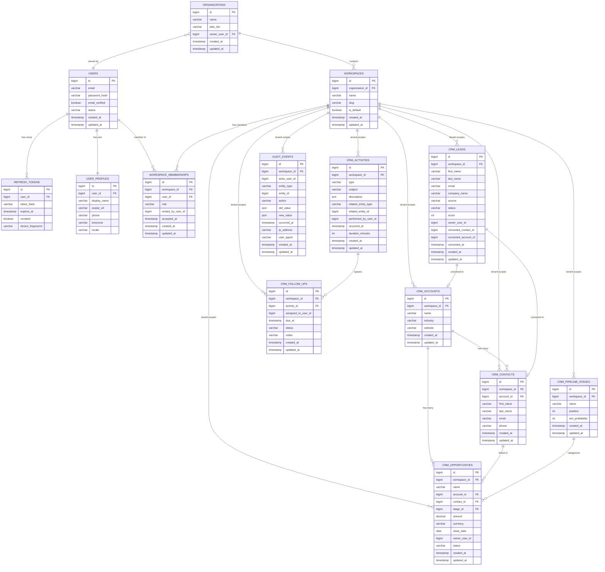
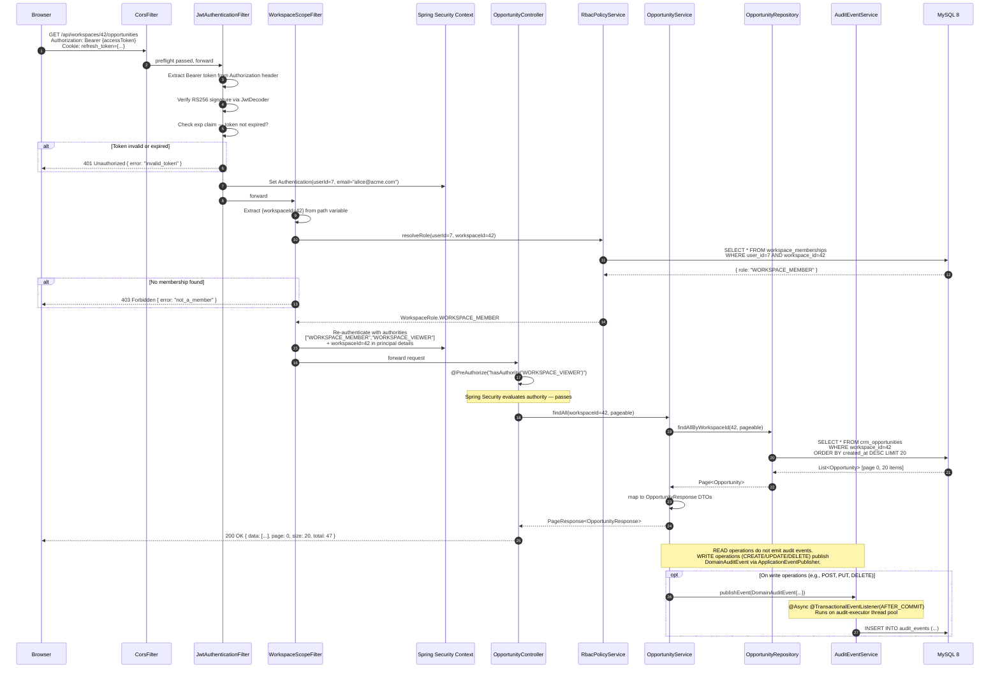
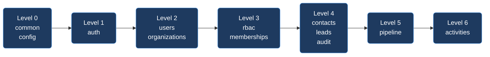

# VoicePilot AI — Sprint 4 Architecture Document

> **Document Status:** Authoritative Design Specification  
> **Sprint:** 4  
> **Authors:** Principal Architecture Team  
> **Last Updated:** 2026-11-03  
> **Target Stack:** Java 21 · Spring Boot 3.3.4 · Spring Security 6.x · Spring Data JPA · MySQL 8 · Flyway · React 18 · TypeScript 5 · JWT (RS256)

---

## Table of Contents

1. [Executive Summary](#1-executive-summary)
2. [Domain Boundaries](#2-domain-boundaries)
3. [Module Package Map](#3-module-package-map)
4. [Mermaid Architecture Diagram](#4-mermaid-architecture-diagram)
5. [Entity Relationship Overview](#5-entity-relationship-overview)
6. [Request Flow](#6-request-flow)
7. [Key Architectural Decisions](#7-key-architectural-decisions)
8. [Dependency Order (Build DAG)](#8-dependency-order-build-dag)
9. [Acceptance Criteria](#9-acceptance-criteria)

---

## 1. Executive Summary

Sprint 4 transforms VoicePilot AI from a single-tenant CRM skeleton into a **multi-tenant, workspace-scoped, security-hardened platform**. Before this sprint the application had no authentication, no authorization, no tenant isolation, and a flat package structure with four lightly-populated domains. Every HTTP endpoint was publicly accessible.

### What Sprint 4 Adds

| Capability | Before Sprint 4 | After Sprint 4 |
|---|---|---|
| Authentication | None | JWT (RS256) access token + HttpOnly refresh cookie |
| Authorization | None | Spring Security 6 filter chain + RBAC |
| Tenant Isolation | None | `workspace_id` FK on every tenant-scoped table |
| User Identity | None | `users` + `user_profiles` tables |
| Organizations | None | `organizations` + `workspaces` + `workspace_memberships` |
| RBAC | None | `WORKSPACE_ADMIN`, `WORKSPACE_MEMBER`, `WORKSPACE_VIEWER` roles |
| Lead Management | None | `crm_leads` table + LeadService |
| Sales Pipeline | None | `crm_opportunities` + `crm_pipeline_stages` |
| Activities | None | `crm_activities` + `crm_follow_ups` |
| Audit | None | `audit_events` async write via Spring Events |
| Existing data migration | Flat tables | Flyway migrations add `workspace_id` FK + back-fill script |

### Why Now

The contact and account data already captured in Sprints 1–3 is inherently multi-tenant: a single VoicePilot deployment will serve many organizations. Wiring in security and workspace isolation at Sprint 4 — before the pipeline and activities features go live — avoids a painful retrofit later and keeps the migration surface small (no production data yet to re-key).

---

## 2. Domain Boundaries

Each domain owns exactly one Java package subtree, one or more JPA entities, one or more Spring `@Service` classes, one or more Spring Data JPA repositories, and a precisely enumerated set of allowed inbound dependencies. **Circular dependencies between domains are forbidden.** Cross-domain access is permitted only through public service interfaces, never through direct repository injection across domain boundaries.

---

### 2.1 Identity & Auth

| Property | Value |
|---|---|
| **Package** | `com.voicepilot.auth` |
| **Owned Entities** | `User`, `RefreshToken` |
| **Owned Services** | `AuthService`, `TokenService`, `RefreshTokenService` |
| **Owned Repositories** | `UserRepository`, `RefreshTokenRepository` |
| **Allowed Inbound Deps** | `common` only |
| **Allowed Outbound Deps** | `common` |

**Responsibility:** Handles registration, login, token issuance (RS256 JWT), token refresh, and logout (refresh token invalidation). Owns the `users` table and `refresh_tokens` table. Exposes `POST /api/auth/register`, `POST /api/auth/login`, `POST /api/auth/refresh`, `POST /api/auth/logout`.

**Entity sketches:**

```java
// com.voicepilot.auth.entity.User
@Entity
@Table(name = "users",
       uniqueConstraints = @UniqueConstraint(columnNames = "email"))
public class User extends BaseEntity {

    @Column(nullable = false, length = 255)
    private String email;

    @Column(name = "password_hash", nullable = false, length = 72)
    private String passwordHash;           // BCrypt cost=12

    @Column(name = "email_verified", nullable = false)
    private boolean emailVerified = false;

    @Column(nullable = false, length = 20)
    @Enumerated(EnumType.STRING)
    private UserStatus status = UserStatus.ACTIVE;  // ACTIVE | SUSPENDED | DELETED
}
```

```java
// com.voicepilot.auth.entity.RefreshToken
@Entity
@Table(name = "refresh_tokens",
       indexes = @Index(name = "idx_rt_token_hash", columnList = "token_hash"))
public class RefreshToken extends BaseEntity {

    @ManyToOne(fetch = FetchType.LAZY, optional = false)
    @JoinColumn(name = "user_id", nullable = false)
    private User user;

    @Column(name = "token_hash", nullable = false, length = 64)
    private String tokenHash;          // SHA-256 of the raw token stored in cookie

    @Column(name = "expires_at", nullable = false)
    private Instant expiresAt;

    @Column(name = "revoked", nullable = false)
    private boolean revoked = false;

    @Column(name = "device_fingerprint", length = 128)
    private String deviceFingerprint;
}
```

---

### 2.2 User Profiles

| Property | Value |
|---|---|
| **Package** | `com.voicepilot.users` |
| **Owned Entities** | `UserProfile` |
| **Owned Services** | `UserProfileService` |
| **Owned Repositories** | `UserProfileRepository` |
| **Allowed Inbound Deps** | `common`, `auth` |
| **Allowed Outbound Deps** | `common` |

**Responsibility:** Stores non-auth user data: display name, avatar URL, phone, timezone, locale. Exposes `GET /api/users/me`, `PUT /api/users/me`. Profile is created automatically on registration via a Spring `@EventListener(UserRegisteredEvent.class)` in `UserProfileService`.

```java
// com.voicepilot.users.entity.UserProfile
@Entity
@Table(name = "user_profiles")
public class UserProfile extends BaseEntity {

    @Column(name = "user_id", nullable = false, unique = true)
    private Long userId;                   // FK → users.id, not a JPA relation (cross-domain)

    @Column(name = "display_name", nullable = false, length = 100)
    private String displayName;

    @Column(name = "avatar_url", length = 512)
    private String avatarUrl;

    @Column(name = "phone", length = 30)
    private String phone;

    @Column(name = "timezone", length = 64)
    private String timezone = "UTC";

    @Column(name = "locale", length = 10)
    private String locale = "en";
}
```

---

### 2.3 Organizations & Workspaces

| Property | Value |
|---|---|
| **Package** | `com.voicepilot.organizations` |
| **Owned Entities** | `Organization`, `Workspace` |
| **Owned Services** | `OrganizationService`, `WorkspaceService` |
| **Owned Repositories** | `OrganizationRepository`, `WorkspaceRepository` |
| **Allowed Inbound Deps** | `common`, `auth` |
| **Allowed Outbound Deps** | `common` |

**Responsibility:** An `Organization` is the billing/legal entity. A single organization may have multiple `Workspace`s (e.g., "Sales APAC", "Sales EMEA"). Workspaces are the unit of tenant isolation — every tenant-scoped table carries a `workspace_id` FK.

```java
// com.voicepilot.organizations.entity.Organization
@Entity
@Table(name = "organizations")
public class Organization extends BaseEntity {

    @Column(nullable = false, length = 150)
    private String name;

    @Column(name = "plan_tier", length = 30)
    @Enumerated(EnumType.STRING)
    private PlanTier planTier = PlanTier.FREE;  // FREE | STARTER | GROWTH | ENTERPRISE

    @Column(name = "owner_user_id", nullable = false)
    private Long ownerUserId;
}

// com.voicepilot.organizations.entity.Workspace
@Entity
@Table(name = "workspaces",
       uniqueConstraints = @UniqueConstraint(columnNames = {"organization_id", "slug"}))
public class Workspace extends BaseEntity {

    @ManyToOne(fetch = FetchType.LAZY, optional = false)
    @JoinColumn(name = "organization_id", nullable = false)
    private Organization organization;

    @Column(nullable = false, length = 100)
    private String name;

    @Column(nullable = false, length = 63)
    private String slug;               // URL-safe, unique per org, e.g. "sales-apac"

    @Column(name = "is_default", nullable = false)
    private boolean isDefault = false;
}
```

---

### 2.4 Workspace Memberships

| Property | Value |
|---|---|
| **Package** | `com.voicepilot.memberships` |
| **Owned Entities** | `WorkspaceMembership` |
| **Owned Services** | `WorkspaceMembershipService` |
| **Owned Repositories** | `WorkspaceMembershipRepository` |
| **Allowed Inbound Deps** | `common`, `auth`, `organizations` |
| **Allowed Outbound Deps** | `common` |

**Responsibility:** Joins `users` ↔ `workspaces` with a role. The security filter chain calls `WorkspaceMembershipService.assertMembership(userId, workspaceId)` on every tenant-scoped request.

```java
// com.voicepilot.memberships.entity.WorkspaceMembership
@Entity
@Table(name = "workspace_memberships",
       uniqueConstraints = @UniqueConstraint(columnNames = {"workspace_id", "user_id"}))
public class WorkspaceMembership extends BaseEntity {

    @Column(name = "workspace_id", nullable = false)
    private Long workspaceId;

    @Column(name = "user_id", nullable = false)
    private Long userId;

    @Column(nullable = false, length = 30)
    @Enumerated(EnumType.STRING)
    private WorkspaceRole role;            // WORKSPACE_ADMIN | WORKSPACE_MEMBER | WORKSPACE_VIEWER

    @Column(name = "invited_by_user_id")
    private Long invitedByUserId;

    @Column(name = "accepted_at")
    private Instant acceptedAt;            // null = pending invitation
}
```

---

### 2.5 RBAC

| Property | Value |
|---|---|
| **Package** | `com.voicepilot.rbac` |
| **Owned Entities** | *(no new JPA entity — roles are an enum on `WorkspaceMembership`)* |
| **Owned Services** | `PermissionEvaluator` (implements Spring's `PermissionEvaluator`), `RbacPolicyService` |
| **Owned Repositories** | *(none — reads through `WorkspaceMembershipRepository`)* |
| **Allowed Inbound Deps** | `common`, `memberships` |
| **Allowed Outbound Deps** | `common`, `memberships` |

**Responsibility:** Translates `WorkspaceRole` into granted Spring Security authorities. Provides `@PreAuthorize("hasAuthority('WORKSPACE_ADMIN')")` support and a custom `PermissionEvaluator` for object-level authorization (e.g., "can this user delete this opportunity?").

**Role-to-Authority mapping:**

| Role | Granted Authorities |
|---|---|
| `WORKSPACE_ADMIN` | `WORKSPACE_ADMIN`, `WORKSPACE_MEMBER`, `WORKSPACE_VIEWER` |
| `WORKSPACE_MEMBER` | `WORKSPACE_MEMBER`, `WORKSPACE_VIEWER` |
| `WORKSPACE_VIEWER` | `WORKSPACE_VIEWER` |

```java
// com.voicepilot.rbac.service.RbacPolicyService
@Service
public class RbacPolicyService {

    private final WorkspaceMembershipRepository membershipRepo;

    public WorkspaceRole resolveRole(Long userId, Long workspaceId) {
        return membershipRepo
            .findByUserIdAndWorkspaceId(userId, workspaceId)
            .map(WorkspaceMembership::getRole)
            .orElseThrow(() -> new AccessDeniedException("Not a member of workspace " + workspaceId));
    }

    public Collection<GrantedAuthority> toGrantedAuthorities(WorkspaceRole role) {
        return switch (role) {
            case WORKSPACE_ADMIN  -> List.of(authority("WORKSPACE_ADMIN"),
                                             authority("WORKSPACE_MEMBER"),
                                             authority("WORKSPACE_VIEWER"));
            case WORKSPACE_MEMBER -> List.of(authority("WORKSPACE_MEMBER"),
                                             authority("WORKSPACE_VIEWER"));
            case WORKSPACE_VIEWER -> List.of(authority("WORKSPACE_VIEWER"));
        };
    }

    private SimpleGrantedAuthority authority(String name) {
        return new SimpleGrantedAuthority(name);
    }
}
```

---

### 2.6 Tenant-Scoped Accounts & Contacts

| Property | Value |
|---|---|
| **Package** | `com.voicepilot.contacts` *(existing — evolved)* |
| **Owned Entities** | `Account`, `Contact`, `Segment` *(all gain `workspaceId`)* |
| **Owned Services** | `AccountService`, `ContactService`, `SegmentService` |
| **Owned Repositories** | `AccountRepository`, `ContactRepository`, `SegmentRepository` |
| **Allowed Inbound Deps** | `common`, `memberships`, `rbac` |
| **Allowed Outbound Deps** | `common` |

**Responsibility:** Retrofits existing entities with `workspace_id`. All repository queries must include `AND workspace_id = :workspaceId`. A Flyway migration (`V4__add_workspace_id_to_contacts_tables.sql`) adds the column with a default sentinel workspace (ID=1) for any pre-existing rows.

```java
// Flyway: V4__add_workspace_id_to_contacts_tables.sql
ALTER TABLE crm_accounts
    ADD COLUMN workspace_id BIGINT NOT NULL DEFAULT 1
        COMMENT 'FK → workspaces.id; added Sprint 4',
    ADD CONSTRAINT fk_accounts_workspace
        FOREIGN KEY (workspace_id) REFERENCES workspaces(id);

ALTER TABLE crm_contacts
    ADD COLUMN workspace_id BIGINT NOT NULL DEFAULT 1
        COMMENT 'FK → workspaces.id; added Sprint 4',
    ADD CONSTRAINT fk_contacts_workspace
        FOREIGN KEY (workspace_id) REFERENCES workspaces(id);

ALTER TABLE crm_segments
    ADD COLUMN workspace_id BIGINT NOT NULL DEFAULT 1
        COMMENT 'FK → workspaces.id; added Sprint 4',
    ADD CONSTRAINT fk_segments_workspace
        FOREIGN KEY (workspace_id) REFERENCES workspaces(id);

-- Add composite indexes for tenant-scoped queries
CREATE INDEX idx_accounts_workspace ON crm_accounts(workspace_id);
CREATE INDEX idx_contacts_workspace ON crm_contacts(workspace_id);
CREATE INDEX idx_segments_workspace ON crm_segments(workspace_id);
```

All repository interfaces gain a `workspaceId` parameter on every finder:

```java
public interface ContactRepository extends JpaRepository<Contact, Long> {
    Page<Contact> findAllByWorkspaceId(Long workspaceId, Pageable pageable);
    Optional<Contact> findByIdAndWorkspaceId(Long id, Long workspaceId);
    // ... etc.
}
```

---

### 2.7 Lead Management

| Property | Value |
|---|---|
| **Package** | `com.voicepilot.leads` |
| **Owned Entities** | `Lead` |
| **Owned Services** | `LeadService`, `LeadScoringService` |
| **Owned Repositories** | `LeadRepository` |
| **Allowed Inbound Deps** | `common`, `contacts`, `memberships`, `rbac` |
| **Allowed Outbound Deps** | `common`, `contacts` |

**Responsibility:** A `Lead` is an unqualified prospect that may be converted into a `Contact` + `Account`. Tracks lead source, score, and qualification status.

```java
// com.voicepilot.leads.entity.Lead
@Entity
@Table(name = "crm_leads",
       indexes = {
           @Index(name = "idx_leads_workspace", columnList = "workspace_id"),
           @Index(name = "idx_leads_status",    columnList = "status")
       })
public class Lead extends BaseEntity {

    @Column(name = "workspace_id", nullable = false)
    private Long workspaceId;

    @Column(name = "first_name", nullable = false, length = 100)
    private String firstName;

    @Column(name = "last_name", length = 100)
    private String lastName;

    @Column(name = "email", length = 255)
    private String email;

    @Column(name = "phone", length = 30)
    private String phone;

    @Column(name = "company_name", length = 150)
    private String companyName;

    @Column(name = "source", length = 50)
    @Enumerated(EnumType.STRING)
    private LeadSource source;    // WEB_FORM | IMPORT | MANUAL | API | REFERRAL

    @Column(name = "status", nullable = false, length = 30)
    @Enumerated(EnumType.STRING)
    private LeadStatus status = LeadStatus.NEW;  // NEW | CONTACTED | QUALIFIED | CONVERTED | DISQUALIFIED

    @Column(name = "score", nullable = false)
    private Integer score = 0;            // 0-100 computed by LeadScoringService

    @Column(name = "owner_user_id")
    private Long ownerUserId;

    @Column(name = "converted_contact_id")
    private Long convertedContactId;      // set on conversion, status → CONVERTED

    @Column(name = "converted_account_id")
    private Long convertedAccountId;

    @Column(name = "converted_at")
    private Instant convertedAt;
}
```

---

### 2.8 Sales Opportunities & Pipeline

| Property | Value |
|---|---|
| **Package** | `com.voicepilot.pipeline` |
| **Owned Entities** | `PipelineStage`, `Opportunity` |
| **Owned Services** | `PipelineService`, `OpportunityService` |
| **Owned Repositories** | `PipelineStageRepository`, `OpportunityRepository` |
| **Allowed Inbound Deps** | `common`, `contacts`, `leads`, `memberships`, `rbac` |
| **Allowed Outbound Deps** | `common`, `contacts` |

**Responsibility:** A `PipelineStage` is workspace-scoped and ordered (e.g., Prospecting → Qualification → Proposal → Negotiation → Closed Won / Closed Lost). An `Opportunity` represents a deal attached to an `Account` and optionally a `Contact`.

```java
@Entity
@Table(name = "crm_pipeline_stages",
       uniqueConstraints = @UniqueConstraint(columnNames = {"workspace_id", "position"}))
public class PipelineStage extends BaseEntity {

    @Column(name = "workspace_id", nullable = false)
    private Long workspaceId;

    @Column(nullable = false, length = 80)
    private String name;

    @Column(nullable = false)
    private Integer position;         // ordering key, gap-tolerant (10, 20, 30...)

    @Column(name = "win_probability", nullable = false)
    private Integer winProbability;   // 0-100 percent
}

@Entity
@Table(name = "crm_opportunities",
       indexes = {
           @Index(name = "idx_opp_workspace", columnList = "workspace_id"),
           @Index(name = "idx_opp_stage",     columnList = "stage_id"),
           @Index(name = "idx_opp_account",   columnList = "account_id")
       })
public class Opportunity extends BaseEntity {

    @Column(name = "workspace_id", nullable = false)
    private Long workspaceId;

    @Column(nullable = false, length = 200)
    private String name;

    @Column(name = "account_id", nullable = false)
    private Long accountId;

    @Column(name = "contact_id")
    private Long contactId;

    @Column(name = "stage_id", nullable = false)
    private Long stageId;

    @Column(name = "amount", precision = 18, scale = 2)
    private BigDecimal amount;

    @Column(name = "currency", length = 3)
    private String currency = "USD";

    @Column(name = "close_date")
    private LocalDate closeDate;

    @Column(name = "owner_user_id")
    private Long ownerUserId;

    @Column(name = "status", nullable = false, length = 20)
    @Enumerated(EnumType.STRING)
    private OpportunityStatus status = OpportunityStatus.OPEN; // OPEN | WON | LOST
}
```

---

### 2.9 Activities & Follow-ups

| Property | Value |
|---|---|
| **Package** | `com.voicepilot.activities` |
| **Owned Entities** | `Activity`, `FollowUp` |
| **Owned Services** | `ActivityService`, `FollowUpService` |
| **Owned Repositories** | `ActivityRepository`, `FollowUpRepository` |
| **Allowed Inbound Deps** | `common`, `contacts`, `leads`, `pipeline`, `memberships`, `rbac` |
| **Allowed Outbound Deps** | `common` |

**Responsibility:** An `Activity` is a logged interaction (call, email, meeting, note) associated with any CRM entity via a polymorphic reference pair (`relatedEntityType` + `relatedEntityId`). A `FollowUp` is a scheduled future action with a due date and assignee.

```java
@Entity
@Table(name = "crm_activities",
       indexes = {
           @Index(name = "idx_act_workspace",    columnList = "workspace_id"),
           @Index(name = "idx_act_related",      columnList = "related_entity_type, related_entity_id"),
           @Index(name = "idx_act_performed_by", columnList = "performed_by_user_id")
       })
public class Activity extends BaseEntity {

    @Column(name = "workspace_id", nullable = false)
    private Long workspaceId;

    @Column(name = "type", nullable = false, length = 30)
    @Enumerated(EnumType.STRING)
    private ActivityType type;   // CALL | EMAIL | MEETING | NOTE | TASK | DEMO

    @Column(name = "subject", nullable = false, length = 255)
    private String subject;

    @Column(name = "description", columnDefinition = "TEXT")
    private String description;

    @Column(name = "related_entity_type", nullable = false, length = 30)
    private String relatedEntityType;   // "CONTACT" | "ACCOUNT" | "LEAD" | "OPPORTUNITY"

    @Column(name = "related_entity_id", nullable = false)
    private Long relatedEntityId;

    @Column(name = "performed_by_user_id", nullable = false)
    private Long performedByUserId;

    @Column(name = "occurred_at", nullable = false)
    private Instant occurredAt;

    @Column(name = "duration_minutes")
    private Integer durationMinutes;
}
```

---

### 2.10 Audit Events

| Property | Value |
|---|---|
| **Package** | `com.voicepilot.audit` |
| **Owned Entities** | `AuditEvent` |
| **Owned Services** | `AuditEventService` (writes async), `AuditQueryService` (reads) |
| **Owned Repositories** | `AuditEventRepository` |
| **Allowed Inbound Deps** | `common` only (other domains publish events; audit consumes them) |
| **Allowed Outbound Deps** | `common` |

**Responsibility:** Any domain may publish a `DomainAuditEvent` (a Spring `ApplicationEvent`) describing a state change. `AuditEventService` listens with `@Async @TransactionalEventListener(phase = AFTER_COMMIT)` and persists the record. The audit domain never calls other domains back — it is a pure sink.

```java
// com.voicepilot.audit.event.DomainAuditEvent
public record DomainAuditEvent(
    Long    workspaceId,
    Long    actorUserId,
    String  entityType,   // "OPPORTUNITY", "CONTACT", etc.
    Long    entityId,
    String  action,       // "CREATE", "UPDATE", "DELETE", "STAGE_CHANGE", etc.
    String  oldValue,     // JSON snapshot, nullable
    String  newValue,     // JSON snapshot, nullable
    Instant occurredAt
) implements Serializable {}

// com.voicepilot.audit.entity.AuditEvent
@Entity
@Table(name = "audit_events",
       indexes = {
           @Index(name = "idx_audit_workspace",   columnList = "workspace_id"),
           @Index(name = "idx_audit_entity",      columnList = "entity_type, entity_id"),
           @Index(name = "idx_audit_actor",       columnList = "actor_user_id"),
           @Index(name = "idx_audit_occurred_at", columnList = "occurred_at")
       })
public class AuditEvent extends BaseEntity {

    @Column(name = "workspace_id", nullable = false)
    private Long workspaceId;

    @Column(name = "actor_user_id")
    private Long actorUserId;           // null for system actions

    @Column(name = "entity_type", nullable = false, length = 50)
    private String entityType;

    @Column(name = "entity_id", nullable = false)
    private Long entityId;

    @Column(name = "action", nullable = false, length = 50)
    private String action;

    @Column(name = "old_value", columnDefinition = "JSON")
    private String oldValue;

    @Column(name = "new_value", columnDefinition = "JSON")
    private String newValue;

    @Column(name = "occurred_at", nullable = false)
    private Instant occurredAt;

    @Column(name = "ip_address", length = 45)
    private String ipAddress;

    @Column(name = "user_agent", length = 512)
    private String userAgent;
}
```

---

## 3. Module Package Map

The full Java package tree for `com.voicepilot.*` after Sprint 4:

```
com.voicepilot
│
├── VoicePilotApplication.java
│
├── common/                              ← shared kernel (no domain logic)
│   ├── entity/
│   │   └── BaseEntity.java             ← @MappedSuperclass: id, createdAt, updatedAt
│   ├── response/
│   │   ├── ApiResponse.java
│   │   ├── ErrorResponse.java
│   │   └── PageResponse.java
│   ├── exception/
│   │   ├── GlobalExceptionHandler.java
│   │   ├── ResourceNotFoundException.java
│   │   └── ResourceConflictException.java
│   └── util/
│       └── SecurityUtils.java          ← static helpers: currentUserId(), currentWorkspaceId()
│
├── config/                             ← Spring configuration beans
│   ├── WebCorsConfig.java              ← (existing, updated for credentials)
│   ├── SecurityConfig.java             ← NEW: SecurityFilterChain, BCrypt bean
│   ├── JwtConfig.java                  ← NEW: RSA key pair, JwtDecoder, JwtEncoder
│   ├── AsyncConfig.java                ← NEW: @EnableAsync, ThreadPoolTaskExecutor
│   └── OpenApiConfig.java              ← NEW: SpringDoc bearer auth config
│
├── auth/                               ← Domain 1: Identity & Auth
│   ├── controller/
│   │   └── AuthController.java
│   ├── dto/
│   │   ├── LoginRequest.java
│   │   ├── RegisterRequest.java
│   │   ├── AuthResponse.java           ← { accessToken, expiresIn, tokenType }
│   │   └── RefreshResponse.java
│   ├── entity/
│   │   ├── User.java
│   │   └── RefreshToken.java
│   ├── repository/
│   │   ├── UserRepository.java
│   │   └── RefreshTokenRepository.java
│   ├── service/
│   │   ├── AuthService.java
│   │   ├── TokenService.java
│   │   └── RefreshTokenService.java
│   └── event/
│       └── UserRegisteredEvent.java
│
├── users/                              ← Domain 2: User Profiles
│   ├── controller/
│   │   └── UserProfileController.java
│   ├── dto/
│   │   ├── UserProfileResponse.java
│   │   └── UpdateProfileRequest.java
│   ├── entity/
│   │   └── UserProfile.java
│   ├── repository/
│   │   └── UserProfileRepository.java
│   └── service/
│       └── UserProfileService.java
│
├── organizations/                      ← Domain 3: Organizations & Workspaces
│   ├── controller/
│   │   ├── OrganizationController.java
│   │   └── WorkspaceController.java
│   ├── dto/
│   │   ├── CreateOrganizationRequest.java
│   │   ├── OrganizationResponse.java
│   │   ├── CreateWorkspaceRequest.java
│   │   └── WorkspaceResponse.java
│   ├── entity/
│   │   ├── Organization.java
│   │   └── Workspace.java
│   ├── repository/
│   │   ├── OrganizationRepository.java
│   │   └── WorkspaceRepository.java
│   └── service/
│       ├── OrganizationService.java
│       └── WorkspaceService.java
│
├── memberships/                        ← Domain 4: Workspace Memberships
│   ├── controller/
│   │   └── WorkspaceMembershipController.java
│   ├── dto/
│   │   ├── InviteMemberRequest.java
│   │   └── MembershipResponse.java
│   ├── entity/
│   │   └── WorkspaceMembership.java
│   ├── repository/
│   │   └── WorkspaceMembershipRepository.java
│   └── service/
│       └── WorkspaceMembershipService.java
│
├── rbac/                               ← Domain 5: RBAC
│   ├── enums/
│   │   └── WorkspaceRole.java          ← WORKSPACE_ADMIN | WORKSPACE_MEMBER | WORKSPACE_VIEWER
│   ├── evaluator/
│   │   └── VoicePilotPermissionEvaluator.java
│   └── service/
│       └── RbacPolicyService.java
│
├── contacts/                           ← Domain 6: Tenant-Scoped Accounts & Contacts
│   ├── controller/
│   │   ├── AccountController.java
│   │   ├── ContactController.java
│   │   └── SegmentController.java
│   ├── dto/  …
│   ├── entity/
│   │   ├── Account.java                ← + workspaceId field
│   │   ├── Contact.java                ← + workspaceId field
│   │   └── Segment.java                ← + workspaceId field
│   ├── repository/
│   │   ├── AccountRepository.java
│   │   ├── ContactRepository.java
│   │   └── SegmentRepository.java
│   └── service/
│       ├── AccountService.java
│       ├── ContactService.java
│       └── SegmentService.java
│
├── leads/                              ← Domain 7: Lead Management
│   ├── controller/
│   │   └── LeadController.java
│   ├── dto/  …
│   ├── entity/
│   │   └── Lead.java
│   ├── repository/
│   │   └── LeadRepository.java
│   └── service/
│       ├── LeadService.java
│       └── LeadScoringService.java
│
├── pipeline/                           ← Domain 8: Sales Opportunities & Pipeline
│   ├── controller/
│   │   ├── PipelineStageController.java
│   │   └── OpportunityController.java
│   ├── dto/  …
│   ├── entity/
│   │   ├── PipelineStage.java
│   │   └── Opportunity.java
│   ├── repository/
│   │   ├── PipelineStageRepository.java
│   │   └── OpportunityRepository.java
│   └── service/
│       ├── PipelineService.java
│       └── OpportunityService.java
│
├── activities/                         ← Domain 9: Activities & Follow-ups
│   ├── controller/
│   │   ├── ActivityController.java
│   │   └── FollowUpController.java
│   ├── dto/  …
│   ├── entity/
│   │   ├── Activity.java
│   │   └── FollowUp.java
│   ├── repository/
│   │   ├── ActivityRepository.java
│   │   └── FollowUpRepository.java
│   └── service/
│       ├── ActivityService.java
│       └── FollowUpService.java
│
└── audit/                              ← Domain 10: Audit Events
    ├── controller/
    │   └── AuditQueryController.java   ← read-only, ADMIN only
    ├── dto/  …
    ├── entity/
    │   └── AuditEvent.java
    ├── event/
    │   └── DomainAuditEvent.java       ← Spring ApplicationEvent record
    ├── repository/
    │   └── AuditEventRepository.java
    └── service/
        ├── AuditEventService.java      ← @Async listener
        └── AuditQueryService.java
```

---

## 4. Mermaid Architecture Diagram

```mermaid
flowchart TD
    subgraph CLIENT["Client Layer"]
        BROWSER["Browser / React SPA"]
    end

    subgraph SPRING_SECURITY["Spring Security Filter Chain"]
        CORS["CorsFilter"]
        JWT_FILTER["JwtAuthenticationFilter"]
        WS_FILTER["WorkspaceScopeFilter"]
    end

    subgraph CONFIG["config — Spring Configuration"]
        SEC_CFG["SecurityConfig"]
        JWT_CFG["JwtConfig"]
        ASYNC_CFG["AsyncConfig"]
        CORS_CFG["WebCorsConfig"]
    end

    subgraph COMMON["common — Shared Kernel"]
        BASE_ENTITY["BaseEntity"]
        API_RESP["ApiResponse / PageResponse"]
        EXCEPTIONS["GlobalExceptionHandler"]
        SEC_UTILS["SecurityUtils"]
    end

    subgraph AUTH["auth — Identity & Auth"]
        AUTH_CTRL["AuthController"]
        AUTH_SVC["AuthService"]
        TOKEN_SVC["TokenService"]
        RT_SVC["RefreshTokenService"]
        USER_REPO["UserRepository"]
        RT_REPO["RefreshTokenRepository"]
    end

    subgraph USERS["users — User Profiles"]
        USR_CTRL["UserProfileController"]
        USR_SVC["UserProfileService"]
        USR_REPO["UserProfileRepository"]
    end

    subgraph ORGS["organizations — Orgs & Workspaces"]
        ORG_CTRL["OrganizationController"]
        WS_CTRL["WorkspaceController"]
        ORG_SVC["OrganizationService"]
        WS_SVC["WorkspaceService"]
        WS_REPO["WorkspaceRepository"]
    end

    subgraph MEMBERSHIPS["memberships — Workspace Memberships"]
        MEM_CTRL["WorkspaceMembershipController"]
        MEM_SVC["WorkspaceMembershipService"]
        MEM_REPO["WorkspaceMembershipRepository"]
    end

    subgraph RBAC["rbac — RBAC Policy"]
        RBAC_SVC["RbacPolicyService"]
        PERM_EVAL["VoicePilotPermissionEvaluator"]
    end

    subgraph CONTACTS["contacts — Accounts, Contacts, Segments"]
        ACCT_CTRL["AccountController"]
        CON_CTRL["ContactController"]
        ACCT_SVC["AccountService"]
        CON_SVC["ContactService"]
        ACCT_REPO["AccountRepository"]
        CON_REPO["ContactRepository"]
    end

    subgraph LEADS["leads — Lead Management"]
        LEAD_CTRL["LeadController"]
        LEAD_SVC["LeadService"]
        SCORE_SVC["LeadScoringService"]
        LEAD_REPO["LeadRepository"]
    end

    subgraph PIPELINE["pipeline — Opportunities & Pipeline"]
        OPP_CTRL["OpportunityController"]
        OPP_SVC["OpportunityService"]
        PIPE_SVC["PipelineService"]
        OPP_REPO["OpportunityRepository"]
        STAGE_REPO["PipelineStageRepository"]
    end

    subgraph ACTIVITIES["activities — Activities & Follow-ups"]
        ACT_CTRL["ActivityController"]
        ACT_SVC["ActivityService"]
        FU_SVC["FollowUpService"]
        ACT_REPO["ActivityRepository"]
        FU_REPO["FollowUpRepository"]
    end

    subgraph AUDIT["audit — Audit Events"]
        AUDIT_CTRL["AuditQueryController"]
        AUDIT_SVC["AuditEventService (Async Listener)"]
        AUDIT_QUERY["AuditQueryService"]
        AUDIT_REPO["AuditEventRepository"]
    end

    subgraph DB["MySQL 8 — voicepilot_db"]
        DB_USERS["users / refresh_tokens"]
        DB_PROFILES["user_profiles"]
        DB_ORGS["organizations / workspaces"]
        DB_MEM["workspace_memberships"]
        DB_CONTACTS["crm_accounts / crm_contacts / crm_segments"]
        DB_LEADS["crm_leads"]
        DB_PIPELINE["crm_pipeline_stages / crm_opportunities"]
        DB_ACTIVITIES["crm_activities / crm_follow_ups"]
        DB_AUDIT["audit_events"]
    end

    BROWSER -->|"HTTPS REST + Cookie"| CORS
    CORS --> JWT_FILTER
    JWT_FILTER --> WS_FILTER
    WS_FILTER -->|"routes to"| AUTH_CTRL & USR_CTRL & ORG_CTRL & WS_CTRL & MEM_CTRL & ACCT_CTRL & CON_CTRL & LEAD_CTRL & OPP_CTRL & ACT_CTRL & AUDIT_CTRL

    AUTH_CTRL --> AUTH_SVC --> TOKEN_SVC & RT_SVC
    AUTH_SVC --> USER_REPO --> DB_USERS
    RT_SVC --> RT_REPO --> DB_USERS

    USR_SVC --> USR_REPO --> DB_PROFILES

    ORG_SVC --> WS_REPO --> DB_ORGS

    MEM_SVC --> MEM_REPO --> DB_MEM
    MEM_SVC --> RBAC_SVC

    RBAC_SVC --> MEM_REPO
    PERM_EVAL --> RBAC_SVC

    ACCT_SVC --> ACCT_REPO --> DB_CONTACTS
    CON_SVC --> CON_REPO --> DB_CONTACTS

    LEAD_SVC --> LEAD_REPO --> DB_LEADS
    LEAD_SVC --> SCORE_SVC
    LEAD_SVC -->|"convert → Contact/Account"| CON_SVC & ACCT_SVC

    OPP_SVC --> OPP_REPO --> DB_PIPELINE
    PIPE_SVC --> STAGE_REPO --> DB_PIPELINE

    ACT_SVC --> ACT_REPO --> DB_ACTIVITIES
    FU_SVC --> FU_REPO --> DB_ACTIVITIES

    AUTH_SVC -.->|"publishes UserRegisteredEvent"| AUDIT_SVC
    ACCT_SVC -.->|"publishes DomainAuditEvent"| AUDIT_SVC
    CON_SVC -.->|"publishes DomainAuditEvent"| AUDIT_SVC
    LEAD_SVC -.->|"publishes DomainAuditEvent"| AUDIT_SVC
    OPP_SVC -.->|"publishes DomainAuditEvent"| AUDIT_SVC
    ACT_SVC -.->|"publishes DomainAuditEvent"| AUDIT_SVC

    AUDIT_SVC --> AUDIT_REPO --> DB_AUDIT
    AUDIT_QUERY --> AUDIT_REPO

    CONFIG --> AUTH & USERS & ORGS & MEMBERSHIPS & RBAC & CONTACTS & LEADS & PIPELINE & ACTIVITIES & AUDIT
    COMMON --> AUTH & USERS & ORGS & MEMBERSHIPS & RBAC & CONTACTS & LEADS & PIPELINE & ACTIVITIES & AUDIT
```



---

## 5. Entity Relationship Overview



---

## 6. Request Flow

The sequence below illustrates a `GET /api/workspaces/{workspaceId}/opportunities` call — the canonical pattern for every tenant-scoped, authenticated endpoint.



---

## 6.1 JWT Token Design

### Access Token (RS256 JWT)

```json
{
  "alg": "RS256",
  "typ": "JWT"
}
{
  "sub": "7",
  "email": "alice@acme.com",
  "iat": 1730650777,
  "exp": 1730654377,
  "iss": "voicepilot-api",
  "aud": "voicepilot-spa"
}
```

- **Lifetime:** 60 minutes. Short-lived to limit blast radius on key compromise.
- **Signing:** RS256 with a 2048-bit RSA private key stored as `classpath:keys/private.pem` (loaded from environment secret in production).
- **Claims:** `sub` = userId (String). No role/workspace claims — roles are resolved per-request from DB to prevent stale cached role data.

### Refresh Token

- **Lifetime:** 30 days.
- **Storage:** Raw 256-bit random value in `HttpOnly; Secure; SameSite=Strict` cookie named `vp_rt`. Server stores SHA-256(rawToken) in `refresh_tokens` table.
- **Rotation:** On every successful `/api/auth/refresh` call, the old token is marked `revoked=true` and a new one is issued. Reuse detection: if a revoked token is presented, **all** tokens for that user are revoked immediately.

```java
// com.voicepilot.config.JwtConfig
@Configuration
public class JwtConfig {

    @Value("${voicepilot.jwt.private-key-path}")
    private String privateKeyPath;

    @Value("${voicepilot.jwt.public-key-path}")
    private String publicKeyPath;

    @Bean
    public JwtEncoder jwtEncoder() throws Exception {
        RSAKey rsaKey = RSAKey.parse(loadPem(privateKeyPath));
        return new NimbusJwtEncoder(new ImmutableJWKSet<>(new JWKSet(rsaKey)));
    }

    @Bean
    public JwtDecoder jwtDecoder() throws Exception {
        RSAPublicKey publicKey = (RSAPublicKey) loadPublicKey(publicKeyPath);
        return NimbusJwtDecoder.withPublicKey(publicKey).build();
    }
}
```

---

## 6.2 Security Filter Chain

```java
// com.voicepilot.config.SecurityConfig
@Configuration
@EnableWebSecurity
@EnableMethodSecurity(prePostEnabled = true)
public class SecurityConfig {

    private final JwtDecoder jwtDecoder;
    private final RbacPolicyService rbacPolicyService;

    @Bean
    public SecurityFilterChain filterChain(HttpSecurity http) throws Exception {
        return http
            .csrf(AbstractHttpConfigurer::disable)                    // REST API; CSRF not needed
            .sessionManagement(s -> s.sessionCreationPolicy(STATELESS))
            .cors(c -> c.configurationSource(corsConfigurationSource()))
            .authorizeHttpRequests(auth -> auth
                .requestMatchers("/api/auth/**").permitAll()          // public auth endpoints
                .requestMatchers("/actuator/health").permitAll()
                .requestMatchers("/v3/api-docs/**", "/swagger-ui/**").permitAll()
                .anyRequest().authenticated()
            )
            .oauth2ResourceServer(rs -> rs
                .jwt(jwt -> jwt.decoder(jwtDecoder))
            )
            .addFilterAfter(workspaceScopeFilter(), BearerTokenAuthenticationFilter.class)
            .exceptionHandling(ex -> ex
                .authenticationEntryPoint(new BearerTokenAuthenticationEntryPoint())
                .accessDeniedHandler(new BearerTokenAccessDeniedHandler())
            )
            .build();
    }

    @Bean
    public PasswordEncoder passwordEncoder() {
        return new BCryptPasswordEncoder(12);
    }
}
```

---

## 7. Key Architectural Decisions

### ADR-001 — Modular Monolith vs. Microservices

**Decision:** VoicePilot AI is built as a **modular monolith** — a single deployable Spring Boot JAR with well-enforced internal domain packages.

**Rationale:**
- Team size is 3–6 engineers. The coordination overhead of microservices (service discovery, distributed tracing, saga orchestration, independent CI/CD pipelines) exceeds the benefit at this scale.
- The domain model is highly relational. Opportunities reference Accounts; Activities reference Contacts, Leads, and Opportunities. Cross-domain joins in a monolith are synchronous and transactional. Across microservice boundaries they require either shared DBs (anti-pattern) or eventual consistency with compensating transactions (high complexity).
- The modular package boundaries are enforced through code review and ArchUnit tests. Should the team grow beyond 30 engineers or a domain exhibit traffic patterns requiring independent scaling (e.g., Audit ingestion), the domain is already bounded and can be extracted into a service with targeted effort.

**Trade-offs:**
| Pro | Con |
|---|---|
| Single deployment unit, simple ops | Cannot independently scale individual domains |
| Synchronous, ACID cross-domain transactions | A badly-behaved domain can degrade the whole process |
| Simple local dev (one `mvn spring-boot:run`) | Shared JVM means shared thread pool and heap |
| Easy refactoring across domain boundaries | Requires discipline to maintain package boundary rules |

---

### ADR-002 — Shared Database with Logical Tenant Isolation

**Decision:** All domains share a single MySQL 8 database (`voicepilot_db`). Tenant isolation is **logical** via a `workspace_id` column on every tenant-scoped table, enforced in every repository query and Spring Security filter.

**Rationale:**
- Schema-per-tenant or database-per-tenant would require dynamic datasource routing (AbstractRoutingDataSource), Flyway multi-tenant migration orchestration, and connection pool explosion (1 connection pool × N tenants). At 100+ workspaces this becomes unmanageable.
- `workspace_id` isolation is the industry standard for early-stage multi-tenant SaaS (Salesforce, Linear, Notion all use this model at their cores).
- MySQL 8 row-level security is not natively supported; the `workspace_id` filter is the application-layer equivalent.

**Enforcement Mechanism:** `WorkspaceScopeFilter` sets `workspaceId` into the security context on every request. All service methods accept `workspaceId` as an explicit parameter, not a threadlocal. Repositories enforce the filter via method-name derived queries (`findAllByWorkspaceId`) and `@Query` JPQL.

**Trade-offs:**
| Pro | Con |
|---|---|
| Single schema to maintain with Flyway | A missing `workspace_id` in a query is a data leak |
| Efficient connection pooling (HikariCP default pool) | One tenant's heavy query can impact others (mitigated by connection pool limits) |
| Simple backup/restore strategy | No hard isolation guarantee at DB level (defense in depth required in app layer) |

> [!CAUTION]
> Every `@Query` annotation and derived repository method MUST include `workspace_id = :workspaceId`. This will be enforced via an ArchUnit rule that statically verifies no `Repository` method is missing the workspace parameter on tenant-scoped entities.

---

### ADR-003 — Long IDs Retained for Existing Tables

**Decision:** Existing tables (`crm_accounts`, `crm_contacts`, `crm_segments`) retain `BIGINT AUTO_INCREMENT` primary keys (mapped as `Long` in Java). New Sprint 4 tables (`users`, `workspaces`, `crm_leads`, etc.) also use `BIGINT AUTO_INCREMENT`.

**Rationale:**
- Changing existing PKs to UUIDs would require a multi-step migration: add UUID column, back-fill, swap FK references, drop old column — high risk with no production data justification in this sprint.
- `BIGINT` keys are 8 bytes vs 16 bytes for `UUID`, making B-tree indexes ~50% smaller on ID columns. On a CRM table with millions of rows this matters.
- UUIDs (v4) have poor index locality (random insertion order causes B-tree fragmentation). UUID v7 (time-ordered) would mitigate this but introduces a non-standard dependency.

**Trade-offs:**
| Pro | Con |
|---|---|
| No migration risk on existing tables | Sequential IDs are enumerable (IDOR risk — mitigated by workspace_id enforcement) |
| Smaller, faster B-tree indexes | Harder to shard by ID if horizontal scaling needed in future |
| Simpler JPA mapping (`@GeneratedValue IDENTITY`) | Not globally unique across hypothetical future microservice data stores |

> [!NOTE]
> IDOR (Insecure Direct Object Reference) is mitigated structurally: every fetch is `findByIdAndWorkspaceId(id, workspaceId)`. A user who guesses opportunity ID=999 but belongs to workspace=5 will receive a 404 because workspace=5 doesn't own that record.

---

### ADR-004 — JWT Stateless + Refresh Token in HttpOnly Cookie

**Decision:** Authentication uses short-lived RS256 JWTs (60 min) as Bearer tokens. Long-lived refresh tokens (30 days) are stored server-side (DB) and delivered to the client in an `HttpOnly; Secure; SameSite=Strict` cookie.

**Rationale:**
- **Stateless access tokens** allow horizontal scaling of API servers with no shared session store. Any server can validate any access token using the public RSA key.
- **Server-side refresh tokens** allow revocation (logout, suspicious activity, admin forced-logout). A pure stateless refresh token (e.g., long-lived JWT) cannot be revoked without a blocklist, which re-introduces statefulness anyway.
- **HttpOnly cookie** for the refresh token prevents XSS-based token theft from JavaScript. The access token is kept in memory (React state), not `localStorage`, to minimize XSS exposure.
- **RS256** (asymmetric) over HS256 (symmetric): the public key can be shared with other services for validation without exposing the signing secret. Prepares for future service-to-service trust.

**Token Rotation:**
```
Browser                     Server
  |--- POST /auth/refresh  --->|
  |    Cookie: vp_rt=ABC       |
  |                            |  1. Hash(ABC) → lookup DB
  |                            |  2. Mark ABC revoked
  |                            |  3. Generate new raw token XYZ
  |                            |  4. Store Hash(XYZ) in DB
  |<--- 200 OK  --------------|
  |    { accessToken: "..." }  |
  |    Set-Cookie: vp_rt=XYZ  |
```

**Trade-offs:**
| Pro | Con |
|---|---|
| Revocable refresh tokens (security) | DB hit on every refresh (every 60 min per client) |
| HttpOnly cookie immune to XSS theft | SameSite=Strict breaks OAuth flows from 3rd-party redirects |
| RS256 enables future service-to-service JWT trust | RSA operations are slower than HMAC (negligible at scale) |
| Access token in memory, not localStorage | Requires CORS `credentials: true` on client fetch calls |

---

### ADR-005 — RBAC Roles: WORKSPACE_ADMIN, WORKSPACE_MEMBER, WORKSPACE_VIEWER

**Decision:** Three workspace-scoped roles are defined. Roles are stored on `WorkspaceMembership`, not in the JWT, and resolved fresh from the database on each request by `WorkspaceScopeFilter`.

**Role Definitions:**

| Role | Create | Read | Update | Delete | Manage Members | View Audit Log |
|---|---|---|---|---|---|---|
| `WORKSPACE_ADMIN` | ✅ | ✅ | ✅ | ✅ | ✅ | ✅ |
| `WORKSPACE_MEMBER` | ✅ | ✅ | ✅ | ❌ | ❌ | ❌ |
| `WORKSPACE_VIEWER` | ❌ | ✅ | ❌ | ❌ | ❌ | ❌ |

**Enforcement Layers:**
1. **Filter layer:** `WorkspaceScopeFilter` resolves role and sets `GrantedAuthority` list on the Security context.
2. **Controller layer:** `@PreAuthorize("hasAuthority('WORKSPACE_MEMBER')")` on mutating endpoints.
3. **Service layer:** Business-rule level checks (e.g., "only the opportunity owner or admin can delete") via `VoicePilotPermissionEvaluator`.

**Rationale:** Three roles cover 95% of B2B SaaS use cases without the complexity of attribute-based access control (ABAC). Fine-grained permissions can be layered later on the `WorkspaceMembership` as a JSON `custom_permissions` column without changing the primary role model.

**Trade-offs:**
| Pro | Con |
|---|---|
| Simple to understand and audit | Cannot express "this member can edit contacts but not opportunities" |
| Roles are hierarchical — clean Spring authority inheritance | Three roles may force under-scoped access (MEMBER gets more than needed) |
| Fresh DB lookup prevents stale cached role issues | One DB read per request (mitigated by connection pool, sub-1ms) |

---

### ADR-006 — Audit Events as a Separate Domain with Async Write

**Decision:** The `audit` domain is a dedicated package that consumes Spring `ApplicationEvent`s published by other domains. Persistence is async (`@Async @TransactionalEventListener(phase = AFTER_COMMIT)`), using a dedicated `ThreadPoolTaskExecutor` named `auditExecutor`.

**Rationale:**
- Audit writes must not slow down the primary request path. An opportunity update that triggers an audit write should not make the HTTP response wait for the audit INSERT.
- `AFTER_COMMIT` phase ensures audit records are only written if the originating transaction committed successfully. An audit record for a rolled-back transaction would be misleading.
- Isolating the audit domain means no other domain imports from `com.voicepilot.audit`. The event mechanism (Spring's `ApplicationEventPublisher`) is the only coupling point — and it is already in the Spring common API.
- Audit data is append-only. Using a separate table (not soft-deleting existing records) preserves immutability.

**Async Executor Configuration:**

```java
// com.voicepilot.config.AsyncConfig
@Configuration
@EnableAsync
public class AsyncConfig {

    @Bean(name = "auditExecutor")
    public Executor auditExecutor() {
        ThreadPoolTaskExecutor executor = new ThreadPoolTaskExecutor();
        executor.setCorePoolSize(2);
        executor.setMaxPoolSize(10);
        executor.setQueueCapacity(500);
        executor.setThreadNamePrefix("audit-");
        executor.setRejectedExecutionHandler(new ThreadPoolExecutor.CallerRunsPolicy());
        // CallerRunsPolicy: if queue is full, the calling thread writes the audit record
        // synchronously — degraded performance but no data loss
        executor.initialize();
        return executor;
    }
}

// com.voicepilot.audit.service.AuditEventService
@Service
public class AuditEventService {

    private final AuditEventRepository auditEventRepository;

    @Async("auditExecutor")
    @TransactionalEventListener(phase = TransactionPhase.AFTER_COMMIT)
    public void onDomainEvent(DomainAuditEvent event) {
        AuditEvent entity = new AuditEvent();
        entity.setWorkspaceId(event.workspaceId());
        entity.setActorUserId(event.actorUserId());
        entity.setEntityType(event.entityType());
        entity.setEntityId(event.entityId());
        entity.setAction(event.action());
        entity.setOldValue(event.oldValue());
        entity.setNewValue(event.newValue());
        entity.setOccurredAt(event.occurredAt());
        auditEventRepository.save(entity);
    }
}
```

**Trade-offs:**
| Pro | Con |
|---|---|
| Audit writes don't block HTTP response | Small window where app crashes after commit but before async audit write → lost event |
| `AFTER_COMMIT` ensures no phantom audit records | Requires careful thread pool sizing to avoid `CallerRunsPolicy` fallback under load |
| Fully decoupled — audit domain has no outbound deps | Harder to test async listeners (need `@SpringBootTest` with `CompletableFuture` or `Awaitility`) |
| Append-only table — tamper-evident by design | Audit table will grow indefinitely — requires a retention/archival policy (outside Sprint 4 scope) |

---

## 8. Dependency Order (Build DAG)

Domains must be implemented in the following order. A domain at level N may only import from domains at levels 1 through N-1. This is the strict topological sort of the dependency graph.



**Strict Build Order Table:**

| Level | Domain | Depends On | Blocks |
|---|---|---|---|
| 0 | `common` | *(nothing)* | all |
| 0 | `config` | `common` | all |
| 1 | `auth` | `common` | `users`, `organizations`, `memberships`, `rbac` |
| 2 | `users` | `common`, `auth` | `memberships` |
| 2 | `organizations` | `common`, `auth` | `memberships`, `contacts`, `leads`, `pipeline`, `activities`, `audit` |
| 3 | `memberships` | `common`, `auth`, `organizations` | `rbac`, `contacts`, `leads`, `pipeline`, `activities` |
| 3 | `rbac` | `common`, `memberships` | `contacts`, `leads`, `pipeline`, `activities` |
| 4 | `contacts` | `common`, `memberships`, `rbac` | `leads`, `pipeline`, `activities` |
| 4 | `leads` | `common`, `contacts`, `memberships`, `rbac` | `pipeline`, `activities` |
| 4 | `audit` | `common` | *(terminal — nothing depends on audit)* |
| 5 | `pipeline` | `common`, `contacts`, `leads`, `memberships`, `rbac` | `activities` |
| 6 | `activities` | `common`, `contacts`, `leads`, `pipeline`, `memberships`, `rbac` | *(terminal)* |

> [!IMPORTANT]
> `audit` at Level 4 has **no outbound dependencies** on other domains. Other domains depend on Spring's `ApplicationEventPublisher` (not on the `audit` package directly). This makes `audit` safe to implement in parallel with `contacts` and `leads` once Level 3 is complete.

---

## 9. Acceptance Criteria

The following criteria must all pass before Sprint 4 is considered architecturally complete and Sprint 5 can begin feature development against the new foundation.

### 9.1 Authentication & Security

- [ ] `POST /api/auth/register` creates a `User` and `UserProfile`, returns `201 Created` with `AuthResponse`.
- [ ] `POST /api/auth/login` validates credentials (BCrypt), returns access token (JWT RS256, 60 min TTL) in body and refresh token in `HttpOnly` cookie.
- [ ] `POST /api/auth/refresh` validates the refresh token cookie, rotates it, and returns a new access token.
- [ ] `POST /api/auth/logout` revokes the current refresh token and clears the cookie.
- [ ] An unauthenticated request to any non-auth endpoint returns `401 Unauthorized`.
- [ ] A request with a valid JWT but no workspace membership returns `403 Forbidden`.
- [ ] A `WORKSPACE_VIEWER` attempting a POST/PUT/DELETE on any CRM endpoint receives `403 Forbidden`.
- [ ] A `WORKSPACE_MEMBER` attempting to delete a resource receives `403 Forbidden`.
- [ ] A presented revoked refresh token causes **all** tokens for that user to be revoked (reuse detection).

### 9.2 Multi-Tenancy

- [ ] All `crm_accounts`, `crm_contacts`, `crm_segments` rows from pre-Sprint 4 are migrated with `workspace_id = 1` (sentinel workspace) via Flyway `V4__add_workspace_id_to_contacts_tables.sql`.
- [ ] `GET /api/workspaces/{id}/contacts` returns only contacts scoped to workspace `{id}`.
- [ ] A user who is a member of workspace A receives a `404` (not `403`) when requesting a resource owned by workspace B.
- [ ] All repository integration tests assert that `workspace_id` is included in every query.

### 9.3 Domain Integrity

- [ ] An ArchUnit test (`ArchitectureTest.java`) verifies:
  - No class in `com.voicepilot.audit` imports from `com.voicepilot.contacts`, `com.voicepilot.leads`, etc.
  - No class in `com.voicepilot.auth` imports from any non-`common` domain.
  - No `Repository` interface in a domain-A package is injected into a `Service` class in domain-B package.
- [ ] All entities extend `BaseEntity`.
- [ ] All Flyway migrations in `db/migration/` are named with the convention `V{n}__{description}.sql` and are idempotent (safe to re-run on a clean schema).

### 9.4 Audit

- [ ] `CREATE`, `UPDATE`, and `DELETE` operations on `Contact`, `Account`, `Lead`, and `Opportunity` produce a corresponding row in `audit_events` within 5 seconds (async, best-effort).
- [ ] `GET /api/workspaces/{id}/audit-events` is accessible only to `WORKSPACE_ADMIN` and returns a paginated list.
- [ ] Audit records are never deleted or updated — only inserted.

### 9.5 Observability & Quality

- [ ] Spring Boot Actuator `/actuator/health` returns `UP` and is publicly accessible (no auth required).
- [ ] OpenAPI spec (`/v3/api-docs`) correctly documents the `Authorization: Bearer` security scheme for all protected endpoints.
- [ ] Unit test coverage ≥ 80% on all `Service` classes (measured by JaCoCo).
- [ ] No Flyway migration failures on a clean database (`mvn flyway:migrate` on an empty schema succeeds without errors).
- [ ] `mvn verify` passes with zero test failures in CI.

---

*End of SPRINT_4_ARCHITECTURE.md*
