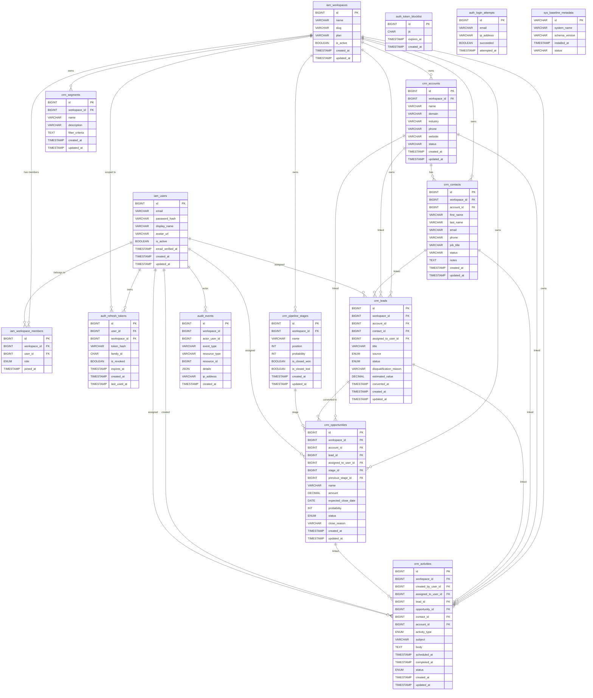
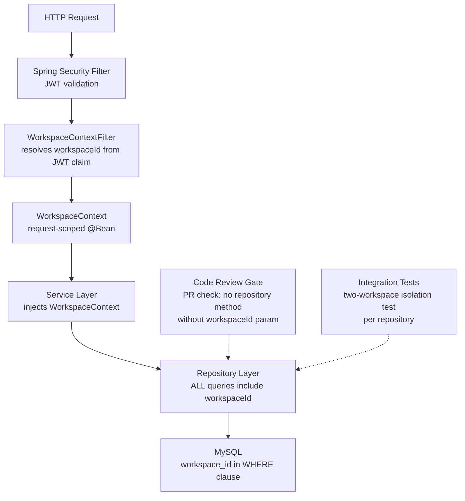
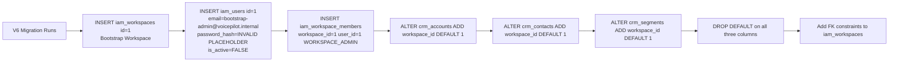
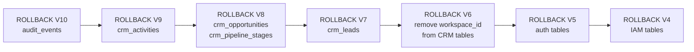

# Sprint 4 — Database Design

**Project:** VoicePilot AI  
**Stack:** Spring Boot 3.3.4 / Java 21 · MySQL 8.0 · Flyway · InnoDB · utf8mb4_unicode_ci  
**Author:** Principal Software Architect  
**Status:** APPROVED FOR IMPLEMENTATION  
**Migrations:** V4 → V10 (additive on top of V1–V3 baseline)

---

## Table of Contents

1. [Design Principles](#1-design-principles)
2. [Complete Entity-Relationship Diagram](#2-complete-entity-relationship-diagram)
3. [New Tables — Full DDL](#3-new-tables--full-ddl)
   - [V4 — Identity & Workspaces](#v4--identity--workspaces)
   - [V5 — Auth Tokens](#v5--auth-tokens)
   - [V6 — CRM Tenant Columns](#v6--crm-tenant-columns)
   - [V7 — Leads](#v7--leads)
   - [V8 — Opportunities & Pipeline](#v8--opportunities--pipeline)
   - [V9 — Activities](#v9--activities)
   - [V10 — Audit Events](#v10--audit-events)
4. [Index Strategy](#4-index-strategy)
5. [Unique Constraints Scoped to Workspace](#5-unique-constraints-scoped-to-workspace)
6. [Tenant Isolation Enforcement](#6-tenant-isolation-enforcement)
7. [Foreign Key Strategy](#7-foreign-key-strategy)
8. [Data Migration Strategy for Existing Records](#8-data-migration-strategy-for-existing-records)
9. [Rollback Strategy](#9-rollback-strategy)

---

## 1. Design Principles

### 1.1 Shared Database, Logical Tenant Isolation

VoicePilot AI is a **modular monolith** using a **shared-database, shared-schema** multi-tenancy model. Every tenant (workspace) lives in the same MySQL schema. Tenant isolation is enforced **logically** through a `workspace_id` column present on every business-domain table.

This model is chosen over schema-per-tenant because:

- Flyway migrations remain a single deployment unit — no per-tenant migration fan-out.
- MySQL connection pool is shared; no resource multiplication per tenant.
- Cross-workspace aggregate queries (e.g., usage dashboards) are native SQL joins rather than application-level federation.
- Operational complexity (backup, restore, DDL changes) scales with table count, not tenant count.

The trade-off is that **a missing `workspace_id` predicate in a query leaks all tenants' data**. Mitigation is described in §6.

### 1.2 No Raw Dynamic SQL

All queries are expressed through **Spring Data JPA** `@Query` annotations with named parameters or through Hibernate Criteria API. Dynamic predicates (e.g., filter criteria for segments) are built using `JpaSpecificationExecutor<T>` with a `Specification<T>` composition pattern. Raw `EntityManager.createNativeQuery(String)` with string concatenation is **forbidden** at code-review level.

### 1.3 All Queries Workspace-Scoped at the Repository Layer

Every Spring Data repository that owns a workspace-scoped table **MUST** accept a `long workspaceId` parameter on every finder and mutation method. The `workspaceId` value is resolved **once per HTTP request** from the authenticated `SecurityContext` principal (specifically from the JWT `workspace_id` claim) and injected via a `WorkspaceContext` request-scoped bean. No service layer method accepts `workspaceId` from user-supplied request payload for tenant routing — it always originates from the verified JWT.

```java
// CORRECT — workspaceId from JWT, never from request body
@Repository
public interface CrmLeadRepository extends JpaRepository<CrmLead, Long>,
                                            JpaSpecificationExecutor<CrmLead> {

    @Query("SELECT l FROM CrmLead l WHERE l.workspaceId = :workspaceId AND l.id = :id")
    Optional<CrmLead> findByIdAndWorkspaceId(long id, long workspaceId);

    @Query("SELECT l FROM CrmLead l WHERE l.workspaceId = :workspaceId")
    Page<CrmLead> findAllByWorkspaceId(long workspaceId, Pageable pageable);
}
```

### 1.4 Migration Versioning Contract

| Version | Scope | Type |
|---------|-------|------|
| V1 | Baseline metadata | DDL CREATE |
| V2 | CRM core (accounts, contacts, segments) | DDL CREATE |
| V3 | (reserved / applied) | — |
| **V4** | IAM — users, workspaces, members | DDL CREATE |
| **V5** | Auth — refresh tokens, blocklist, login attempts | DDL CREATE |
| **V6** | CRM — add workspace_id to existing tables | DDL ALTER |
| **V7** | CRM — leads | DDL CREATE |
| **V8** | CRM — pipeline stages, opportunities | DDL CREATE |
| **V9** | CRM — activities | DDL CREATE |
| **V10** | Audit events | DDL CREATE |

> [!IMPORTANT]
> Flyway is configured with `spring.flyway.validate-on-migrate=true` and `out-of-order=false`. Migrations must be applied in strict version order. Never modify a migration that has been applied to any environment.

---

## 2. Complete Entity-Relationship Diagram



---

## 3. New Tables — Full DDL

All tables use:
- **Engine:** InnoDB
- **Charset:** utf8mb4
- **Collation:** utf8mb4_unicode_ci
- **PK pattern:** `BIGINT NOT NULL AUTO_INCREMENT PRIMARY KEY` — consistent with `crm_accounts`, `crm_contacts`, `crm_segments`
- **Timestamps:** `TIMESTAMP NOT NULL DEFAULT CURRENT_TIMESTAMP` for `created_at`; `TIMESTAMP NOT NULL DEFAULT CURRENT_TIMESTAMP ON UPDATE CURRENT_TIMESTAMP` for `updated_at`

---

### V4 — Identity & Workspaces

**File:** `src/main/resources/db/migration/V4__create_iam_tables.sql`

```sql
-- =============================================================================
-- V4: Identity & Workspace tables
-- =============================================================================

-- -----------------------------------------------------------------------------
-- iam_users
-- Stores the canonical identity for every user across all workspaces.
-- Passwords are stored as bcrypt hashes (cost factor 12, 60-char output but
-- VARCHAR(255) future-proofs for Argon2id migration).
-- email is the global unique login identifier — NOT workspace-scoped.
-- -----------------------------------------------------------------------------
CREATE TABLE iam_users (
    id                  BIGINT          NOT NULL AUTO_INCREMENT,
    email               VARCHAR(160)    NOT NULL,
    password_hash       VARCHAR(255)    NOT NULL,
    display_name        VARCHAR(100)    NOT NULL,
    avatar_url          VARCHAR(500)    NULL,
    is_active           BOOLEAN         NOT NULL DEFAULT TRUE,
    email_verified_at   TIMESTAMP       NULL,
    created_at          TIMESTAMP       NOT NULL DEFAULT CURRENT_TIMESTAMP,
    updated_at          TIMESTAMP       NOT NULL DEFAULT CURRENT_TIMESTAMP
                                                 ON UPDATE CURRENT_TIMESTAMP,

    CONSTRAINT pk_iam_users PRIMARY KEY (id),
    CONSTRAINT uq_iam_users_email UNIQUE (email)
) ENGINE=InnoDB
  DEFAULT CHARSET=utf8mb4
  COLLATE=utf8mb4_unicode_ci
  COMMENT='Global user identity table. One user may belong to many workspaces.';

CREATE INDEX idx_iam_users_is_active ON iam_users (is_active);

-- -----------------------------------------------------------------------------
-- iam_workspaces
-- A workspace is the top-level tenant boundary. All CRM data is scoped here.
-- slug is a URL-safe lowercase identifier used in API paths and subdomains.
-- plan is a free-text string intentionally not an ENUM to allow billing-tier
-- changes without a schema migration.
-- -----------------------------------------------------------------------------
CREATE TABLE iam_workspaces (
    id          BIGINT          NOT NULL AUTO_INCREMENT,
    name        VARCHAR(160)    NOT NULL,
    slug        VARCHAR(80)     NOT NULL,
    plan        VARCHAR(32)     NOT NULL DEFAULT 'FREE',
    is_active   BOOLEAN         NOT NULL DEFAULT TRUE,
    created_at  TIMESTAMP       NOT NULL DEFAULT CURRENT_TIMESTAMP,
    updated_at  TIMESTAMP       NOT NULL DEFAULT CURRENT_TIMESTAMP
                                         ON UPDATE CURRENT_TIMESTAMP,

    CONSTRAINT pk_iam_workspaces PRIMARY KEY (id),
    CONSTRAINT uq_iam_workspaces_slug UNIQUE (slug),
    CONSTRAINT chk_iam_workspaces_slug CHECK (slug REGEXP '^[a-z0-9][a-z0-9\\-]{1,78}[a-z0-9]$')
) ENGINE=InnoDB
  DEFAULT CHARSET=utf8mb4
  COLLATE=utf8mb4_unicode_ci
  COMMENT='Tenant workspace. Root boundary for all CRM data isolation.';

CREATE INDEX idx_iam_workspaces_is_active ON iam_workspaces (is_active);

-- -----------------------------------------------------------------------------
-- iam_workspace_members
-- Junction table: which users belong to which workspaces, and at what role.
-- A single user may hold different roles in different workspaces.
-- role is ENUM here because workspace roles are a closed, stable set;
-- any new role requires a deliberate schema migration and a code release.
-- UNIQUE(workspace_id, user_id) enforces one role per user per workspace.
-- -----------------------------------------------------------------------------
CREATE TABLE iam_workspace_members (
    id              BIGINT      NOT NULL AUTO_INCREMENT,
    workspace_id    BIGINT      NOT NULL,
    user_id         BIGINT      NOT NULL,
    role            ENUM(
                        'WORKSPACE_ADMIN',
                        'WORKSPACE_MEMBER',
                        'WORKSPACE_VIEWER'
                    )           NOT NULL,
    joined_at       TIMESTAMP   NOT NULL DEFAULT CURRENT_TIMESTAMP,

    CONSTRAINT pk_iam_workspace_members PRIMARY KEY (id),
    CONSTRAINT uq_iam_workspace_members_ws_user UNIQUE (workspace_id, user_id),
    CONSTRAINT fk_iam_wm_workspace FOREIGN KEY (workspace_id)
        REFERENCES iam_workspaces (id)
        ON DELETE CASCADE
        ON UPDATE RESTRICT,
    CONSTRAINT fk_iam_wm_user FOREIGN KEY (user_id)
        REFERENCES iam_users (id)
        ON DELETE CASCADE
        ON UPDATE RESTRICT
) ENGINE=InnoDB
  DEFAULT CHARSET=utf8mb4
  COLLATE=utf8mb4_unicode_ci
  COMMENT='User-to-workspace membership with RBAC role.';

CREATE INDEX idx_iam_wm_user_id      ON iam_workspace_members (user_id);
CREATE INDEX idx_iam_wm_workspace_id ON iam_workspace_members (workspace_id);
```

---

### V5 — Auth Tokens

**File:** `src/main/resources/db/migration/V5__create_auth_tables.sql`

```sql
-- =============================================================================
-- V5: Authentication token infrastructure
-- =============================================================================

-- -----------------------------------------------------------------------------
-- auth_refresh_tokens
-- Stores refresh token state using token rotation with family tracking.
-- The opaque refresh token itself is NEVER stored. Only its SHA-256 hex hash
-- is stored in token_hash (VARCHAR 64 = 64 hex chars of a 256-bit hash).
-- family_id (UUID) groups all rotated tokens that descend from the same
-- original issuance. If a token from a revoked family is presented,
-- the entire family is immediately revoked (theft detection).
-- workspace_id allows revoking all tokens for a user in a specific workspace
-- (e.g., when a user is removed from a workspace).
-- -----------------------------------------------------------------------------
CREATE TABLE auth_refresh_tokens (
    id              BIGINT          NOT NULL AUTO_INCREMENT,
    user_id         BIGINT          NOT NULL,
    workspace_id    BIGINT          NOT NULL,
    token_hash      VARCHAR(64)     NOT NULL COMMENT 'SHA-256 hex digest of opaque token',
    family_id       CHAR(36)        NOT NULL COMMENT 'UUID v4, groups token rotation chain',
    is_revoked      BOOLEAN         NOT NULL DEFAULT FALSE,
    expires_at      TIMESTAMP       NOT NULL,
    created_at      TIMESTAMP       NOT NULL DEFAULT CURRENT_TIMESTAMP,
    last_used_at    TIMESTAMP       NULL,

    CONSTRAINT pk_auth_refresh_tokens PRIMARY KEY (id),
    CONSTRAINT uq_auth_refresh_tokens_hash UNIQUE (token_hash),
    CONSTRAINT fk_art_user FOREIGN KEY (user_id)
        REFERENCES iam_users (id)
        ON DELETE CASCADE
        ON UPDATE RESTRICT,
    CONSTRAINT fk_art_workspace FOREIGN KEY (workspace_id)
        REFERENCES iam_workspaces (id)
        ON DELETE CASCADE
        ON UPDATE RESTRICT
) ENGINE=InnoDB
  DEFAULT CHARSET=utf8mb4
  COLLATE=utf8mb4_unicode_ci
  COMMENT='Refresh token state. Stores SHA-256 hash of opaque token, never plaintext.';

CREATE INDEX idx_art_user_id      ON auth_refresh_tokens (user_id);
CREATE INDEX idx_art_workspace_id ON auth_refresh_tokens (workspace_id);
CREATE INDEX idx_art_family_id    ON auth_refresh_tokens (family_id);
CREATE INDEX idx_art_expires_at   ON auth_refresh_tokens (expires_at);

-- -----------------------------------------------------------------------------
-- auth_token_blocklist
-- Short-lived JWT access tokens (15 min TTL) that have been explicitly revoked
-- before expiry (e.g., logout, password change) are placed here.
-- jti is the JWT ID claim (UUID v4) — globally unique per token.
-- A scheduled job purges rows where expires_at < NOW().
-- index on expires_at supports: DELETE FROM auth_token_blocklist WHERE expires_at < NOW()
-- -----------------------------------------------------------------------------
CREATE TABLE auth_token_blocklist (
    id          BIGINT      NOT NULL AUTO_INCREMENT,
    jti         CHAR(36)    NOT NULL COMMENT 'JWT ID claim (UUID v4)',
    expires_at  TIMESTAMP   NOT NULL COMMENT 'Copy of JWT exp — allows safe cleanup',
    created_at  TIMESTAMP   NOT NULL DEFAULT CURRENT_TIMESTAMP,

    CONSTRAINT pk_auth_token_blocklist PRIMARY KEY (id),
    CONSTRAINT uq_auth_token_blocklist_jti UNIQUE (jti)
) ENGINE=InnoDB
  DEFAULT CHARSET=utf8mb4
  COLLATE=utf8mb4_unicode_ci
  COMMENT='Blocklisted JWT access tokens pending natural expiry.';

CREATE INDEX idx_atbl_expires_at ON auth_token_blocklist (expires_at);

-- -----------------------------------------------------------------------------
-- auth_login_attempts
-- Rate-limiting and suspicious-access audit log.
-- Records every authentication attempt regardless of outcome.
-- ip_address is VARCHAR(45) to accommodate both IPv4 (15 chars) and
-- IPv6 (39 chars) including IPv4-mapped IPv6 addresses.
-- Compound indexes support two key query patterns:
--   1. "How many failed attempts for email X in the last N minutes?" (lockout)
--   2. "How many attempts from IP Y in the last N minutes?" (IP-based throttling)
-- attempted_at is NOT DEFAULT CURRENT_TIMESTAMP — callers set it explicitly
-- so test code can inject deterministic timestamps.
-- -----------------------------------------------------------------------------
CREATE TABLE auth_login_attempts (
    id              BIGINT          NOT NULL AUTO_INCREMENT,
    email           VARCHAR(160)    NOT NULL,
    ip_address      VARCHAR(45)     NOT NULL,
    succeeded       BOOLEAN         NOT NULL,
    attempted_at    TIMESTAMP       NOT NULL,

    CONSTRAINT pk_auth_login_attempts PRIMARY KEY (id)
) ENGINE=InnoDB
  DEFAULT CHARSET=utf8mb4
  COLLATE=utf8mb4_unicode_ci
  COMMENT='Login attempt audit log for rate limiting and brute-force detection.';

CREATE INDEX idx_ala_email_attempted ON auth_login_attempts (email, attempted_at);
CREATE INDEX idx_ala_ip_attempted    ON auth_login_attempts (ip_address, attempted_at);
```

---

### V6 — CRM Tenant Columns

**File:** `src/main/resources/db/migration/V6__add_workspace_id_to_crm_tables.sql`

> [!CAUTION]
> This migration adds `NOT NULL` columns to populated tables and modifies existing unique constraints. It **must** be run inside a transaction. On tables with millions of rows, add columns as `NULL` first, back-fill, then add the `NOT NULL` constraint with `ALTER TABLE ... MODIFY COLUMN`. For Sprint 4 (dev/staging data volumes), the single-pass approach below is safe. See §8 for bootstrap workspace details and §9 for rollback.

```sql
-- =============================================================================
-- V6: Add workspace_id to CRM tables and migrate existing data to bootstrap
--     workspace. See §8 for the bootstrap workspace design rationale.
-- =============================================================================

-- Step 1: Create the bootstrap workspace -----------------------------------------
-- id=1 is fixed and referenced by subsequent INSERT/UPDATE statements.
-- slug 'bootstrap' is a reserved slug — application code must reject it in the
-- workspace creation API.
INSERT INTO iam_workspaces (id, name, slug, plan, is_active, created_at, updated_at)
VALUES (1, 'Bootstrap Workspace', 'bootstrap', 'FREE', TRUE,
        CURRENT_TIMESTAMP, CURRENT_TIMESTAMP);

-- Step 2: Create the bootstrap admin user ----------------------------------------
-- password_hash is a deliberate INVALID bcrypt placeholder that will NEVER match
-- any password. It is not a bcrypt hash — it has no valid $2a$ prefix.
-- The administrator MUST set a real password via the password-reset flow before
-- this account can authenticate. This is a security control, not an oversight.
INSERT INTO iam_users (
    id, email, password_hash, display_name, is_active,
    email_verified_at, created_at, updated_at
)
VALUES (
    1,
    'bootstrap-admin@voicepilot.internal',
    '!!INVALID_PLACEHOLDER_MUST_ROTATE_BEFORE_PRODUCTION!!',
    'Bootstrap Admin',
    FALSE,   -- account is DISABLED until credentials are rotated
    NULL,    -- email not verified
    CURRENT_TIMESTAMP,
    CURRENT_TIMESTAMP
);

-- Step 3: Add bootstrap admin to bootstrap workspace as WORKSPACE_ADMIN -----------
INSERT INTO iam_workspace_members (workspace_id, user_id, role, joined_at)
VALUES (1, 1, 'WORKSPACE_ADMIN', CURRENT_TIMESTAMP);

-- Step 4: ALTER crm_accounts ------------------------------------------------------
-- Add workspace_id column positioned after id (cosmetic; MySQL AFTER clause).
ALTER TABLE crm_accounts
    ADD COLUMN workspace_id BIGINT NOT NULL DEFAULT 1 AFTER id;

-- Remove the DEFAULT now that all rows are populated (enforce explicit supply on INSERT)
ALTER TABLE crm_accounts
    ALTER COLUMN workspace_id DROP DEFAULT;

-- Add FK constraint
ALTER TABLE crm_accounts
    ADD CONSTRAINT fk_crm_accounts_workspace FOREIGN KEY (workspace_id)
        REFERENCES iam_workspaces (id)
        ON DELETE RESTRICT
        ON UPDATE RESTRICT;

-- Add covering index for workspace-scoped queries
CREATE INDEX idx_crm_accounts_workspace_id ON crm_accounts (workspace_id);

-- Step 5: ALTER crm_contacts ------------------------------------------------------
ALTER TABLE crm_contacts
    ADD COLUMN workspace_id BIGINT NOT NULL DEFAULT 1 AFTER id;

ALTER TABLE crm_contacts
    ALTER COLUMN workspace_id DROP DEFAULT;

ALTER TABLE crm_contacts
    ADD CONSTRAINT fk_crm_contacts_workspace FOREIGN KEY (workspace_id)
        REFERENCES iam_workspaces (id)
        ON DELETE RESTRICT
        ON UPDATE RESTRICT;

CREATE INDEX idx_crm_contacts_workspace_id ON crm_contacts (workspace_id);

-- Re-define email uniqueness: email must be unique PER WORKSPACE, not globally.
-- Drop the old global unique index if one exists (V2 may have created it).
DROP PROCEDURE IF EXISTS voicepilot_drop_index_if_exists;
DELIMITER $$
CREATE PROCEDURE voicepilot_drop_index_if_exists(
    IN p_table  VARCHAR(64),
    IN p_index  VARCHAR(64)
)
BEGIN
    IF EXISTS (
        SELECT 1
        FROM   information_schema.statistics
        WHERE  table_schema = DATABASE()
          AND  table_name   = p_table
          AND  index_name   = p_index
    ) THEN
        SET @sql = CONCAT('ALTER TABLE `', p_table, '` DROP INDEX `', p_index, '`');
        PREPARE stmt FROM @sql;
        EXECUTE stmt;
        DEALLOCATE PREPARE stmt;
    END IF;
END$$
DELIMITER ;

CALL voicepilot_drop_index_if_exists('crm_contacts', 'uq_crm_contacts_email');
DROP PROCEDURE IF EXISTS voicepilot_drop_index_if_exists;

-- New workspace-scoped unique constraint: same email allowed in different workspaces
ALTER TABLE crm_contacts
    ADD CONSTRAINT uq_crm_contacts_workspace_email UNIQUE (workspace_id, email);

-- Step 6: ALTER crm_segments ------------------------------------------------------
ALTER TABLE crm_segments
    ADD COLUMN workspace_id BIGINT NOT NULL DEFAULT 1 AFTER id;

ALTER TABLE crm_segments
    ALTER COLUMN workspace_id DROP DEFAULT;

ALTER TABLE crm_segments
    ADD CONSTRAINT fk_crm_segments_workspace FOREIGN KEY (workspace_id)
        REFERENCES iam_workspaces (id)
        ON DELETE RESTRICT
        ON UPDATE RESTRICT;

CREATE INDEX idx_crm_segments_workspace_id ON crm_segments (workspace_id);
```

---

### V7 — Leads

**File:** `src/main/resources/db/migration/V7__create_crm_leads.sql`

```sql
-- =============================================================================
-- V7: CRM Leads
-- =============================================================================

-- -----------------------------------------------------------------------------
-- crm_leads
-- A lead is a prospect that has not yet been qualified into an opportunity.
-- account_id and contact_id are nullable: a lead may exist before the
-- corresponding account or contact records are created.
-- assigned_to_user_id is nullable: unassigned leads are valid (pool model).
-- converted_at records when this lead was converted to an opportunity;
-- at that point status = 'CONVERTED'.
-- disqualification_reason is populated when status = 'DISQUALIFIED'.
-- source ENUM is append-only by policy — new sources require a migration.
-- -----------------------------------------------------------------------------
CREATE TABLE crm_leads (
    id                      BIGINT          NOT NULL AUTO_INCREMENT,
    workspace_id            BIGINT          NOT NULL,
    account_id              BIGINT          NULL,
    contact_id              BIGINT          NULL,
    assigned_to_user_id     BIGINT          NULL,
    title                   VARCHAR(200)    NOT NULL,
    source                  ENUM(
                                'WEBSITE',
                                'REFERRAL',
                                'COLD_CALL',
                                'EMAIL_CAMPAIGN',
                                'SOCIAL_MEDIA',
                                'TRADE_SHOW',
                                'INBOUND',
                                'OTHER'
                            )               NOT NULL,
    status                  ENUM(
                                'NEW',
                                'CONTACTED',
                                'QUALIFIED',
                                'DISQUALIFIED',
                                'CONVERTED'
                            )               NOT NULL DEFAULT 'NEW',
    disqualification_reason VARCHAR(255)    NULL,
    estimated_value         DECIMAL(15,2)   NULL,
    converted_at            TIMESTAMP       NULL,
    created_at              TIMESTAMP       NOT NULL DEFAULT CURRENT_TIMESTAMP,
    updated_at              TIMESTAMP       NOT NULL DEFAULT CURRENT_TIMESTAMP
                                                     ON UPDATE CURRENT_TIMESTAMP,

    CONSTRAINT pk_crm_leads PRIMARY KEY (id),
    CONSTRAINT fk_crm_leads_workspace FOREIGN KEY (workspace_id)
        REFERENCES iam_workspaces (id)
        ON DELETE RESTRICT
        ON UPDATE RESTRICT,
    CONSTRAINT fk_crm_leads_account FOREIGN KEY (account_id)
        REFERENCES crm_accounts (id)
        ON DELETE SET NULL
        ON UPDATE RESTRICT,
    CONSTRAINT fk_crm_leads_contact FOREIGN KEY (contact_id)
        REFERENCES crm_contacts (id)
        ON DELETE SET NULL
        ON UPDATE RESTRICT,
    CONSTRAINT fk_crm_leads_assigned_user FOREIGN KEY (assigned_to_user_id)
        REFERENCES iam_users (id)
        ON DELETE SET NULL
        ON UPDATE RESTRICT,
    CONSTRAINT chk_crm_leads_disqualification
        CHECK (
            (status = 'DISQUALIFIED' AND disqualification_reason IS NOT NULL)
            OR status != 'DISQUALIFIED'
        ),
    CONSTRAINT chk_crm_leads_converted
        CHECK (
            (status = 'CONVERTED' AND converted_at IS NOT NULL)
            OR status != 'CONVERTED'
        )
) ENGINE=InnoDB
  DEFAULT CHARSET=utf8mb4
  COLLATE=utf8mb4_unicode_ci
  COMMENT='Sales leads — pre-opportunity prospects scoped to a workspace.';

CREATE INDEX idx_crm_leads_workspace_status
    ON crm_leads (workspace_id, status);

CREATE INDEX idx_crm_leads_workspace_assigned
    ON crm_leads (workspace_id, assigned_to_user_id);

CREATE INDEX idx_crm_leads_workspace_account
    ON crm_leads (workspace_id, account_id);

CREATE INDEX idx_crm_leads_workspace_contact
    ON crm_leads (workspace_id, contact_id);
```

---

### V8 — Opportunities & Pipeline

**File:** `src/main/resources/db/migration/V8__create_crm_opportunities.sql`

```sql
-- =============================================================================
-- V8: Pipeline Stages and Opportunities
-- =============================================================================

-- -----------------------------------------------------------------------------
-- crm_pipeline_stages
-- Each workspace defines its own pipeline stages ordered by `position`.
-- position is 1-indexed and workspace-unique — no two stages in the same
-- workspace may share a position.
-- probability is 0-100 (integer percent). CHECK constraint enforces range.
-- A stage may be closed-won XOR closed-lost XOR neither (open), enforced
-- by CHECK constraint. Two closed flags cannot both be TRUE simultaneously.
-- -----------------------------------------------------------------------------
CREATE TABLE crm_pipeline_stages (
    id              BIGINT          NOT NULL AUTO_INCREMENT,
    workspace_id    BIGINT          NOT NULL,
    name            VARCHAR(100)    NOT NULL,
    position        INT             NOT NULL,
    probability     INT             NOT NULL DEFAULT 0
                                    COMMENT '0-100 integer percentage',
    is_closed_won   BOOLEAN         NOT NULL DEFAULT FALSE,
    is_closed_lost  BOOLEAN         NOT NULL DEFAULT FALSE,
    created_at      TIMESTAMP       NOT NULL DEFAULT CURRENT_TIMESTAMP,
    updated_at      TIMESTAMP       NOT NULL DEFAULT CURRENT_TIMESTAMP
                                             ON UPDATE CURRENT_TIMESTAMP,

    CONSTRAINT pk_crm_pipeline_stages PRIMARY KEY (id),
    CONSTRAINT uq_crm_pipeline_stages_position UNIQUE (workspace_id, position),
    CONSTRAINT fk_crm_ps_workspace FOREIGN KEY (workspace_id)
        REFERENCES iam_workspaces (id)
        ON DELETE RESTRICT
        ON UPDATE RESTRICT,
    CONSTRAINT chk_crm_ps_probability
        CHECK (probability >= 0 AND probability <= 100),
    CONSTRAINT chk_crm_ps_closed_flags
        CHECK (NOT (is_closed_won = TRUE AND is_closed_lost = TRUE))
) ENGINE=InnoDB
  DEFAULT CHARSET=utf8mb4
  COLLATE=utf8mb4_unicode_ci
  COMMENT='Per-workspace sales pipeline stage definitions.';

CREATE INDEX idx_crm_ps_workspace_id ON crm_pipeline_stages (workspace_id);

-- -----------------------------------------------------------------------------
-- crm_opportunities
-- An opportunity is a qualified revenue event in the pipeline.
-- stage_id points to the current pipeline stage.
-- previous_stage_id records where the opportunity was before the last move —
-- used for velocity calculations and Kanban UI transitions. It is nullable
-- (NULL on creation) and self-referencing crm_pipeline_stages.
-- lead_id is nullable: opportunities can be created without a parent lead.
-- probability defaults to the stage probability but can be overridden per-opp.
-- amount is nullable: deal size may not be known at creation.
-- expected_close_date is DATE (not TIMESTAMP) — time-of-day is irrelevant.
-- -----------------------------------------------------------------------------
CREATE TABLE crm_opportunities (
    id                      BIGINT          NOT NULL AUTO_INCREMENT,
    workspace_id            BIGINT          NOT NULL,
    account_id              BIGINT          NULL,
    lead_id                 BIGINT          NULL,
    assigned_to_user_id     BIGINT          NULL,
    name                    VARCHAR(200)    NOT NULL,
    stage_id                BIGINT          NOT NULL,
    previous_stage_id       BIGINT          NULL,
    amount                  DECIMAL(15,2)   NULL,
    expected_close_date     DATE            NULL,
    probability             INT             NULL
                                            COMMENT 'Overrides stage probability if set',
    status                  ENUM(
                                'OPEN',
                                'WON',
                                'LOST'
                            )               NOT NULL DEFAULT 'OPEN',
    close_reason            VARCHAR(255)    NULL,
    created_at              TIMESTAMP       NOT NULL DEFAULT CURRENT_TIMESTAMP,
    updated_at              TIMESTAMP       NOT NULL DEFAULT CURRENT_TIMESTAMP
                                                     ON UPDATE CURRENT_TIMESTAMP,

    CONSTRAINT pk_crm_opportunities PRIMARY KEY (id),
    CONSTRAINT fk_crm_opp_workspace FOREIGN KEY (workspace_id)
        REFERENCES iam_workspaces (id)
        ON DELETE RESTRICT
        ON UPDATE RESTRICT,
    CONSTRAINT fk_crm_opp_account FOREIGN KEY (account_id)
        REFERENCES crm_accounts (id)
        ON DELETE SET NULL
        ON UPDATE RESTRICT,
    CONSTRAINT fk_crm_opp_lead FOREIGN KEY (lead_id)
        REFERENCES crm_leads (id)
        ON DELETE SET NULL
        ON UPDATE RESTRICT,
    CONSTRAINT fk_crm_opp_assigned_user FOREIGN KEY (assigned_to_user_id)
        REFERENCES iam_users (id)
        ON DELETE SET NULL
        ON UPDATE RESTRICT,
    CONSTRAINT fk_crm_opp_stage FOREIGN KEY (stage_id)
        REFERENCES crm_pipeline_stages (id)
        ON DELETE RESTRICT
        ON UPDATE RESTRICT,
    CONSTRAINT fk_crm_opp_prev_stage FOREIGN KEY (previous_stage_id)
        REFERENCES crm_pipeline_stages (id)
        ON DELETE SET NULL
        ON UPDATE RESTRICT,
    CONSTRAINT chk_crm_opp_probability
        CHECK (probability IS NULL OR (probability >= 0 AND probability <= 100)),
    CONSTRAINT chk_crm_opp_close_reason
        CHECK (
            (status IN ('WON', 'LOST') AND close_reason IS NOT NULL)
            OR status = 'OPEN'
        )
) ENGINE=InnoDB
  DEFAULT CHARSET=utf8mb4
  COLLATE=utf8mb4_unicode_ci
  COMMENT='Sales opportunities tracked through pipeline stages.';

CREATE INDEX idx_crm_opp_workspace_status
    ON crm_opportunities (workspace_id, status);

CREATE INDEX idx_crm_opp_workspace_stage
    ON crm_opportunities (workspace_id, stage_id);

CREATE INDEX idx_crm_opp_workspace_close_date
    ON crm_opportunities (workspace_id, expected_close_date);

CREATE INDEX idx_crm_opp_workspace_assigned
    ON crm_opportunities (workspace_id, assigned_to_user_id);

CREATE INDEX idx_crm_opp_workspace_account
    ON crm_opportunities (workspace_id, account_id);
```

---

### V9 — Activities

**File:** `src/main/resources/db/migration/V9__create_crm_activities.sql`

```sql
-- =============================================================================
-- V9: CRM Activities
-- =============================================================================

-- -----------------------------------------------------------------------------
-- crm_activities
-- Activities are the atomic unit of sales work: calls, meetings, emails, notes,
-- tasks, and demos. An activity may be associated with at most one entity of
-- each type (lead, opportunity, contact, account) simultaneously.
-- All four entity FKs are nullable — a standalone task with no CRM entity is valid.
-- created_by_user_id is the immutable author; assigned_to_user_id is mutable.
-- scheduled_at is when the activity is planned; completed_at is when it was done.
-- status OVERDUE is a derived state in application logic (scheduled_at < NOW()
-- and status is still SCHEDULED) but is also persisted to support indexed queries.
-- -----------------------------------------------------------------------------
CREATE TABLE crm_activities (
    id                      BIGINT          NOT NULL AUTO_INCREMENT,
    workspace_id            BIGINT          NOT NULL,
    created_by_user_id      BIGINT          NOT NULL,
    assigned_to_user_id     BIGINT          NULL,
    lead_id                 BIGINT          NULL,
    opportunity_id          BIGINT          NULL,
    contact_id              BIGINT          NULL,
    account_id              BIGINT          NULL,
    activity_type           ENUM(
                                'CALL',
                                'EMAIL',
                                'MEETING',
                                'NOTE',
                                'TASK',
                                'DEMO'
                            )               NOT NULL,
    subject                 VARCHAR(200)    NOT NULL,
    body                    TEXT            NULL,
    scheduled_at            TIMESTAMP       NULL,
    completed_at            TIMESTAMP       NULL,
    status                  ENUM(
                                'SCHEDULED',
                                'COMPLETED',
                                'CANCELLED',
                                'OVERDUE'
                            )               NOT NULL DEFAULT 'SCHEDULED',
    created_at              TIMESTAMP       NOT NULL DEFAULT CURRENT_TIMESTAMP,
    updated_at              TIMESTAMP       NOT NULL DEFAULT CURRENT_TIMESTAMP
                                                     ON UPDATE CURRENT_TIMESTAMP,

    CONSTRAINT pk_crm_activities PRIMARY KEY (id),
    CONSTRAINT fk_crm_act_workspace FOREIGN KEY (workspace_id)
        REFERENCES iam_workspaces (id)
        ON DELETE RESTRICT
        ON UPDATE RESTRICT,
    CONSTRAINT fk_crm_act_created_by FOREIGN KEY (created_by_user_id)
        REFERENCES iam_users (id)
        ON DELETE RESTRICT
        ON UPDATE RESTRICT,
    CONSTRAINT fk_crm_act_assigned_to FOREIGN KEY (assigned_to_user_id)
        REFERENCES iam_users (id)
        ON DELETE SET NULL
        ON UPDATE RESTRICT,
    CONSTRAINT fk_crm_act_lead FOREIGN KEY (lead_id)
        REFERENCES crm_leads (id)
        ON DELETE SET NULL
        ON UPDATE RESTRICT,
    CONSTRAINT fk_crm_act_opportunity FOREIGN KEY (opportunity_id)
        REFERENCES crm_opportunities (id)
        ON DELETE SET NULL
        ON UPDATE RESTRICT,
    CONSTRAINT fk_crm_act_contact FOREIGN KEY (contact_id)
        REFERENCES crm_contacts (id)
        ON DELETE SET NULL
        ON UPDATE RESTRICT,
    CONSTRAINT fk_crm_act_account FOREIGN KEY (account_id)
        REFERENCES crm_accounts (id)
        ON DELETE SET NULL
        ON UPDATE RESTRICT,
    CONSTRAINT chk_crm_act_completed
        CHECK (
            (status = 'COMPLETED' AND completed_at IS NOT NULL)
            OR status != 'COMPLETED'
        )
) ENGINE=InnoDB
  DEFAULT CHARSET=utf8mb4
  COLLATE=utf8mb4_unicode_ci
  COMMENT='CRM activity log: calls, emails, meetings, notes, tasks, demos.';

CREATE INDEX idx_crm_act_workspace_status
    ON crm_activities (workspace_id, status);

CREATE INDEX idx_crm_act_workspace_assigned
    ON crm_activities (workspace_id, assigned_to_user_id);

CREATE INDEX idx_crm_act_workspace_scheduled
    ON crm_activities (workspace_id, scheduled_at);

CREATE INDEX idx_crm_act_workspace_lead
    ON crm_activities (workspace_id, lead_id);

CREATE INDEX idx_crm_act_workspace_opportunity
    ON crm_activities (workspace_id, opportunity_id);

CREATE INDEX idx_crm_act_workspace_contact
    ON crm_activities (workspace_id, contact_id);

CREATE INDEX idx_crm_act_workspace_account
    ON crm_activities (workspace_id, account_id);
```

---

### V10 — Audit Events

**File:** `src/main/resources/db/migration/V10__create_audit_events.sql`

> [!NOTE]
> `audit_events` is an **append-only** table. There is no `updated_at` column. Rows are never modified after insert. Partitioning by `RANGE` on `UNIX_TIMESTAMP(created_at)` enables efficient partition pruning for time-range queries and supports a 90-day retention policy via `ALTER TABLE ... DROP PARTITION`.

```sql
-- =============================================================================
-- V10: Audit Events — append-only, partitioned, 90-day retention
-- =============================================================================

-- -----------------------------------------------------------------------------
-- audit_events
-- workspace_id is NULLABLE to allow system-level events (e.g., billing webhooks,
-- background job completions) that have no workspace context.
-- actor_user_id is NULLABLE for system/automation actors.
-- event_type is a dot-namespaced string: 'lead.created', 'user.login.failed', etc.
-- resource_type + resource_id identify the affected entity (polymorphic ref).
-- details is a JSON blob for arbitrary event-specific metadata.
-- ip_address is captured from the request context; NULL for system events.
--
-- PARTITION STRATEGY:
--   Monthly RANGE partitions on UNIX_TIMESTAMP(created_at).
--   Sprint 4 provisions partitions covering 2025-01 through 2026-12 plus future.
--   A monthly maintenance job adds the next month's partition and drops
--   the partition older than 90 days. Partition names: p_YYYYMM.
--   The PK must include the partition key (created_at) per MySQL rules.
-- -----------------------------------------------------------------------------
CREATE TABLE audit_events (
    id              BIGINT          NOT NULL AUTO_INCREMENT,
    workspace_id    BIGINT          NULL,
    actor_user_id   BIGINT          NULL,
    event_type      VARCHAR(80)     NOT NULL,
    resource_type   VARCHAR(80)     NULL,
    resource_id     BIGINT          NULL,
    details         JSON            NULL,
    ip_address      VARCHAR(45)     NULL,
    created_at      TIMESTAMP       NOT NULL DEFAULT CURRENT_TIMESTAMP,

    -- PK must include partition key for MySQL partitioned table with AUTO_INCREMENT.
    -- The (id, created_at) pair is globally unique; created_at alone is not.
    CONSTRAINT pk_audit_events PRIMARY KEY (id, created_at)
) ENGINE=InnoDB
  DEFAULT CHARSET=utf8mb4
  COLLATE=utf8mb4_unicode_ci
  COMMENT='Append-only audit log. Partitioned by month. 90-day retention.'
  PARTITION BY RANGE (UNIX_TIMESTAMP(created_at)) (
    PARTITION p_202501 VALUES LESS THAN (UNIX_TIMESTAMP('2025-02-01 00:00:00')),
    PARTITION p_202502 VALUES LESS THAN (UNIX_TIMESTAMP('2025-03-01 00:00:00')),
    PARTITION p_202503 VALUES LESS THAN (UNIX_TIMESTAMP('2025-04-01 00:00:00')),
    PARTITION p_202504 VALUES LESS THAN (UNIX_TIMESTAMP('2025-05-01 00:00:00')),
    PARTITION p_202505 VALUES LESS THAN (UNIX_TIMESTAMP('2025-06-01 00:00:00')),
    PARTITION p_202506 VALUES LESS THAN (UNIX_TIMESTAMP('2025-07-01 00:00:00')),
    PARTITION p_202507 VALUES LESS THAN (UNIX_TIMESTAMP('2025-08-01 00:00:00')),
    PARTITION p_202508 VALUES LESS THAN (UNIX_TIMESTAMP('2025-09-01 00:00:00')),
    PARTITION p_202509 VALUES LESS THAN (UNIX_TIMESTAMP('2025-10-01 00:00:00')),
    PARTITION p_202510 VALUES LESS THAN (UNIX_TIMESTAMP('2025-11-01 00:00:00')),
    PARTITION p_202511 VALUES LESS THAN (UNIX_TIMESTAMP('2025-12-01 00:00:00')),
    PARTITION p_202512 VALUES LESS THAN (UNIX_TIMESTAMP('2026-01-01 00:00:00')),
    PARTITION p_202601 VALUES LESS THAN (UNIX_TIMESTAMP('2026-02-01 00:00:00')),
    PARTITION p_202602 VALUES LESS THAN (UNIX_TIMESTAMP('2026-03-01 00:00:00')),
    PARTITION p_202603 VALUES LESS THAN (UNIX_TIMESTAMP('2026-04-01 00:00:00')),
    PARTITION p_202604 VALUES LESS THAN (UNIX_TIMESTAMP('2026-05-01 00:00:00')),
    PARTITION p_202605 VALUES LESS THAN (UNIX_TIMESTAMP('2026-06-01 00:00:00')),
    PARTITION p_202606 VALUES LESS THAN (UNIX_TIMESTAMP('2026-07-01 00:00:00')),
    PARTITION p_202607 VALUES LESS THAN (UNIX_TIMESTAMP('2026-08-01 00:00:00')),
    PARTITION p_202608 VALUES LESS THAN (UNIX_TIMESTAMP('2026-09-01 00:00:00')),
    PARTITION p_202609 VALUES LESS THAN (UNIX_TIMESTAMP('2026-10-01 00:00:00')),
    PARTITION p_202610 VALUES LESS THAN (UNIX_TIMESTAMP('2026-11-01 00:00:00')),
    PARTITION p_202611 VALUES LESS THAN (UNIX_TIMESTAMP('2026-12-01 00:00:00')),
    PARTITION p_202612 VALUES LESS THAN (UNIX_TIMESTAMP('2027-01-01 00:00:00')),
    PARTITION p_future  VALUES LESS THAN MAXVALUE
);

-- Note: InnoDB does not support FK constraints on partitioned tables in MySQL 8.
-- workspace_id and actor_user_id are NOT declared as FK constraints here.
-- Referential integrity for audit_events is enforced at the application layer
-- (AuditEventService validates actor and workspace before insert).
-- This is a deliberate trade-off: audit writes must never block on a missing FK.

CREATE INDEX idx_audit_workspace_created
    ON audit_events (workspace_id, created_at);

CREATE INDEX idx_audit_actor_created
    ON audit_events (actor_user_id, created_at);

CREATE INDEX idx_audit_event_type_created
    ON audit_events (event_type, created_at);

CREATE INDEX idx_audit_resource
    ON audit_events (resource_type, resource_id);
```

**Repeatable migration for partition maintenance:**

**File:** `src/main/resources/db/migration/R__audit_events_partition_maintenance.sql`

```sql
-- =============================================================================
-- R__audit_events_partition_maintenance.sql
-- Repeatable migration (re-runs when checksum changes).
-- Manually updated each month by the on-call engineer:
--   1. Add the next month's partition before p_future.
--   2. Drop the partition that is now > 90 days old.
-- Example for February 2027 maintenance:
-- =============================================================================

-- Add next month partition (run before the month starts):
-- ALTER TABLE audit_events REORGANIZE PARTITION p_future INTO (
--     PARTITION p_202702 VALUES LESS THAN (UNIX_TIMESTAMP('2027-03-01 00:00:00')),
--     PARTITION p_future  VALUES LESS THAN MAXVALUE
-- );

-- Drop expired partition (90-day retention = 3 months back):
-- ALTER TABLE audit_events DROP PARTITION p_202410;
```

---

## 4. Index Strategy

The following table is the authoritative index registry. Every index has a named pattern it supports and a type declaration. All indexes are BTREE (InnoDB default).

| Table | Index Name | Columns | Type | Query Pattern |
|---|---|---|---|---|
| `iam_users` | `uq_iam_users_email` | `(email)` | UNIQUE BTREE | Login lookup: `WHERE email = ?` |
| `iam_users` | `idx_iam_users_is_active` | `(is_active)` | BTREE | Admin user listing: `WHERE is_active = 1` |
| `iam_workspaces` | `uq_iam_workspaces_slug` | `(slug)` | UNIQUE BTREE | Slug lookup: `WHERE slug = ?` |
| `iam_workspaces` | `idx_iam_workspaces_is_active` | `(is_active)` | BTREE | Active workspace listing |
| `iam_workspace_members` | `uq_iam_workspace_members_ws_user` | `(workspace_id, user_id)` | UNIQUE BTREE | Membership check: `WHERE workspace_id=? AND user_id=?` |
| `iam_workspace_members` | `idx_iam_wm_user_id` | `(user_id)` | BTREE | "All workspaces for user": `WHERE user_id = ?` |
| `iam_workspace_members` | `idx_iam_wm_workspace_id` | `(workspace_id)` | BTREE | "All members of workspace": `WHERE workspace_id = ?` |
| `auth_refresh_tokens` | `uq_auth_refresh_tokens_hash` | `(token_hash)` | UNIQUE BTREE | Token validation: `WHERE token_hash = ?` |
| `auth_refresh_tokens` | `idx_art_user_id` | `(user_id)` | BTREE | "Revoke all tokens for user": `WHERE user_id = ?` |
| `auth_refresh_tokens` | `idx_art_workspace_id` | `(workspace_id)` | BTREE | "Revoke all tokens for workspace": `WHERE workspace_id = ?` |
| `auth_refresh_tokens` | `idx_art_family_id` | `(family_id)` | BTREE | Token theft: `WHERE family_id = ?` (revoke entire family) |
| `auth_refresh_tokens` | `idx_art_expires_at` | `(expires_at)` | BTREE | Cleanup: `WHERE expires_at < NOW()` |
| `auth_token_blocklist` | `uq_auth_token_blocklist_jti` | `(jti)` | UNIQUE BTREE | JWT validation: `WHERE jti = ?` |
| `auth_token_blocklist` | `idx_atbl_expires_at` | `(expires_at)` | BTREE | Cleanup job: `DELETE WHERE expires_at < NOW()` |
| `auth_login_attempts` | `idx_ala_email_attempted` | `(email, attempted_at)` | BTREE | Rate limit: `WHERE email=? AND attempted_at > ?` |
| `auth_login_attempts` | `idx_ala_ip_attempted` | `(ip_address, attempted_at)` | BTREE | IP throttle: `WHERE ip_address=? AND attempted_at > ?` |
| `crm_accounts` | `idx_crm_accounts_workspace_id` | `(workspace_id)` | BTREE | Tenant list: `WHERE workspace_id = ?` |
| `crm_contacts` | `uq_crm_contacts_workspace_email` | `(workspace_id, email)` | UNIQUE BTREE | Dedup check: `WHERE workspace_id=? AND email=?` |
| `crm_contacts` | `idx_crm_contacts_workspace_id` | `(workspace_id)` | BTREE | Tenant list + FK join |
| `crm_segments` | `idx_crm_segments_workspace_id` | `(workspace_id)` | BTREE | Tenant list: `WHERE workspace_id = ?` |
| `crm_leads` | `idx_crm_leads_workspace_status` | `(workspace_id, status)` | BTREE | Kanban column: `WHERE workspace_id=? AND status=?` |
| `crm_leads` | `idx_crm_leads_workspace_assigned` | `(workspace_id, assigned_to_user_id)` | BTREE | "My leads" view: `WHERE workspace_id=? AND assigned_to_user_id=?` |
| `crm_leads` | `idx_crm_leads_workspace_account` | `(workspace_id, account_id)` | BTREE | Account detail panel: `WHERE workspace_id=? AND account_id=?` |
| `crm_leads` | `idx_crm_leads_workspace_contact` | `(workspace_id, contact_id)` | BTREE | Contact timeline: `WHERE workspace_id=? AND contact_id=?` |
| `crm_pipeline_stages` | `uq_crm_pipeline_stages_position` | `(workspace_id, position)` | UNIQUE BTREE | Stage reordering validation |
| `crm_pipeline_stages` | `idx_crm_ps_workspace_id` | `(workspace_id)` | BTREE | Pipeline config fetch |
| `crm_opportunities` | `idx_crm_opp_workspace_status` | `(workspace_id, status)` | BTREE | Pipeline board: `WHERE workspace_id=? AND status=?` |
| `crm_opportunities` | `idx_crm_opp_workspace_stage` | `(workspace_id, stage_id)` | BTREE | Stage card list: `WHERE workspace_id=? AND stage_id=?` |
| `crm_opportunities` | `idx_crm_opp_workspace_close_date` | `(workspace_id, expected_close_date)` | BTREE | Forecast: `WHERE workspace_id=? AND expected_close_date BETWEEN ? AND ?` |
| `crm_opportunities` | `idx_crm_opp_workspace_assigned` | `(workspace_id, assigned_to_user_id)` | BTREE | "My pipeline" view |
| `crm_opportunities` | `idx_crm_opp_workspace_account` | `(workspace_id, account_id)` | BTREE | Account opportunities panel |
| `crm_activities` | `idx_crm_act_workspace_status` | `(workspace_id, status)` | BTREE | Activity queue: `WHERE workspace_id=? AND status=?` |
| `crm_activities` | `idx_crm_act_workspace_assigned` | `(workspace_id, assigned_to_user_id)` | BTREE | "My tasks" view |
| `crm_activities` | `idx_crm_act_workspace_scheduled` | `(workspace_id, scheduled_at)` | BTREE | Calendar view: `WHERE workspace_id=? AND scheduled_at BETWEEN ? AND ?` |
| `crm_activities` | `idx_crm_act_workspace_lead` | `(workspace_id, lead_id)` | BTREE | Lead activity timeline |
| `crm_activities` | `idx_crm_act_workspace_opportunity` | `(workspace_id, opportunity_id)` | BTREE | Opportunity activity timeline |
| `crm_activities` | `idx_crm_act_workspace_contact` | `(workspace_id, contact_id)` | BTREE | Contact activity timeline |
| `crm_activities` | `idx_crm_act_workspace_account` | `(workspace_id, account_id)` | BTREE | Account activity timeline |
| `audit_events` | `idx_audit_workspace_created` | `(workspace_id, created_at)` | BTREE | Audit log by workspace + time range |
| `audit_events` | `idx_audit_actor_created` | `(actor_user_id, created_at)` | BTREE | "What did user X do?" query |
| `audit_events` | `idx_audit_event_type_created` | `(event_type, created_at)` | BTREE | Event type filter with time range |
| `audit_events` | `idx_audit_resource` | `(resource_type, resource_id)` | BTREE | "Full history of lead #42" |

> [!TIP]
> All compound indexes lead with `workspace_id` as the leftmost column. MySQL BTREE indexes support leftmost prefix queries. An index on `(workspace_id, status)` satisfies `WHERE workspace_id = ?` alone (prefix scan), and also `WHERE workspace_id = ? AND status = ?` (full key lookup). This means you do **not** need a separate single-column `workspace_id` index on tables that already have compound indexes with `workspace_id` as the leftmost column — except where explicitly declared.

---

## 5. Unique Constraints Scoped to Workspace

The following unique constraints intentionally include `workspace_id` as a component. The rationale for each is explained.

### 5.1 `uq_crm_contacts_workspace_email` — `(workspace_id, email)`

**Why workspace-scoped:** A contact's email address is unique within a workspace's addressbook, but the same person (same email) may legitimately be a contact in two different workspaces (e.g., a mutual customer of two companies using VoicePilot). Enforcing global email uniqueness across all workspaces would constitute data leakage (it reveals that workspace B already has a record for `alice@example.com`) and would block legitimate multi-tenant use.

### 5.2 `uq_crm_pipeline_stages_position` — `(workspace_id, position)`

**Why workspace-scoped:** Each workspace has its own pipeline with independently numbered stage positions (1, 2, 3…). Position 1 in workspace A and position 1 in workspace B are entirely independent concepts. A global unique constraint on `position` alone would allow only one stage at each position number across the entire system — clearly wrong.

### 5.3 `uq_iam_workspace_members_ws_user` — `(workspace_id, user_id)`

**Why workspace-scoped:** A user may belong to multiple workspaces, but they may only hold **one role** per workspace. The unique constraint enforces that each `(workspace, user)` pair has exactly one membership row, preventing role confusion (e.g., a user accidentally having both `WORKSPACE_ADMIN` and `WORKSPACE_VIEWER` in the same workspace).

### 5.4 Summary Table

| Constraint Name | Table | Columns | Scope Rationale |
|---|---|---|---|
| `uq_crm_contacts_workspace_email` | `crm_contacts` | `(workspace_id, email)` | Email uniqueness is per-addressbook, not global |
| `uq_crm_pipeline_stages_position` | `crm_pipeline_stages` | `(workspace_id, position)` | Stage positions are per-pipeline |
| `uq_iam_workspace_members_ws_user` | `iam_workspace_members` | `(workspace_id, user_id)` | One role per user per workspace |

---

## 6. Tenant Isolation Enforcement

### 6.1 The Core Risk

With a shared-schema model, a single missing `WHERE workspace_id = ?` predicate in any query returns **every tenant's data**. This is not mitigated by encryption at rest — the data is decrypted at the application layer, and the ORM returns it without warning.

### 6.2 Architectural Enforcement Layers



### 6.3 WorkspaceContext Bean

```java
@Component
@RequestScope
public class WorkspaceContext {

    private long workspaceId;
    private long userId;
    private WorkspaceRole role;

    // Populated once per request by WorkspaceContextFilter from validated JWT
    public void init(long workspaceId, long userId, WorkspaceRole role) {
        this.workspaceId = workspaceId;
        this.userId = userId;
        this.role = role;
    }

    public long getWorkspaceId() {
        if (workspaceId == 0) {
            throw new IllegalStateException("WorkspaceContext not initialised — " +
                "ensure WorkspaceContextFilter runs before service invocation");
        }
        return workspaceId;
    }
}
```

### 6.4 Correct vs. Incorrect Query Patterns

**SELECT — Correct (workspace-scoped):**

```sql
-- Fetch a single lead, only if it belongs to the authenticated workspace.
-- If lead #42 belongs to workspace 7 and the JWT contains workspace_id=3,
-- this query returns 0 rows — not a 403, but the service layer converts
-- empty result to ResourceNotFoundException which maps to HTTP 404.
SELECT l.id,
       l.title,
       l.status,
       l.estimated_value,
       l.assigned_to_user_id,
       l.created_at
FROM   crm_leads l
WHERE  l.workspace_id = 3       -- from WorkspaceContext, NOT request body
  AND  l.id          = 42;
```

**UPDATE — Correct (workspace-scoped):**

```sql
-- Update only succeeds if the lead exists AND belongs to this workspace.
-- affected_rows = 0 means service throws ResourceNotFoundException -> HTTP 404.
-- This prevents cross-tenant mutation: an attacker in workspace 3 cannot
-- update leads in workspace 7 even if they guess a valid lead ID.
UPDATE crm_leads
SET    status    = 'QUALIFIED',
       updated_at = CURRENT_TIMESTAMP
WHERE  id           = 42
  AND  workspace_id = 3;        -- workspace predicate on every DML
```

**SELECT — FORBIDDEN (global, leaks all tenants):**

```sql
-- NEVER DO THIS. Returns leads for ALL workspaces.
SELECT * FROM crm_leads WHERE id = 42;

-- Also forbidden: workspaceId from user-supplied request parameter:
SELECT * FROM crm_leads WHERE workspace_id = :userProvidedId AND id = 42;
-- workspaceId MUST come from the verified JWT, never from untrusted input.
```

### 6.5 Repository Pattern Contract

Every repository method that touches workspace-scoped data **MUST** follow this signature contract:

```java
// Pattern A: Spring Data derived query — always include workspaceId parameter
Optional<CrmLead> findByIdAndWorkspaceId(long id, long workspaceId);

// Pattern B: @Query annotation with explicit predicate
@Query("""
    SELECT l FROM CrmLead l
    WHERE  l.workspaceId = :workspaceId
      AND  l.status IN :statuses
    ORDER BY l.createdAt DESC
    """)
Page<CrmLead> findByWorkspaceIdAndStatusIn(
        long workspaceId,
        Collection<LeadStatus> statuses,
        Pageable pageable);

// Pattern C: JpaSpecificationExecutor — workspace predicate MUST be first spec
static Specification<CrmLead> withinWorkspace(long workspaceId) {
    return (root, query, cb) -> cb.equal(root.get("workspaceId"), workspaceId);
}
// Usage: always AND-compose withinWorkspace(...) as the base specification
```

### 6.6 Two-Workspace Isolation Integration Test (Mandatory per Repository)

```java
@DataJpaTest
class CrmLeadRepositoryIsolationTest {

    @Autowired CrmLeadRepository repo;

    @Test
    void leadInWorkspaceA_isNotVisibleFromWorkspaceB() {
        long workspaceA = 10L, workspaceB = 20L;
        CrmLead lead = repo.save(buildLead(workspaceA));

        Optional<CrmLead> result = repo.findByIdAndWorkspaceId(lead.getId(), workspaceB);

        assertThat(result).isEmpty(); // Workspace B cannot see Workspace A's lead
    }
}
```

---

## 7. Foreign Key Strategy

This section defines the `ON DELETE` and `ON UPDATE` behavior for every FK, with justification.

> [!NOTE]
> `ON UPDATE RESTRICT` is the universal choice for all FKs. Primary keys in this schema are never updated (AUTO_INCREMENT IDs are immutable identifiers). RESTRICT makes any accidental PK update fail loudly rather than cascade silently.

### 7.1 FK Behavior Matrix

| Child Table | FK Column | Parent Table | ON DELETE | ON UPDATE | Justification |
|---|---|---|---|---|---|
| `iam_workspace_members` | `workspace_id` | `iam_workspaces` | **CASCADE** | RESTRICT | Deleting a workspace removes all memberships. No orphaned memberships. |
| `iam_workspace_members` | `user_id` | `iam_users` | **CASCADE** | RESTRICT | Deleting a user removes all their workspace memberships. |
| `auth_refresh_tokens` | `user_id` | `iam_users` | **CASCADE** | RESTRICT | Deleting a user invalidates all their tokens immediately. |
| `auth_refresh_tokens` | `workspace_id` | `iam_workspaces` | **CASCADE** | RESTRICT | Deleting a workspace revokes all associated refresh tokens. |
| `crm_accounts` | `workspace_id` | `iam_workspaces` | **RESTRICT** | RESTRICT | Workspace deletion requires explicit data migration first. Prevents accidental mass-delete. |
| `crm_contacts` | `workspace_id` | `iam_workspaces` | **RESTRICT** | RESTRICT | Same as above. |
| `crm_contacts` | `account_id` | `crm_accounts` | **SET NULL** | RESTRICT | Contact survives account deletion; account_id becomes NULL. |
| `crm_segments` | `workspace_id` | `iam_workspaces` | **RESTRICT** | RESTRICT | Same as crm_accounts workspace FK. |
| `crm_leads` | `workspace_id` | `iam_workspaces` | **RESTRICT** | RESTRICT | Leads are business records; never silently deleted. |
| `crm_leads` | `account_id` | `crm_accounts` | **SET NULL** | RESTRICT | Lead survives account deletion; account link removed, not lead. |
| `crm_leads` | `contact_id` | `crm_contacts` | **SET NULL** | RESTRICT | Lead survives contact deletion. |
| `crm_leads` | `assigned_to_user_id` | `iam_users` | **SET NULL** | RESTRICT | Lead becomes unassigned when a user is deleted; it does not disappear. |
| `crm_pipeline_stages` | `workspace_id` | `iam_workspaces` | **RESTRICT** | RESTRICT | Stage definitions are config; cannot be orphaned. |
| `crm_opportunities` | `workspace_id` | `iam_workspaces` | **RESTRICT** | RESTRICT | Revenue records are never auto-deleted. |
| `crm_opportunities` | `account_id` | `crm_accounts` | **SET NULL** | RESTRICT | Opportunity preserved when account deleted. |
| `crm_opportunities` | `lead_id` | `crm_leads` | **SET NULL** | RESTRICT | Opportunity preserved when source lead deleted. |
| `crm_opportunities` | `assigned_to_user_id` | `iam_users` | **SET NULL** | RESTRICT | Opportunity unassigned when user deleted. |
| `crm_opportunities` | `stage_id` | `crm_pipeline_stages` | **RESTRICT** | RESTRICT | Cannot delete a stage that has open opportunities — must move opps first. |
| `crm_opportunities` | `previous_stage_id` | `crm_pipeline_stages` | **SET NULL** | RESTRICT | Historical stage reference can be lost without data integrity risk. |
| `crm_activities` | `workspace_id` | `iam_workspaces` | **RESTRICT** | RESTRICT | Activity log preserved. |
| `crm_activities` | `created_by_user_id` | `iam_users` | **RESTRICT** | RESTRICT | Author attribution is immutable; cannot delete a user who has authored activities. Application must soft-delete (`is_active=false`) or reassign first. |
| `crm_activities` | `assigned_to_user_id` | `iam_users` | **SET NULL** | RESTRICT | Activity unassigned when assignee deleted. |
| `crm_activities` | `lead_id` | `crm_leads` | **SET NULL** | RESTRICT | Activity preserved when lead deleted. |
| `crm_activities` | `opportunity_id` | `crm_opportunities` | **SET NULL** | RESTRICT | Activity preserved when opportunity deleted. |
| `crm_activities` | `contact_id` | `crm_contacts` | **SET NULL** | RESTRICT | Activity preserved when contact deleted. |
| `crm_activities` | `account_id` | `crm_accounts` | **SET NULL** | RESTRICT | Activity preserved when account deleted. |

### 7.2 RESTRICT on Workspace Deletion — Operational Procedure

Tables with `ON DELETE RESTRICT` on the `workspace_id` FK require an explicit workspace offboarding procedure before the workspace row can be deleted:

```sql
-- Workspace offboarding must be executed in this order (FK dependency chain):
-- 1. Delete activities
DELETE FROM crm_activities      WHERE workspace_id = :ws;
-- 2. Delete opportunities
DELETE FROM crm_opportunities   WHERE workspace_id = :ws;
-- 3. Delete leads
DELETE FROM crm_leads           WHERE workspace_id = :ws;
-- 4. Delete segments
DELETE FROM crm_segments        WHERE workspace_id = :ws;
-- 5. Delete contacts
DELETE FROM crm_contacts        WHERE workspace_id = :ws;
-- 6. Delete accounts
DELETE FROM crm_accounts        WHERE workspace_id = :ws;
-- 7. Delete pipeline stages
DELETE FROM crm_pipeline_stages WHERE workspace_id = :ws;
-- 8. Now the workspace row can be deleted
DELETE FROM iam_workspaces      WHERE id = :ws;
-- iam_workspace_members and auth_refresh_tokens CASCADE automatically
```

> [!WARNING]
> Workspace deletion is an irreversible destructive operation. It **must** require a multi-step confirmation flow in the UI (type workspace name, wait 24 hours, confirm again) and a soft-delete flag (`is_active = FALSE`) to be set for 30 days before hard delete is permitted. The DDL FK constraints are the last line of defense, not the first.

---

## 8. Data Migration Strategy for Existing Records

### 8.1 Problem Statement

V1–V3 created `crm_accounts`, `crm_contacts`, and `crm_segments` **without** `workspace_id`. When V6 runs in production, these tables may already contain real customer data. The V6 migration must:

1. Ensure `workspace_id NOT NULL` is satisfied for every existing row.
2. Not destroy or corrupt any existing data.
3. Establish a valid parent workspace row in `iam_workspaces` before adding the FK.
4. Establish a human-owned admin account that can claim the migrated data.

### 8.2 Bootstrap Workspace Design

The migration creates **exactly one** bootstrap workspace (id=1) and **exactly one** bootstrap admin user (id=1) with a **deliberately invalid** `password_hash`. The bootstrap admin cannot log in via normal authentication because:

- The `password_hash` value `!!INVALID_PLACEHOLDER_MUST_ROTATE_BEFORE_PRODUCTION!!` will never pass bcrypt verification.
- `is_active = FALSE` — the Spring Security `UserDetailsService` implementation **must** reject inactive users before even reaching password comparison.



### 8.3 Post-Migration Credential Rotation Procedure

> [!CAUTION]
> **MANDATORY before any production traffic.** The bootstrap admin account is created in a disabled, locked state. The following steps MUST be completed by the DevOps/platform team immediately after V6 is deployed to production.

**Step 1:** Generate a secure temporary password:
```bash
openssl rand -base64 24
```

**Step 2:** Hash it with bcrypt (cost factor 12):
```bash
# Using the Spring Security CLI or htpasswd:
java -jar spring-security-crypto.jar --bcrypt "$(openssl rand -base64 24)"
```

**Step 3:** Update the bootstrap admin via direct DB access (not the application API, since the account is inactive):
```sql
UPDATE iam_users
SET    password_hash       = '$2a$12$<real-bcrypt-hash-here>',
       is_active           = TRUE,
       email_verified_at   = CURRENT_TIMESTAMP,
       updated_at          = CURRENT_TIMESTAMP
WHERE  id = 1;
```

**Step 4:** Immediately log in as the bootstrap admin and use the "Change Password" flow to set a unique, vault-stored password.

**Step 5:** Optionally change the email from `bootstrap-admin@voicepilot.internal` to a real monitored address.

**Step 6:** Document the bootstrap admin credentials in the team's secrets vault (e.g., HashiCorp Vault, AWS Secrets Manager).

### 8.4 V6 Migration Safety Checklist

| Check | Action |
|---|---|
| `iam_workspaces` has no id=1 row | V6 INSERT will fail if row exists — safe (idempotent guard) |
| `iam_users` has no id=1 row | Same guard |
| `crm_accounts` row count matches after migration | `SELECT COUNT(*)` before and after |
| All `crm_accounts.workspace_id = 1` | `SELECT COUNT(*) FROM crm_accounts WHERE workspace_id != 1` = 0 |
| FK constraint is active | `SHOW CREATE TABLE crm_accounts` confirms FK |
| Old unique index on `crm_contacts.email` dropped | `SHOW INDEX FROM crm_contacts` confirms absence |
| New composite unique on `crm_contacts(workspace_id, email)` exists | `SHOW INDEX FROM crm_contacts` confirms presence |

---

## 9. Rollback Strategy

### 9.1 Flyway Undo Migrations

Flyway Teams edition supports `U` (undo) migration scripts. The open-source edition does not — rollback is performed by writing and applying **new versioned migrations** that reverse the changes. The community edition approach is used here.

> [!WARNING]
> Rollback of V6 is **destructive for existing data**: removing `workspace_id` columns means losing the tenant assignment for all records. Before rolling back V6, you MUST export the data or accept data loss. For V4–V5 (new tables only), rollback is safe.

### 9.2 Per-Version Rollback Scripts

These are **manual runbook scripts**, not Flyway-managed migrations. They are stored in `src/main/resources/db/rollback/`.

---

**File:** `src/main/resources/db/rollback/ROLLBACK_V10.sql`

```sql
-- Safe rollback: drop the audit_events table.
-- No other tables reference audit_events (no FK children).
-- Data loss: all audit log entries are permanently deleted.
DROP TABLE IF EXISTS audit_events;
```

---

**File:** `src/main/resources/db/rollback/ROLLBACK_V9.sql`

```sql
-- Rollback V9: drop crm_activities.
-- Must drop BEFORE rolling back V8 (activities reference opportunities).
DROP TABLE IF EXISTS crm_activities;
```

---

**File:** `src/main/resources/db/rollback/ROLLBACK_V8.sql`

```sql
-- Rollback V8: drop crm_opportunities then crm_pipeline_stages.
-- Order matters: opportunities FK references pipeline_stages.
DROP TABLE IF EXISTS crm_opportunities;
DROP TABLE IF EXISTS crm_pipeline_stages;
```

---

**File:** `src/main/resources/db/rollback/ROLLBACK_V7.sql`

```sql
-- Rollback V7: drop crm_leads.
-- Must be done AFTER rolling back V9 and V8 (activities/opportunities reference leads).
DROP TABLE IF EXISTS crm_leads;
```

---

**File:** `src/main/resources/db/rollback/ROLLBACK_V6.sql`

```sql
-- Rollback V6: remove workspace_id from CRM tables.
-- WARNING: This permanently destroys workspace assignment for all existing records.
-- Ensure a full mysqldump backup exists before executing.

-- crm_segments
ALTER TABLE crm_segments DROP FOREIGN KEY fk_crm_segments_workspace;
DROP INDEX idx_crm_segments_workspace_id ON crm_segments;
ALTER TABLE crm_segments DROP COLUMN workspace_id;

-- crm_contacts
ALTER TABLE crm_contacts DROP FOREIGN KEY fk_crm_contacts_workspace;
ALTER TABLE crm_contacts DROP INDEX uq_crm_contacts_workspace_email;
DROP INDEX idx_crm_contacts_workspace_id ON crm_contacts;
ALTER TABLE crm_contacts DROP COLUMN workspace_id;
-- Restore original global unique on email if it existed in V2:
-- ALTER TABLE crm_contacts ADD CONSTRAINT uq_crm_contacts_email UNIQUE (email);

-- crm_accounts
ALTER TABLE crm_accounts DROP FOREIGN KEY fk_crm_accounts_workspace;
DROP INDEX idx_crm_accounts_workspace_id ON crm_accounts;
ALTER TABLE crm_accounts DROP COLUMN workspace_id;

-- Remove bootstrap data (in FK-safe order)
DELETE FROM iam_workspace_members WHERE workspace_id = 1 AND user_id = 1;
DELETE FROM iam_users      WHERE id = 1;
DELETE FROM iam_workspaces WHERE id = 1;
```

---

**File:** `src/main/resources/db/rollback/ROLLBACK_V5.sql`

```sql
-- Rollback V5: drop auth tables. No FK children depend on these tables.
DROP TABLE IF EXISTS auth_login_attempts;
DROP TABLE IF EXISTS auth_token_blocklist;
DROP TABLE IF EXISTS auth_refresh_tokens;
```

---

**File:** `src/main/resources/db/rollback/ROLLBACK_V4.sql`

```sql
-- Rollback V4: drop IAM tables.
-- Must be executed AFTER rolling back V5 and V6
-- (auth_refresh_tokens and iam_workspace_members reference iam_users/iam_workspaces).
DROP TABLE IF EXISTS iam_workspace_members;
DROP TABLE IF EXISTS iam_workspaces;
DROP TABLE IF EXISTS iam_users;
```

### 9.3 Safe Rollback Execution Order

When rolling back multiple versions, **always roll back in reverse version order**:



### 9.4 Flyway Schema History Cleanup

After executing rollback SQL, remove the Flyway history entries for the rolled-back versions so Flyway will re-apply them on the next deployment:

```sql
-- Remove rolled-back version records from Flyway history.
-- Adjust version numbers to match what was rolled back.
DELETE FROM flyway_schema_history
WHERE version IN ('10', '9', '8', '7', '6', '5', '4')
  AND success = 1;
```

> [!IMPORTANT]
> Never delete Flyway history entries for versions that are still applied. Only delete entries for versions whose DDL changes have been fully reversed by the rollback scripts above. After deletion, verify the schema state matches the remaining Flyway history before re-deploying.

---

*End of Sprint 4 Database Design — VoicePilot AI*
