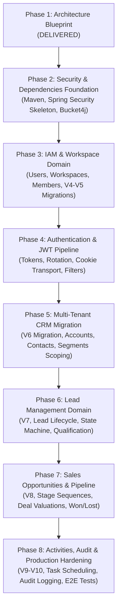

# SPRINT 4 IMPLEMENTATION PLAN
# VoicePilot AI — Phases 2 through 8 Execution Roadmap

---

## 1. Executive Implementation Roadmap

Sprint 4 is decomposed into 7 strictly dependency-ordered execution phases (Phases 2 through 8), building atop the architectural blueprint delivered in Phase 1.

---

## 2. Phase-by-Phase Technical Specifications

### Phase 2: Security & Dependencies Foundation
- **Goal:** Incorporate security dependencies, establish baseline configurations without breaking existing open endpoints.
- **Backend Deliverables:**
  - Update `backend/pom.xml`: Add `spring-boot-starter-security`, `jjwt-api:0.12.6`, `jjwt-impl:0.12.6`, `jjwt-jackson:0.12.6`, and `bucket4j-core:8.10.1`.
  - Create `com.voicepilot.iam.security.SecurityConfig`: Baseline permissive filter chain permitting all incoming traffic while validating filter order.
  - Create `com.voicepilot.iam.security.JwtProperties`: Configuration properties for issuer, secret, and TTLs.
  - Configure `BCryptPasswordEncoder` bean with cost factor 12.
- **Frontend Deliverables:**
  - Setup Axios / Fetch request and response interceptors to prepare for `401 Unauthorized` handling and automatic refresh retry.
- **Exit Criteria:** App builds cleanly; all existing unit/integration tests from Sprint 1–3 pass with zero regressions.

---

### Phase 3: IAM & Workspace Domain
- **Goal:** Implement database persistence and services for organizations, workspaces, and users.
- **Backend Deliverables:**
  - Flyway migrations: `V4__iam_core.sql` and `V5__auth_tokens.sql`.
  - JPA Entities: `IamUser`, `IamWorkspace`, `IamWorkspaceMember`, `RefreshToken`, `TokenBlocklistEntry`, `LoginAttempt`.
  - Repositories: `IamUserRepository`, `IamWorkspaceRepository`, `IamWorkspaceMemberRepository`, `RefreshTokenRepository`, `TokenBlocklistRepository`.
  - Core Services: `WorkspaceService`, `WorkspaceMembershipService`, `WorkspaceMembershipValidator`.
  - Core Context: `TenantContext` (ThreadLocal) with fail-closed semantics.
- **Testing:** Unit tests verifying workspace creation, member role mutations, and validator rejection of unauthorized tenant IDs.
- **Exit Criteria:** Workspace members can be added, updated, and queried with full transactional consistency.

---

### Phase 4: Authentication & JWT Pipeline
- **Goal:** Deploy end-to-end authentication, JWT issuance, HttpOnly refresh cookie rotation, and route protection.
- **Backend Deliverables:**
  - `JwtService`: HS256 token generation, signature verification, claim extraction.
  - `AuthService`: `register()`, `login()`, `refresh()`, `logout()`, `activateBootstrap()`.
  - `JwtAuthenticationFilter`: Extracts Bearer token, checks blocklist, invokes `WorkspaceMembershipValidator`, sets `SecurityContext` & `TenantContext`.
  - `RateLimitFilter`: Bucket4j IP/user rate limiting on `/api/v1/auth/*`.
  - `AuthController`: Complete endpoints for registration, login, logout, refresh, and current user profile (`GET /api/v1/auth/me`).
- **Frontend Deliverables:**
  - Login, Register, and Workspace Selection UI views.
  - Auth context and route guards (`ProtectedRoute`, `AdminRoute`).
- **Testing:** Testcontainers integration tests verifying invalid token rejection, refresh token family revocation upon reuse, and login rate limiting.
- **Exit Criteria:** Unauthenticated requests to protected routes return 401; authenticated requests correctly propagate tenant identity.

---

### Phase 5: Multi-Tenant CRM Migration & Isolation
- **Goal:** Retrofit multi-tenancy onto existing Accounts, Contacts, and Segments modules.
- **Backend Deliverables:**
  - Execute `V6__crm_tenant_isolation.sql` backfill migration.
  - Update `Account`, `Contact`, `Segment` JPA entities to include `workspaceId` column (`@Column(name = "workspace_id", nullable = false)`).
  - Update all repository methods to enforce `WHERE workspaceId = :workspaceId`.
  - Update `AccountService`, `ContactService`, `SegmentService` to consume `TenantContext.get()` instead of trusting external parameters.
  - Update CSV Import and Export services to stamp and verify `workspace_id`.
- **Frontend Deliverables:**
  - Remove all client-side assumptions about global contact IDs.
  - Bind active workspace selector in sidebar/header navigation.
- **Testing:** Tenant isolation tests: Create Contact in Workspace 1; assert query from Workspace 2 returns 404/Empty.
- **Exit Criteria:** 100% of CRM records scoped to a workspace; no cross-tenant data leaks possible.

---

### Phase 6: Lead Management Domain
- **Goal:** Deliver Sales Lead management, assignment, source tracking, and qualification lifecycle.
- **Backend Deliverables:**
  - Flyway migration `V7__crm_leads.sql`.
  - JPA Entity `Lead`, Enums `LeadStatus`, `LeadSource`.
  - `LeadStateMachine`: Enforces strict state transitions (`NEW` → `CONTACTED` → `QUALIFIED` → `CONVERTED` or `DISQUALIFIED`).
  - `LeadService` & `LeadRepository`: Scoped by workspace.
  - `LeadController`: REST endpoints for CRUD, status transitions, assignment, and conversion.
- **Frontend Deliverables:**
  - `LeadsPage.tsx`: Lead list, filter by status/source, assignment dropdown, conversion modal.
- **Testing:** Unit tests verifying valid/invalid status transitions; integration tests for conversion logic.
- **Exit Criteria:** Leads can progress through qualification stages and convert cleanly into Accounts/Contacts.

---

### Phase 7: Sales Opportunities & Pipeline
- **Goal:** Implement visual sales pipeline stages, deal valuation, probability tracking, and close workflows.
- **Backend Deliverables:**
  - Flyway migration `V8__crm_pipeline.sql`.
  - Entities: `PipelineStage`, `Opportunity`.
  - `PipelineStageService`: Stage reordering, default stage provisioning upon workspace creation.
  - `OpportunityService`: CRUD, stage progression, win/loss recording with mandatory reason codes.
  - `PipelineStageController` & `OpportunityController`.
- **Frontend Deliverables:**
  - `PipelinePage.tsx`: Kanban drag-and-drop or column view by pipeline stage.
  - Opportunity create/edit modals with deal value, expected close date, and win/loss reason prompts.
- **Testing:** Test pipeline position uniqueness per workspace; verify opportunities cannot be closed without reasons.
- **Exit Criteria:** Users can visualize and manipulate deals across customizable stages with revenue aggregates.

---

### Phase 8: Activities, Audit Logging & Hardening
- **Goal:** Provide interaction history, scheduled follow-ups, immutable audit logging, and end-to-end hardening.
- **Backend Deliverables:**
  - Flyway migrations `V9__crm_activities.sql` and `V10__audit_events.sql`.
  - Entities: `Activity`, `AuditEvent`.
  - `ActivityService`: Task creation, call/meeting logs, completion tracking.
  - Scheduled Jobs: `@Scheduled` detection of overdue tasks; retention cleanup purging audit records older than 90 days.
  - `AuditEventPublisher` & `AuditEventListener`: Decoupled asynchronous event persistence (`@TransactionalEventListener(phase = AFTER_COMMIT)`).
  - `AuditController`: Admin audit log inspection endpoint.
- **Frontend Deliverables:**
  - Activity timeline component embedded across Lead, Contact, and Opportunity detail views.
  - Admin Audit Log view with search and date range filters.
- **Testing:** Performance verification of audit event writes under load; end-to-end security penetration smoke suite.
- **Exit Criteria:** Complete activity trail linked to business entities; all sensitive administrative actions captured in audit stream.

---

## 3. Cross-Cutting Concerns Matrix

| Phase | Security & Auth | Tenant Isolation | Error Handling & Validation | Audit Logging | Observability |
|---|---|---|---|---|---|
| **Phase 2** | Spring Security Filter Chain | Architecture setup | Standard ErrorResponse | - | Actuator health check |
| **Phase 3** | Password hashing (BCrypt) | Table FKs & constraints | `MembershipException` | - | Member count metrics |
| **Phase 4** | JWT & HttpOnly cookie | Principal injection | `InvalidTokenException`, 429 | `LOGIN_*`, `LOGOUT` | Auth failure gauges |
| **Phase 5** | `@PreAuthorize` on CRM | `TenantContext` propagation | Entity 404 on cross-tenant | `CONTACT_*` events | Tenant query counters |
| **Phase 6** | Role check: ADMIN/MEMBER | Scoped Lead queries | `InvalidLeadTransition` | `LEAD_*` events | Lead conversion rate |
| **Phase 7** | Stage permission checks | Scoped Opportunity queries | Invalid stage skips | `OPP_STAGE_CHANGED` | Pipeline value rollup |
| **Phase 8** | Admin-only audit access | Scoped Activities | Validation on date ranges | Full domain audit | Overdue task monitor |

---

## 4. Risk Register & Mitigation Strategy

| Risk ID | Description | Likelihood | Impact | Mitigation Strategy |
|---|---|---|---|---|
| **R-01** | Cross-tenant data leak via missed query clause | Medium | Critical | Mandatory `TenantContext` enforcement; repository integration tests asserting tenant segregation across every entity. |
| **R-02** | Refresh token theft / replay attack | Low | High | Cryptographic hash storage in DB; rotation upon every use; automatic family invalidation upon reuse detection. |
| **R-03** | Existing data stranded during V6 migration | Medium | High | Deterministic backfill to Bootstrap Workspace (1); pre- and post-flight validation queries; nullable-to-NOT-NULL two-step execution. |
| **R-04** | Audit logging bottleneck degrading write latency | Medium | Medium | Asynchronous decoupled processing via Spring Events (`@Async` + `@TransactionalEventListener(phase = AFTER_COMMIT)`). |
| **R-05** | Production credential exposure in migrations | Low | Critical | Locked placeholder hash inserted by migration; activation requires dedicated one-time setup token or environment bootstrap CLI. |

---

## 5. Definition of Done (DoD) for Sprint 4

A phase is considered complete only when:
1. All Flyway database migrations run idempotently on clean and pre-existing schemas.
2. Spring Data JPA repositories execute queries with explicit `workspace_id` parameters.
3. Controller endpoints are covered by role-based `@PreAuthorize` checks conforming to the Authorization Matrix.
4. Unit test coverage exceeds 85% for state machines and security filters.
5. Integration test suite verifies complete tenant isolation across two simulated independent workspaces.
6. Frontend TypeScript compiles without warnings or errors under strict mode.
7. Architectural boundaries remain intact with zero circular package dependencies.

