# SPRINT 4 MIGRATION STRATEGY
# VoicePilot AI — Zero-Downtime Multi-Tenancy & Data Evolution Strategy

---

## 1. Executive Summary & Migration Lifecycle

Sprint 4 transforms VoicePilot AI from a single-tenant CRM prototype into a multi-tenant, enterprise-grade architecture.
The central challenge is migrating existing operational data across `crm_accounts`, `crm_contacts`, and `crm_segments` to strict workspace isolation without:
1. Data loss or corruption.
2. Breaking foreign key references or orphaned relations.
3. Leaking hardcoded production credentials into source control or Flyway migration scripts.
4. Unplanned production downtime during column alteration and index restructuring.

### 1.1 Migration Progression (V4 → V10)

```mermaid
flowchart LR
    V1["V1: System Baseline\n(sys_baseline_metadata)"] --> V2["V2: CRM Schema\n(accounts, contacts)"]
    V2 --> V3["V3: Segments\n(crm_segments)"]
    V3 --> V4["V4: IAM Core\n(users, workspaces, members)"]
    V4 --> V5["V5: Auth Tokens\n(refresh_tokens, blocklist, attempts)"]
    V5 --> V6["V6: CRM Tenant Isolation\n(Backfill workspace_id + FKs)"]
    V6 --> V7["V7: CRM Leads\n(crm_leads)"]
    V7 --> V8["V8: Sales Pipeline\n(pipeline_stages, opportunities)"]
    V8 --> V9["V9: CRM Activities\n(crm_activities)"]
    V9 --> V10["V10: Audit Events\n(audit_events partitioned)"]
```



---

## 2. Guiding Principles & Safety Guarantees

1. **Strict Forward Compatibility:** Flyway versioned migrations (`V4` through `V10`) only. No repeatable migrations (`R__`) are used for core schema structural evolution.
2. **Determinism & Idempotency:** Guard scripts with conditional logic (`IF NOT EXISTS`, constraint safety checks) where MySQL 8 dialect permits, ensuring safe re-run in recovery scenarios.
3. **No Embedded Production Credentials:** The bootstrap administrator account generated during V6 uses an unusable, cryptographically invalid password hash or an unguessable system entropy placeholder (`$2a$12$PROTECTED_BOOTSTRAP_ACCOUNT_LOCKED_UNTIL_FIRST_RUN_ROTATION...`) requiring an explicit one-time bootstrap activation CLI or setup token.
4. **Fail-Closed Workspace Integrity:** No CRM record will be allowed to have `workspace_id = NULL` post-migration.
5. **Zero-Downtime Multi-Phase Pattern:** Alterations add nullable columns first, perform batch backfill within the migration transaction, and then promote to `NOT NULL` with foreign key and unique index constraints.

---

## 3. Flyway Migration SQL Scripts (Complete DDL/DML)

### V4__iam_core.sql
```sql
-- ============================================================================
-- V4__iam_core.sql
-- VoicePilot AI - Identity, Workspaces & Memberships Foundation
-- ============================================================================

-- Table: iam_users
CREATE TABLE iam_users (
    id BIGINT NOT NULL AUTO_INCREMENT,
    email VARCHAR(160) NOT NULL,
    password_hash VARCHAR(255) NOT NULL,
    display_name VARCHAR(100) NOT NULL,
    avatar_url VARCHAR(500) NULL,
    is_active BOOLEAN NOT NULL DEFAULT TRUE,
    email_verified_at TIMESTAMP NULL,
    created_at TIMESTAMP NOT NULL DEFAULT CURRENT_TIMESTAMP,
    updated_at TIMESTAMP NOT NULL DEFAULT CURRENT_TIMESTAMP ON UPDATE CURRENT_TIMESTAMP,
    CONSTRAINT pk_iam_users PRIMARY KEY (id),
    CONSTRAINT uq_iam_users_email UNIQUE (email)
) ENGINE=InnoDB DEFAULT CHARSET=utf8mb4 COLLATE=utf8mb4_unicode_ci;

CREATE INDEX idx_iam_users_active ON iam_users (is_active);

-- Table: iam_workspaces
CREATE TABLE iam_workspaces (
    id BIGINT NOT NULL AUTO_INCREMENT,
    name VARCHAR(160) NOT NULL,
    slug VARCHAR(80) NOT NULL,
    plan VARCHAR(32) NOT NULL DEFAULT 'FREE',
    is_active BOOLEAN NOT NULL DEFAULT TRUE,
    created_at TIMESTAMP NOT NULL DEFAULT CURRENT_TIMESTAMP,
    updated_at TIMESTAMP NOT NULL DEFAULT CURRENT_TIMESTAMP ON UPDATE CURRENT_TIMESTAMP,
    CONSTRAINT pk_iam_workspaces PRIMARY KEY (id),
    CONSTRAINT uq_iam_workspaces_slug UNIQUE (slug)
) ENGINE=InnoDB DEFAULT CHARSET=utf8mb4 COLLATE=utf8mb4_unicode_ci;

CREATE INDEX idx_iam_workspaces_active ON iam_workspaces (is_active);

-- Table: iam_workspace_members
CREATE TABLE iam_workspace_members (
    id BIGINT NOT NULL AUTO_INCREMENT,
    workspace_id BIGINT NOT NULL,
    user_id BIGINT NOT NULL,
    role VARCHAR(32) NOT NULL,
    joined_at TIMESTAMP NOT NULL DEFAULT CURRENT_TIMESTAMP,
    CONSTRAINT pk_iam_workspace_members PRIMARY KEY (id),
    CONSTRAINT uq_iam_workspace_members_user UNIQUE (workspace_id, user_id),
    CONSTRAINT fk_iam_workspace_members_workspace FOREIGN KEY (workspace_id)
        REFERENCES iam_workspaces (id) ON DELETE CASCADE ON UPDATE CASCADE,
    CONSTRAINT fk_iam_workspace_members_user FOREIGN KEY (user_id)
        REFERENCES iam_users (id) ON DELETE CASCADE ON UPDATE CASCADE
) ENGINE=InnoDB DEFAULT CHARSET=utf8mb4 COLLATE=utf8mb4_unicode_ci;

CREATE INDEX idx_iam_workspace_members_user ON iam_workspace_members (user_id);
CREATE INDEX idx_iam_workspace_members_role ON iam_workspace_members (workspace_id, role);
```

---

### V5__auth_tokens.sql
```sql
-- ============================================================================
-- V5__auth_tokens.sql
-- VoicePilot AI - Token Revocation, Rotation & Login Security
-- ============================================================================

-- Table: auth_refresh_tokens
CREATE TABLE auth_refresh_tokens (
    id BIGINT NOT NULL AUTO_INCREMENT,
    user_id BIGINT NOT NULL,
    workspace_id BIGINT NOT NULL,
    token_hash VARCHAR(64) NOT NULL,
    family_id CHAR(36) NOT NULL,
    is_revoked BOOLEAN NOT NULL DEFAULT FALSE,
    expires_at TIMESTAMP NOT NULL,
    created_at TIMESTAMP NOT NULL DEFAULT CURRENT_TIMESTAMP,
    last_used_at TIMESTAMP NULL,
    CONSTRAINT pk_auth_refresh_tokens PRIMARY KEY (id),
    CONSTRAINT uq_auth_refresh_tokens_hash UNIQUE (token_hash),
    CONSTRAINT fk_auth_refresh_tokens_user FOREIGN KEY (user_id)
        REFERENCES iam_users (id) ON DELETE CASCADE,
    CONSTRAINT fk_auth_refresh_tokens_workspace FOREIGN KEY (workspace_id)
        REFERENCES iam_workspaces (id) ON DELETE CASCADE
) ENGINE=InnoDB DEFAULT CHARSET=utf8mb4 COLLATE=utf8mb4_unicode_ci;

CREATE INDEX idx_auth_refresh_family ON auth_refresh_tokens (family_id);
CREATE INDEX idx_auth_refresh_expires ON auth_refresh_tokens (expires_at);

-- Table: auth_token_blocklist
CREATE TABLE auth_token_blocklist (
    id BIGINT NOT NULL AUTO_INCREMENT,
    jti CHAR(36) NOT NULL,
    expires_at TIMESTAMP NOT NULL,
    created_at TIMESTAMP NOT NULL DEFAULT CURRENT_TIMESTAMP,
    CONSTRAINT pk_auth_token_blocklist PRIMARY KEY (id),
    CONSTRAINT uq_auth_token_blocklist_jti UNIQUE (jti)
) ENGINE=InnoDB DEFAULT CHARSET=utf8mb4 COLLATE=utf8mb4_unicode_ci;

CREATE INDEX idx_auth_blocklist_expires ON auth_token_blocklist (expires_at);

-- Table: auth_login_attempts
CREATE TABLE auth_login_attempts (
    id BIGINT NOT NULL AUTO_INCREMENT,
    email VARCHAR(160) NOT NULL,
    ip_address VARCHAR(45) NOT NULL,
    succeeded BOOLEAN NOT NULL,
    attempted_at TIMESTAMP NOT NULL DEFAULT CURRENT_TIMESTAMP,
    CONSTRAINT pk_auth_login_attempts PRIMARY KEY (id)
) ENGINE=InnoDB DEFAULT CHARSET=utf8mb4 COLLATE=utf8mb4_unicode_ci;

CREATE INDEX idx_auth_attempts_email ON auth_login_attempts (email, attempted_at);
CREATE INDEX idx_auth_attempts_ip ON auth_login_attempts (ip_address, attempted_at);
```

---

### V6__crm_tenant_isolation.sql (Critical Migration & Backfill)
```sql
-- ============================================================================
-- V6__crm_tenant_isolation.sql
-- VoicePilot AI - Retrofit Workspace Scoping onto Existing CRM Data
-- ============================================================================

-- Step 1: Create Initial Bootstrap System Workspace
INSERT INTO iam_workspaces (id, name, slug, plan, is_active, created_at, updated_at)
VALUES (1, 'Default Workspace', 'default', 'ENTERPRISE', TRUE, CURRENT_TIMESTAMP, CURRENT_TIMESTAMP)
ON DUPLICATE KEY UPDATE name = VALUES(name);

-- Step 2: Create Initial Bootstrap System Administrator Account
-- NOTE: Uses a locked BCrypt hash pattern. Must be activated via bootstrap-cli or password reset.
INSERT INTO iam_users (id, email, password_hash, display_name, is_active, email_verified_at, created_at, updated_at)
VALUES (
    1,
    'admin@voicepilot.local',
    '$2a$12$LOCKedBootstrapAccountPlaceholderMustBeRotatedBeforeProdUseXX',
    'System Administrator',
    TRUE,
    CURRENT_TIMESTAMP,
    CURRENT_TIMESTAMP,
    CURRENT_TIMESTAMP
)
ON DUPLICATE KEY UPDATE display_name = VALUES(display_name);

-- Step 3: Link Bootstrap Admin as WORKSPACE_ADMIN
INSERT INTO iam_workspace_members (workspace_id, user_id, role, joined_at)
VALUES (1, 1, 'WORKSPACE_ADMIN', CURRENT_TIMESTAMP)
ON DUPLICATE KEY UPDATE role = 'WORKSPACE_ADMIN';

-- Step 4: Alter crm_accounts -> Add workspace_id (nullable first)
ALTER TABLE crm_accounts ADD COLUMN workspace_id BIGINT NULL AFTER id;

-- Step 5: Backfill crm_accounts to Bootstrap Workspace (1)
UPDATE crm_accounts SET workspace_id = 1 WHERE workspace_id IS NULL;

-- Step 6: Make workspace_id NOT NULL and attach FK
ALTER TABLE crm_accounts
    MODIFY COLUMN workspace_id BIGINT NOT NULL,
    ADD CONSTRAINT fk_crm_accounts_workspace FOREIGN KEY (workspace_id)
        REFERENCES iam_workspaces (id) ON DELETE RESTRICT ON UPDATE CASCADE;

CREATE INDEX idx_crm_accounts_workspace ON crm_accounts (workspace_id);
CREATE INDEX idx_crm_accounts_workspace_status ON crm_accounts (workspace_id, status);

-- Step 7: Alter crm_contacts -> Add workspace_id (nullable first)
ALTER TABLE crm_contacts ADD COLUMN workspace_id BIGINT NULL AFTER id;

-- Step 8: Backfill crm_contacts to Bootstrap Workspace (1)
UPDATE crm_contacts SET workspace_id = 1 WHERE workspace_id IS NULL;

-- Step 9: Make workspace_id NOT NULL and attach FK
ALTER TABLE crm_contacts
    MODIFY COLUMN workspace_id BIGINT NOT NULL,
    ADD CONSTRAINT fk_crm_contacts_workspace FOREIGN KEY (workspace_id)
        REFERENCES iam_workspaces (id) ON DELETE RESTRICT ON UPDATE CASCADE;

-- Step 10: Scope email uniqueness to workspace
CREATE INDEX idx_crm_contacts_workspace ON crm_contacts (workspace_id);
CREATE INDEX idx_crm_contacts_workspace_email ON crm_contacts (workspace_id, email);
CREATE INDEX idx_crm_contacts_workspace_status ON crm_contacts (workspace_id, status);

-- Step 11: Alter crm_segments -> Add workspace_id (nullable first)
ALTER TABLE crm_segments ADD COLUMN workspace_id BIGINT NULL AFTER id;

-- Step 12: Backfill crm_segments to Bootstrap Workspace (1)
UPDATE crm_segments SET workspace_id = 1 WHERE workspace_id IS NULL;

-- Step 13: Make workspace_id NOT NULL and attach FK
ALTER TABLE crm_segments
    MODIFY COLUMN workspace_id BIGINT NOT NULL,
    ADD CONSTRAINT fk_crm_segments_workspace FOREIGN KEY (workspace_id)
        REFERENCES iam_workspaces (id) ON DELETE CASCADE ON UPDATE CASCADE;

CREATE INDEX idx_crm_segments_workspace ON crm_segments (workspace_id);
CREATE UNIQUE INDEX uq_crm_segments_workspace_name ON crm_segments (workspace_id, name);
```

---

### V7__crm_leads.sql
```sql
-- ============================================================================
-- V7__crm_leads.sql
-- VoicePilot AI - Sales Leads Management Table
-- ============================================================================

CREATE TABLE crm_leads (
    id BIGINT NOT NULL AUTO_INCREMENT,
    workspace_id BIGINT NOT NULL,
    account_id BIGINT NULL,
    contact_id BIGINT NULL,
    assigned_to_user_id BIGINT NULL,
    title VARCHAR(200) NOT NULL,
    source VARCHAR(32) NOT NULL DEFAULT 'INBOUND',
    status VARCHAR(32) NOT NULL DEFAULT 'NEW',
    disqualification_reason VARCHAR(255) NULL,
    estimated_value DECIMAL(15,2) NULL,
    converted_at TIMESTAMP NULL,
    created_at TIMESTAMP NOT NULL DEFAULT CURRENT_TIMESTAMP,
    updated_at TIMESTAMP NOT NULL DEFAULT CURRENT_TIMESTAMP ON UPDATE CURRENT_TIMESTAMP,
    CONSTRAINT pk_crm_leads PRIMARY KEY (id),
    CONSTRAINT fk_crm_leads_workspace FOREIGN KEY (workspace_id)
        REFERENCES iam_workspaces (id) ON DELETE RESTRICT,
    CONSTRAINT fk_crm_leads_account FOREIGN KEY (account_id)
        REFERENCES crm_accounts (id) ON DELETE SET NULL,
    CONSTRAINT fk_crm_leads_contact FOREIGN KEY (contact_id)
        REFERENCES crm_contacts (id) ON DELETE SET NULL,
    CONSTRAINT fk_crm_leads_assignee FOREIGN KEY (assigned_to_user_id)
        REFERENCES iam_users (id) ON DELETE SET NULL
) ENGINE=InnoDB DEFAULT CHARSET=utf8mb4 COLLATE=utf8mb4_unicode_ci;

CREATE INDEX idx_crm_leads_ws_status ON crm_leads (workspace_id, status);
CREATE INDEX idx_crm_leads_ws_assignee ON crm_leads (workspace_id, assigned_to_user_id);
CREATE INDEX idx_crm_leads_ws_created ON crm_leads (workspace_id, created_at);
```

---

### V8__crm_pipeline.sql
```sql
-- ============================================================================
-- V8__crm_pipeline.sql
-- VoicePilot AI - Pipeline Stages & Sales Opportunities
-- ============================================================================

-- Table: crm_pipeline_stages
CREATE TABLE crm_pipeline_stages (
    id BIGINT NOT NULL AUTO_INCREMENT,
    workspace_id BIGINT NOT NULL,
    name VARCHAR(100) NOT NULL,
    position INT NOT NULL,
    probability INT NOT NULL DEFAULT 10,
    is_closed_won BOOLEAN NOT NULL DEFAULT FALSE,
    is_closed_lost BOOLEAN NOT NULL DEFAULT FALSE,
    created_at TIMESTAMP NOT NULL DEFAULT CURRENT_TIMESTAMP,
    updated_at TIMESTAMP NOT NULL DEFAULT CURRENT_TIMESTAMP ON UPDATE CURRENT_TIMESTAMP,
    CONSTRAINT pk_crm_pipeline_stages PRIMARY KEY (id),
    CONSTRAINT uq_crm_pipeline_stages_pos UNIQUE (workspace_id, position),
    CONSTRAINT fk_crm_pipeline_stages_ws FOREIGN KEY (workspace_id)
        REFERENCES iam_workspaces (id) ON DELETE CASCADE
) ENGINE=InnoDB DEFAULT CHARSET=utf8mb4 COLLATE=utf8mb4_unicode_ci;

CREATE INDEX idx_crm_pipeline_stages_ws ON crm_pipeline_stages (workspace_id);

-- Seed Standard Default Pipeline Stages for Bootstrap Workspace (1)
INSERT INTO crm_pipeline_stages (workspace_id, name, position, probability, is_closed_won, is_closed_lost)
VALUES 
(1, 'Prospecting', 1, 10, FALSE, FALSE),
(1, 'Qualification', 2, 25, FALSE, FALSE),
(1, 'Proposal', 3, 50, FALSE, FALSE),
(1, 'Negotiation', 4, 75, FALSE, FALSE),
(1, 'Closed Won', 5, 100, TRUE, FALSE),
(1, 'Closed Lost', 6, 0, FALSE, TRUE);

-- Table: crm_opportunities
CREATE TABLE crm_opportunities (
    id BIGINT NOT NULL AUTO_INCREMENT,
    workspace_id BIGINT NOT NULL,
    account_id BIGINT NULL,
    lead_id BIGINT NULL,
    assigned_to_user_id BIGINT NULL,
    stage_id BIGINT NOT NULL,
    previous_stage_id BIGINT NULL,
    name VARCHAR(200) NOT NULL,
    amount DECIMAL(15,2) NULL,
    expected_close_date DATE NULL,
    probability INT NOT NULL DEFAULT 10,
    status VARCHAR(32) NOT NULL DEFAULT 'OPEN',
    close_reason VARCHAR(255) NULL,
    created_at TIMESTAMP NOT NULL DEFAULT CURRENT_TIMESTAMP,
    updated_at TIMESTAMP NOT NULL DEFAULT CURRENT_TIMESTAMP ON UPDATE CURRENT_TIMESTAMP,
    CONSTRAINT pk_crm_opportunities PRIMARY KEY (id),
    CONSTRAINT fk_crm_opportunities_ws FOREIGN KEY (workspace_id)
        REFERENCES iam_workspaces (id) ON DELETE RESTRICT,
    CONSTRAINT fk_crm_opportunities_account FOREIGN KEY (account_id)
        REFERENCES crm_accounts (id) ON DELETE SET NULL,
    CONSTRAINT fk_crm_opportunities_lead FOREIGN KEY (lead_id)
        REFERENCES crm_leads (id) ON DELETE SET NULL,
    CONSTRAINT fk_crm_opportunities_stage FOREIGN KEY (stage_id)
        REFERENCES crm_pipeline_stages (id) ON DELETE RESTRICT,
    CONSTRAINT fk_crm_opportunities_prev_stage FOREIGN KEY (previous_stage_id)
        REFERENCES crm_pipeline_stages (id) ON DELETE SET NULL,
    CONSTRAINT fk_crm_opportunities_assignee FOREIGN KEY (assigned_to_user_id)
        REFERENCES iam_users (id) ON DELETE SET NULL
) ENGINE=InnoDB DEFAULT CHARSET=utf8mb4 COLLATE=utf8mb4_unicode_ci;

CREATE INDEX idx_crm_opps_ws_status ON crm_opportunities (workspace_id, status);
CREATE INDEX idx_crm_opps_ws_stage ON crm_opportunities (workspace_id, stage_id);
CREATE INDEX idx_crm_opps_ws_close_date ON crm_opportunities (workspace_id, expected_close_date);
CREATE INDEX idx_crm_opps_ws_assignee ON crm_opportunities (workspace_id, assigned_to_user_id);
```

---

### V9__crm_activities.sql
```sql
-- ============================================================================
-- V9__crm_activities.sql
-- VoicePilot AI - Sales Activities, Tasks & Follow-ups
-- ============================================================================

CREATE TABLE crm_activities (
    id BIGINT NOT NULL AUTO_INCREMENT,
    workspace_id BIGINT NOT NULL,
    created_by_user_id BIGINT NOT NULL,
    assigned_to_user_id BIGINT NULL,
    lead_id BIGINT NULL,
    opportunity_id BIGINT NULL,
    contact_id BIGINT NULL,
    account_id BIGINT NULL,
    activity_type VARCHAR(32) NOT NULL,
    subject VARCHAR(200) NOT NULL,
    body TEXT NULL,
    scheduled_at TIMESTAMP NULL,
    completed_at TIMESTAMP NULL,
    status VARCHAR(32) NOT NULL DEFAULT 'SCHEDULED',
    created_at TIMESTAMP NOT NULL DEFAULT CURRENT_TIMESTAMP,
    updated_at TIMESTAMP NOT NULL DEFAULT CURRENT_TIMESTAMP ON UPDATE CURRENT_TIMESTAMP,
    CONSTRAINT pk_crm_activities PRIMARY KEY (id),
    CONSTRAINT fk_crm_activities_ws FOREIGN KEY (workspace_id)
        REFERENCES iam_workspaces (id) ON DELETE RESTRICT,
    CONSTRAINT fk_crm_activities_creator FOREIGN KEY (created_by_user_id)
        REFERENCES iam_users (id) ON DELETE RESTRICT,
    CONSTRAINT fk_crm_activities_assignee FOREIGN KEY (assigned_to_user_id)
        REFERENCES iam_users (id) ON DELETE SET NULL,
    CONSTRAINT fk_crm_activities_lead FOREIGN KEY (lead_id)
        REFERENCES crm_leads (id) ON DELETE CASCADE,
    CONSTRAINT fk_crm_activities_opp FOREIGN KEY (opportunity_id)
        REFERENCES crm_opportunities (id) ON DELETE CASCADE,
    CONSTRAINT fk_crm_activities_contact FOREIGN KEY (contact_id)
        REFERENCES crm_contacts (id) ON DELETE CASCADE,
    CONSTRAINT fk_crm_activities_account FOREIGN KEY (account_id)
        REFERENCES crm_accounts (id) ON DELETE CASCADE
) ENGINE=InnoDB DEFAULT CHARSET=utf8mb4 COLLATE=utf8mb4_unicode_ci;

CREATE INDEX idx_crm_activities_ws_status ON crm_activities (workspace_id, status);
CREATE INDEX idx_crm_activities_ws_scheduled ON crm_activities (workspace_id, scheduled_at);
CREATE INDEX idx_crm_activities_ws_assignee ON crm_activities (workspace_id, assigned_to_user_id);
```

---

### V10__audit_events.sql
```sql
-- ============================================================================
-- V10__audit_events.sql
-- VoicePilot AI - Immutable Audit Log Stream
-- ============================================================================

CREATE TABLE audit_events (
    id BIGINT NOT NULL AUTO_INCREMENT,
    workspace_id BIGINT NULL,
    actor_user_id BIGINT NULL,
    event_type VARCHAR(80) NOT NULL,
    resource_type VARCHAR(80) NULL,
    resource_id BIGINT NULL,
    details JSON NULL,
    ip_address VARCHAR(45) NULL,
    created_at TIMESTAMP NOT NULL DEFAULT CURRENT_TIMESTAMP,
    CONSTRAINT pk_audit_events PRIMARY KEY (id, created_at)
) ENGINE=InnoDB DEFAULT CHARSET=utf8mb4 COLLATE=utf8mb4_unicode_ci
PARTITION BY RANGE (UNIX_TIMESTAMP(created_at)) (
    PARTITION p_initial VALUES LESS THAN (UNIX_TIMESTAMP('2026-01-01 00:00:00')),
    PARTITION p_2026_q1 VALUES LESS THAN (UNIX_TIMESTAMP('2026-04-01 00:00:00')),
    PARTITION p_2026_q2 VALUES LESS THAN (UNIX_TIMESTAMP('2026-07-01 00:00:00')),
    PARTITION p_2026_q3 VALUES LESS THAN (UNIX_TIMESTAMP('2026-10-01 00:00:00')),
    PARTITION p_2026_q4 VALUES LESS THAN (UNIX_TIMESTAMP('2027-01-01 00:00:00')),
    PARTITION p_future VALUES LESS THAN MAXVALUE
);

CREATE INDEX idx_audit_ws_created ON audit_events (workspace_id, created_at);
CREATE INDEX idx_audit_actor_created ON audit_events (actor_user_id, created_at);
CREATE INDEX idx_audit_type_created ON audit_events (event_type, created_at);
```

---

## 4. Bootstrap Credential Rotation & First-Run Setup

### 4.1 Security Problem
If a migration inserts a known plaintext password or static BCrypt hash (e.g. `admin123`), every installation worldwide possesses the same credentials until manually altered.

### 4.2 Remediation Architecture
1. **Locked Hash Insertion:** V6 inserts `admin@voicepilot.local` with an intentionally invalid BCrypt prefix (`$2a$12$LOCKedBootstrapAccountPlaceholder...`). BCrypt verification will always fail on standard login.
2. **First-Run CLI / Activation Token:**
   Upon deployment, an administrative CLI utility or setup environment flag is executed:
   ```bash
   java -jar voicepilot-backend.jar --bootstrap.admin.password="${SECURE_BOOTSTRAP_PASSWORD}"
   ```
   Alternatively, the server generates a one-time single-use activation token to standard output on first start when detecting the placeholder hash:
   `[BOOTSTRAP NOTICE] Initial admin activation token: 8f3c7a2b-91d4-4e2a-84b6-72c5a1e490df (expires in 1 hour)`
3. **Mandatory Credential Rotation API:**
   The admin uses `POST /api/v1/auth/activate-bootstrap` with the one-time token to supply their official email and production master password.

---

## 5. Rollback Plans & Safety Invariants

> [!WARNING]
> Rolling back database migrations that restructure foreign keys or introduce multi-tenancy columns (`V6`) causes destructive data loss for newly registered tenants. Rollbacks must only be performed in pre-production staging environments or as cold disaster recovery.

### Manual Down Migration Reference (Inverse Order)

```sql
-- Rollback V10:
DROP TABLE IF EXISTS audit_events;

-- Rollback V9:
DROP TABLE IF EXISTS crm_activities;

-- Rollback V8:
DROP TABLE IF EXISTS crm_opportunities;
DROP TABLE IF EXISTS crm_pipeline_stages;

-- Rollback V7:
DROP TABLE IF EXISTS crm_leads;

-- Rollback V6 (Caution: Strips tenant segregation):
ALTER TABLE crm_segments DROP FOREIGN KEY fk_crm_segments_workspace;
ALTER TABLE crm_segments DROP INDEX uq_crm_segments_workspace_name;
ALTER TABLE crm_segments DROP COLUMN workspace_id;

ALTER TABLE crm_contacts DROP FOREIGN KEY fk_crm_contacts_workspace;
ALTER TABLE crm_contacts DROP INDEX idx_crm_contacts_workspace_email;
ALTER TABLE crm_contacts DROP COLUMN workspace_id;

ALTER TABLE crm_accounts DROP FOREIGN KEY fk_crm_accounts_workspace;
ALTER TABLE crm_accounts DROP COLUMN workspace_id;

-- Rollback V5:
DROP TABLE IF EXISTS auth_login_attempts;
DROP TABLE IF EXISTS auth_token_blocklist;
DROP TABLE IF EXISTS auth_refresh_tokens;

-- Rollback V4:
DROP TABLE IF EXISTS iam_workspace_members;
DROP TABLE IF EXISTS iam_workspaces;
DROP TABLE IF EXISTS iam_users;
```

---

## 6. Post-Migration Verification Queries

Run the following sanity verification queries immediately following the execution of `V6`:

```sql
-- 1. Check for any orphaned accounts missing tenant id
SELECT COUNT(*) AS orphaned_accounts FROM crm_accounts WHERE workspace_id IS NULL;
-- Expected: 0

-- 2. Check for any orphaned contacts missing tenant id
SELECT COUNT(*) AS orphaned_contacts FROM crm_contacts WHERE workspace_id IS NULL;
-- Expected: 0

-- 3. Check for any orphaned segments missing tenant id
SELECT COUNT(*) AS orphaned_segments FROM crm_segments WHERE workspace_id IS NULL;
-- Expected: 0

-- 4. Verify bootstrap workspace and admin membership integrity
SELECT w.id, w.name, u.email, m.role 
FROM iam_workspaces w
JOIN iam_workspace_members m ON w.id = m.workspace_id
JOIN iam_users u ON u.id = m.user_id
WHERE w.id = 1;
-- Expected: 1 | Default Workspace | admin@voicepilot.local | WORKSPACE_ADMIN
```

