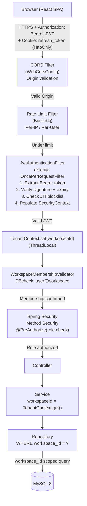
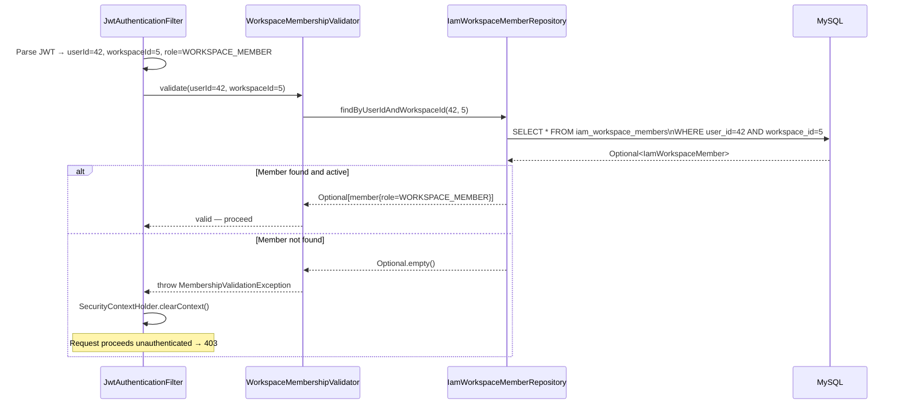

# SPRINT 4 SECURITY MODEL
# VoicePilot AI — Authentication, Authorization & Tenant Isolation

---

## 1. Security Architecture Overview



---

## 2. Definitions

### Authentication
**What it is:** Proving the identity of a caller — "who are you?"
**Mechanism:** JWT signature verification + expiry check on every request. The JWT contains `sub` (userId) and is signed with a 512-bit HMAC-SHA256 key only the server knows.
**What it prevents:** Unauthenticated access to any protected endpoint. A request without a valid JWT is rejected with HTTP 401 before it reaches any controller.

### Authorization
**What it is:** Determining what an authenticated caller is allowed to do — "are you permitted to do this?"
**Mechanism:** Spring Method Security with `@PreAuthorize("hasRole('WORKSPACE_ADMIN')")`. The role claim in the JWT determines which operations are permitted.
**What it prevents:** A `WORKSPACE_VIEWER` cannot create a Lead. A `WORKSPACE_MEMBER` cannot delete a workspace. An authenticated user without the required role receives HTTP 403.

### Workspace Membership Validation
**What it is:** Confirming that an authenticated user is an active member of the workspace encoded in their JWT — "do you belong to this workspace?"
**Mechanism:** On every request, `WorkspaceMembershipValidator` executes one database query: `SELECT role FROM iam_workspace_members WHERE user_id = ? AND workspace_id = ?`. If no row is found, the request is rejected with HTTP 403.
**What it prevents:** A user who was removed from a workspace cannot use a still-valid JWT to access that workspace's resources. Tokens do not become "stale" — membership is always checked live.
**Why not just trust the JWT?** Token lifetime is 15 minutes. A user can be removed from a workspace at any point. Without a live membership check, a removed user can continue to access resources for up to 15 minutes.

### Tenant Isolation
**What it is:** Ensuring that a user who is a member of Workspace A can never read, modify, or delete data belonging to Workspace B — even if they guess a resource ID.
**Mechanism:** `TenantContext` holds the authenticated workspace ID in a `ThreadLocal`. Every repository method reads `workspaceId` exclusively from `TenantContext` — never from path variables, query parameters, or request body. Every query includes `WHERE workspace_id = :workspaceId`.
**What it prevents:** A curious user who guesses a Contact ID from another workspace gets HTTP 404 (not 403 — do not leak existence). No code path can access a resource without a workspace_id filter derived from the authenticated JWT.

---

## 3. Authentication Design

### 3.1 JWT Access Token

**Algorithm:** HS256 (HMAC-SHA256)
**Justification:** VoicePilot AI runs as a single backend instance. RS256 provides value when multiple services need to verify tokens without sharing secrets (e.g., microservices). At monolith scale, the operational complexity of key pair management, key rotation, and JWKS endpoints is not justified. HS256 with a 512-bit (64-byte) random secret is cryptographically strong.

**Token Lifetime:** 15 minutes

**Claims structure:**
```json
{
  "sub": "42",
  "workspaceId": "1",
  "role": "WORKSPACE_MEMBER",
  "jti": "550e8400-e29b-41d4-a716-446655440000",
  "iat": 1699027200,
  "exp": 1699028100,
  "iss": "voicepilot-api"
}
```

| Claim | Type | Description |
|---|---|---|
| `sub` | String | User ID (Long serialized as String) |
| `workspaceId` | String | Active workspace ID (Long as String) |
| `role` | String | Workspace role: `WORKSPACE_ADMIN`, `WORKSPACE_MEMBER`, `WORKSPACE_VIEWER` |
| `jti` | UUID | Unique token ID — used for blocklist revocation |
| `iat` | epoch | Issued at |
| `exp` | epoch | Expiry (iat + 900 seconds) |
| `iss` | String | Issuer identifier |

**Configuration (application.yml):**
```yaml
voicepilot:
  jwt:
    secret: "${JWT_SECRET}"          # 512-bit base64-encoded random value, from env var
    access-token-ttl-seconds: 900    # 15 minutes
    issuer: voicepilot-api
```

> [!CAUTION]
> `JWT_SECRET` must be set as an environment variable or injected by a secrets manager (e.g., AWS Secrets Manager, HashiCorp Vault). It must NEVER be committed to source code or version control.

### 3.2 Refresh Token

**Type:** Opaque random token (32 bytes, SecureRandom → Base64URL encoded = 43 chars)
**Delivery:** HttpOnly, Secure, SameSite=Strict cookie named `vp_rt`
**Lifetime:** 30 days
**Storage:** SHA-256 hash stored in `auth_refresh_tokens` table (never the raw token)
**Rotation:** Every successful refresh issues a new token and revokes the old one
**Family revocation:** Each refresh token belongs to a `family_id` (UUID assigned at login). If a refresh token that has already been consumed is presented again (theft detection), the entire family is revoked — all sessions derived from that login are invalidated.

**Cookie attributes:**
```
Set-Cookie: vp_rt=<token>; HttpOnly; Secure; SameSite=Strict; Path=/api/v1/auth; Max-Age=2592000
```

**Why `Path=/api/v1/auth`?** The cookie is only sent to the auth endpoints, not to every API call — minimizing exposure surface.

### 3.3 Token Revocation

**Access token revocation:**
- Access tokens cannot be invalidated by modifying them (they are stateless)
- On logout, the `jti` is inserted into `auth_token_blocklist` with `expires_at = token exp`
- `JwtAuthenticationFilter` checks the blocklist on every request: `SELECT 1 FROM auth_token_blocklist WHERE jti = ?`
- Expired entries are purged by a scheduled cleanup job to keep the blocklist small

**Refresh token revocation:**
- Logout: marks `is_revoked = TRUE` for the specific token
- Reuse detection: marks all tokens with the same `family_id` as revoked
- Membership removal: all refresh tokens for user+workspace pair are revoked

### 3.4 Logout Flow

```mermaid
sequenceDiagram
    participant B as Browser
    participant AC as AuthController
    participant AS as AuthService
    participant DB as MySQL

    B->>AC: POST /api/v1/auth/logout\n(Bearer JWT + vp_rt cookie)
    AC->>AS: logout(jti, refreshTokenRaw)
    AS->>DB: INSERT INTO auth_token_blocklist (jti, expires_at)
    AS->>DB: UPDATE auth_refresh_tokens SET is_revoked=TRUE\nWHERE token_hash = SHA256(refreshTokenRaw)
    AS-->>AC: done
    AC-->>B: 200 OK\nSet-Cookie: vp_rt=; Max-Age=0 (clear cookie)
```

### 3.5 Password Hashing

**Algorithm:** BCrypt with cost factor 12
**Justification:** Spring Security provides native `BCryptPasswordEncoder`. At cost factor 12, a single hash takes ~250ms on commodity hardware — sufficient to make brute-force attacks computationally expensive while remaining fast enough for login UX. Argon2id is theoretically superior (memory-hard) but requires additional dependency management and tuning. BCrypt at cost 12 is an acceptable security/performance trade-off at this scale.

```java
@Bean
public PasswordEncoder passwordEncoder() {
    return new BCryptPasswordEncoder(12);
}
```

---

## 4. Spring Security Filter Chain

### 4.1 CSRF Decision

**Decision:** CSRF protection is disabled.

**Reasoning:**
1. The application uses stateless JWT authentication via the `Authorization` header — not session cookies.
2. Refresh tokens are stored in a `SameSite=Strict` HttpOnly cookie. `SameSite=Strict` means the browser will not send this cookie on cross-origin requests initiated by third-party sites — this is equivalent to a CSRF token for cookie transport.
3. Cross-origin requests blocked by CORS cannot include the `Authorization: Bearer` header with a forged token.
4. CSRF tokens require server-side session state, which conflicts with stateless JWT design.

**This is safe when:** `SameSite=Strict` is set on the refresh cookie, CORS is properly configured to reject unexpected origins, and the JWT is transported in the `Authorization` header (not a cookie).

### 4.2 CORS Configuration

```java
// Updated WebCorsConfig — must integrate with Spring Security's CorsConfigurationSource
@Bean
public CorsConfigurationSource corsConfigurationSource() {
    CorsConfiguration config = new CorsConfiguration();
    config.setAllowedOrigins(List.of(allowedOrigins.split(",")));
    config.setAllowedMethods(List.of("GET","POST","PUT","PATCH","DELETE","OPTIONS"));
    config.setAllowedHeaders(List.of("Origin","Content-Type","Accept","Authorization"));
    config.setAllowCredentials(true);  // Required for cookie transport
    config.setMaxAge(3600L);
    UrlBasedCorsConfigurationSource source = new UrlBasedCorsConfigurationSource();
    source.registerCorsConfiguration("/**", config);
    return source;
}
```

### 4.3 SecurityConfig

```java
@Configuration
@EnableWebSecurity
@EnableMethodSecurity
public class SecurityConfig {

    @Bean
    public SecurityFilterChain filterChain(HttpSecurity http,
                                           JwtAuthenticationFilter jwtFilter,
                                           CorsConfigurationSource corsSource) throws Exception {
        return http
            .cors(c -> c.configurationSource(corsSource))
            .csrf(AbstractHttpConfigurer::disable)        // Justified above
            .sessionManagement(s -> s.sessionCreationPolicy(STATELESS))
            .authorizeHttpRequests(auth -> auth
                .requestMatchers(
                    "/api/v1/auth/login",
                    "/api/v1/auth/register",
                    "/api/v1/auth/refresh",
                    "/api/v1/health",
                    "/actuator/health",
                    "/v3/api-docs/**",
                    "/swagger-ui/**"
                ).permitAll()
                .anyRequest().authenticated()
            )
            .addFilterBefore(jwtFilter, UsernamePasswordAuthenticationFilter.class)
            .build();
    }
}
```

### 4.4 JwtAuthenticationFilter

```java
@Component
public class JwtAuthenticationFilter extends OncePerRequestFilter {

    @Override
    protected void doFilterInternal(HttpServletRequest request,
                                    HttpServletResponse response,
                                    FilterChain chain) throws IOException, ServletException {
        try {
            String token = extractBearerToken(request);
            if (token != null && jwtService.isValid(token)) {
                Claims claims = jwtService.parse(token);
                if (!tokenBlocklistRepository.existsByJti(claims.getId())) {
                    WorkspacePrincipal principal = WorkspacePrincipal.from(claims);
                    membershipValidator.validate(principal.userId(), principal.workspaceId());
                    TenantContext.set(principal.workspaceId());
                    var auth = new UsernamePasswordAuthenticationToken(
                        principal, null, List.of(new SimpleGrantedAuthority("ROLE_" + principal.role()))
                    );
                    SecurityContextHolder.getContext().setAuthentication(auth);
                }
            }
        } catch (JwtException | MembershipException e) {
            // Fail closed: clear context, do not set authentication
            SecurityContextHolder.clearContext();
        } finally {
            chain.doFilter(request, response);
            TenantContext.clear();  // Always clean up ThreadLocal
        }
    }
}
```

**Fail-closed:** If JWT parsing fails, membership validation fails, or any exception occurs, the `SecurityContext` is cleared and the request proceeds unauthenticated — resulting in HTTP 401 from the authorization layer.

---

## 5. RBAC Design

### 5.1 Roles

| Role | Description |
|---|---|
| `WORKSPACE_ADMIN` | Full control over workspace — can manage members, delete resources, configure pipeline |
| `WORKSPACE_MEMBER` | Can create, read, and update all business resources within the workspace |
| `WORKSPACE_VIEWER` | Read-only access to all business resources |

### 5.2 Permission Matrix

| Permission | WORKSPACE_ADMIN | WORKSPACE_MEMBER | WORKSPACE_VIEWER |
|---|---|---|---|
| `READ_CONTACT` | ✓ | ✓ | ✓ |
| `CREATE_CONTACT` | ✓ | ✓ | ✗ |
| `UPDATE_CONTACT` | ✓ | ✓ | ✗ |
| `DELETE_CONTACT` | ✓ | ✗ | ✗ |
| `IMPORT_CONTACTS` | ✓ | ✓ | ✗ |
| `EXPORT_CONTACTS` | ✓ | ✓ | ✓ |
| `READ_ACCOUNT` | ✓ | ✓ | ✓ |
| `CREATE_ACCOUNT` | ✓ | ✓ | ✗ |
| `UPDATE_ACCOUNT` | ✓ | ✓ | ✗ |
| `DELETE_ACCOUNT` | ✓ | ✗ | ✗ |
| `READ_LEAD` | ✓ | ✓ | ✓ |
| `CREATE_LEAD` | ✓ | ✓ | ✗ |
| `UPDATE_LEAD` | ✓ | ✓ | ✗ |
| `ASSIGN_LEAD` | ✓ | ✓ | ✗ |
| `CONVERT_LEAD` | ✓ | ✓ | ✗ |
| `DELETE_LEAD` | ✓ | ✗ | ✗ |
| `READ_OPPORTUNITY` | ✓ | ✓ | ✓ |
| `CREATE_OPPORTUNITY` | ✓ | ✓ | ✗ |
| `UPDATE_OPPORTUNITY` | ✓ | ✓ | ✗ |
| `MOVE_OPPORTUNITY_STAGE` | ✓ | ✓ | ✗ |
| `CLOSE_OPPORTUNITY` | ✓ | ✓ | ✗ |
| `DELETE_OPPORTUNITY` | ✓ | ✗ | ✗ |
| `MANAGE_PIPELINE_STAGES` | ✓ | ✗ | ✗ |
| `READ_ACTIVITY` | ✓ | ✓ | ✓ |
| `CREATE_ACTIVITY` | ✓ | ✓ | ✗ |
| `UPDATE_ACTIVITY` | ✓ | ✓ | ✗ |
| `COMPLETE_ACTIVITY` | ✓ | ✓ | ✗ |
| `DELETE_ACTIVITY` | ✓ | ✗ | ✗ |
| `MANAGE_MEMBERS` | ✓ | ✗ | ✗ |
| `MANAGE_WORKSPACE` | ✓ | ✗ | ✗ |
| `VIEW_AUDIT_LOG` | ✓ | ✗ | ✗ |

### 5.3 @PreAuthorize Examples

```java
// Contacts controller
@GetMapping
@PreAuthorize("isAuthenticated()")  // All authenticated roles can read
public ApiResponse<PageResponse<ContactResponse>> list(...) { }

@PostMapping
@PreAuthorize("hasAnyRole('WORKSPACE_ADMIN', 'WORKSPACE_MEMBER')")
public ApiResponse<ContactResponse> create(...) { }

@DeleteMapping("/{id}")
@PreAuthorize("hasRole('WORKSPACE_ADMIN')")
public ResponseEntity<Void> delete(...) { }

// Audit controller
@GetMapping
@PreAuthorize("hasRole('WORKSPACE_ADMIN')")
public ApiResponse<PageResponse<AuditEventResponse>> listAuditEvents(...) { }
```

---

## 6. Workspace Membership Validation



**WorkspaceMembershipValidator:**
```java
@Component
public class WorkspaceMembershipValidator {
    private final IamWorkspaceMemberRepository memberRepository;

    public void validate(Long userId, Long workspaceId) {
        memberRepository.findByUserIdAndWorkspaceId(userId, workspaceId)
            .orElseThrow(() -> new MembershipValidationException(
                "User " + userId + " is not a member of workspace " + workspaceId
            ));
    }
}
```

> [!IMPORTANT]
> The `workspaceId` used for membership validation comes exclusively from the JWT claims — never from path variables or request body. This prevents a user from supplying a foreign workspace ID in the URL to bypass the check.

---

## 7. Tenant Isolation Strategy

### 7.1 TenantContext

```java
public final class TenantContext {
    private static final ThreadLocal<Long> WORKSPACE_ID = new ThreadLocal<>();

    public static void set(Long workspaceId) { WORKSPACE_ID.set(workspaceId); }
    public static Long get() {
        Long id = WORKSPACE_ID.get();
        if (id == null) throw new IllegalStateException("TenantContext not initialized — fail closed");
        return id;
    }
    public static void clear() { WORKSPACE_ID.remove(); }
}
```

**Always cleared in `finally` block** of `JwtAuthenticationFilter` to prevent ThreadLocal leaks in thread-pooled environments.

### 7.2 Repository-Level Tenant Filtering

```java
// ContactRepository — workspace_id always from TenantContext, never from caller
public interface ContactRepository extends JpaRepository<Contact, Long> {

    @Query("SELECT c FROM Contact c WHERE c.workspaceId = :workspaceId")
    Page<Contact> findAllByWorkspaceId(@Param("workspaceId") Long workspaceId, Pageable pageable);

    @Query("SELECT c FROM Contact c WHERE c.id = :id AND c.workspaceId = :workspaceId")
    Optional<Contact> findByIdAndWorkspaceId(@Param("id") Long id,
                                              @Param("workspaceId") Long workspaceId);
}
```

```java
// ContactService — extracts workspaceId from TenantContext, not from request
@Service
public class ContactService {
    public PageResponse<ContactResponse> listContacts(Pageable pageable) {
        Long workspaceId = TenantContext.get();  // From authenticated context
        Page<Contact> page = contactRepository.findAllByWorkspaceId(workspaceId, pageable);
        return PageResponse.from(page, ContactResponse::from);
    }

    public ContactResponse getContact(Long id) {
        Long workspaceId = TenantContext.get();
        return contactRepository.findByIdAndWorkspaceId(id, workspaceId)
            .map(ContactResponse::from)
            .orElseThrow(() -> new ResourceNotFoundException("Contact", id));
        // Returns 404, not 403 — do not leak existence of cross-tenant resources
    }
}
```

### 7.3 Cross-Tenant Prevention Chain

```
JWT claim workspaceId
    ↓
JwtAuthenticationFilter sets TenantContext
    ↓
WorkspaceMembershipValidator confirms user∈workspace
    ↓
All service methods call TenantContext.get() for workspaceId
    ↓
All repository queries include WHERE workspace_id = ?
    ↓
MySQL enforces FK: workspace_id REFERENCES iam_workspaces(id)
    ↓
Result: Cross-tenant access physically impossible at query level
```

---

## 8. CORS & CSRF Configuration

| Concern | Configuration | Justification |
|---|---|---|
| CORS Origin | Configurable via `voicepilot.cors.allowed-origins` (env var) | Production must set to exact frontend domain |
| CORS Credentials | `allowCredentials(true)` | Required for HttpOnly cookie transport |
| CSRF | **Disabled** | Stateless JWT + SameSite=Strict cookie — see §4.1 |
| SameSite | `SameSite=Strict` on refresh cookie | Browser blocks cross-origin cookie submission |
| Secure flag | `Secure` on refresh cookie | Cookie only sent over HTTPS |

---

## 9. Rate Limiting Strategy

**Library:** Bucket4j (in-memory, no external infra)

| Endpoint Group | Limit | Window | Action on Breach |
|---|---|---|---|
| `POST /api/v1/auth/login` | 10 requests | 1 minute per IP | HTTP 429, `Retry-After` header |
| `POST /api/v1/auth/register` | 5 requests | 1 minute per IP | HTTP 429 |
| `POST /api/v1/auth/refresh` | 30 requests | 1 minute per IP | HTTP 429 |
| All authenticated API endpoints | 300 requests | 1 minute per userId | HTTP 429 |
| Login failure lockout | 5 failures | 10 minutes per email | HTTP 423 (account temporarily locked) |

**Implementation:** `RateLimitFilter extends OncePerRequestFilter` placed before `JwtAuthenticationFilter`. Uses a `ConcurrentHashMap<String, Bucket>` keyed by IP or userId.

**Login lockout:** Tracked in `auth_login_attempts` table. `LoginAttemptService.recordFailure(email, ip)` and `isLocked(email)` queries.

---

## 10. Audit Logging

### 10.1 Architecture

```
Business operation completes
    ↓ @Transactional business method commits
    ↓ ApplicationEventPublisher.publishEvent(new AuditDomainEvent(...))
    ↓ @TransactionalEventListener(phase = AFTER_COMMIT)  ← only fires after commit
    ↓ @Async (separate thread, does not block request)
    ↓ AuditEventRepository.save(auditEvent)
    ↓ MySQL: INSERT INTO audit_events
```

### 10.2 Audit Events Catalogue

| Event Type | Trigger | Logged Fields |
|---|---|---|
| `LOGIN_SUCCESS` | Successful authentication | userId, workspaceId, ip |
| `LOGIN_FAILURE` | Failed login attempt | email, ip |
| `LOGOUT` | Explicit logout | userId, workspaceId |
| `TOKEN_REVOKED` | Refresh token family revoked | userId, familyId |
| `WORKSPACE_CREATED` | New workspace | workspaceId, actorUserId |
| `MEMBER_ADDED` | User added to workspace | workspaceId, targetUserId, role |
| `MEMBER_REMOVED` | User removed from workspace | workspaceId, targetUserId |
| `MEMBER_ROLE_CHANGED` | Role change | workspaceId, targetUserId, oldRole, newRole |
| `CONTACT_CREATED` | Contact created | workspaceId, contactId |
| `CONTACT_DELETED` | Contact deleted | workspaceId, contactId |
| `CONTACTS_IMPORTED` | Bulk import completed | workspaceId, count, errorCount |
| `LEAD_CREATED` | Lead created | workspaceId, leadId |
| `LEAD_STATUS_CHANGED` | Lead status transition | workspaceId, leadId, fromStatus, toStatus |
| `LEAD_CONVERTED` | Lead → Opportunity | workspaceId, leadId, opportunityId |
| `OPPORTUNITY_CREATED` | Opportunity created | workspaceId, opportunityId |
| `OPPORTUNITY_STAGE_CHANGED` | Stage moved | workspaceId, opportunityId, fromStageId, toStageId |
| `OPPORTUNITY_CLOSED` | WON or LOST | workspaceId, opportunityId, status, closeReason |
| `SECURITY_ALERT` | Refresh token reuse | userId, familyId, ip |

### 10.3 Retention

- `@Scheduled(cron = "0 3 * * *")` — runs daily at 03:00
- Deletes `audit_events` where `created_at < NOW() - INTERVAL 90 DAY`
- Logs count of deleted rows

---

## 11. Threat Model

| Threat | Attack Vector | Mitigation | Residual Risk |
|---|---|---|---|
| JWT Access Token Theft | XSS extracts token from JS memory or localStorage | Token not in localStorage — in `Authorization` header set by app code. XSS can steal it from memory only during session. 15-min TTL limits window. | Low — short window |
| Refresh Token Theft | Network intercept or XSS cookie theft | HttpOnly (no JS access), Secure (HTTPS only), SameSite=Strict (no cross-site). Reuse detection revokes entire family. | Low |
| Brute Force Login | Repeated password attempts | 5 failures → 10-min lockout per email; 10 req/min per IP | Low |
| CSRF | Forged cross-site form submission | SameSite=Strict cookie, stateless JWT in header not cookie | Very Low |
| SQL Injection | Malicious input in filters | Spring Data JPA parameterized queries only. Never raw SQL with user input. | Very Low |
| Privilege Escalation | User claims higher role | JWT role claim is set by server at login, not by client. DB membership check validates on every request. | Very Low |
| Cross-Tenant Data Leak | Guess resource ID from another workspace | All queries include `workspace_id` from TenantContext. Cross-workspace ID returns 404. | Very Low |
| Mass Assignment | Extra fields in request body deserialized into entity | Explicit DTOs for all request bodies. No entity-level deserialization from requests. | Very Low |
| Token Replay after Logout | Use old JWT after logout | JTI blocklist checked on every request. TTL-based cleanup keeps blocklist lean. | Low — blocklist DB lookup adds ~1ms |
| Workspace ID Spoofing | Frontend sends different workspaceId in request body | workspaceId NEVER read from request body/path for data scoping — only from JWT via TenantContext. | None |

---

## 12. Security Event Handling

### Authentication Failure
```java
@Component
public class AuthenticationEventHandler {

    @EventListener
    public void onAuthFailure(AbstractAuthenticationFailureEvent event) {
        String email = event.getAuthentication().getName();
        String ip = extractIp(event);
        loginAttemptService.recordFailure(email, ip);
        // After 5 failures within 10 min → account locked flag set in DB
    }
}
```

### Refresh Token Reuse Detection
```java
// In AuthService.refresh()
RefreshToken token = refreshTokenRepository.findByTokenHash(hash)
    .orElseThrow(() -> new InvalidTokenException("Unknown refresh token"));

if (token.isRevoked()) {
    // REUSE DETECTED — revoke entire family
    refreshTokenRepository.revokeAllByFamilyId(token.getFamilyId());
    auditPublisher.publish(SECURITY_ALERT, token.getUserId(), token.getWorkspaceId(),
        Map.of("familyId", token.getFamilyId(), "action", "FAMILY_REVOKED"));
    throw new SecurityAlertException("Refresh token reuse detected — all sessions revoked");
}
```

