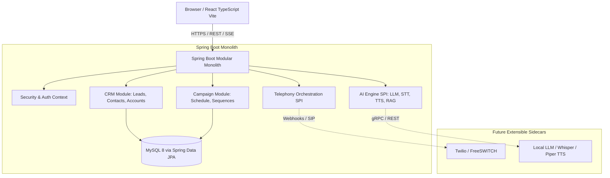

# VoicePilot AI - Technical Architecture Document

## 1. System Vision & Purpose

**VoicePilot AI** is a production-oriented, AI-powered Voice CRM SaaS platform. It combines core customer relationship management workflows (leads, accounts, pipelines, communications) with scheduled outbound/inbound voice AI calling, speech-to-text (STT), text-to-speech (TTS), retrieval-augmented generation (RAG) knowledge retrieval, and local/remote LLM inference.

---

## 2. Architectural Blueprint

### Core Paradigm: Modular Monolith
To maximize velocity, maintain strict transactional integrity, and avoid distributed-system latency/complexity, the core business engine is engineered as a **Modular Monolith** in Java 21 / Spring Boot.

- **Single Deployable Unit**: The Spring Boot backend packages all core business domains into a single artifact.
- **Strict Boundary Enforcement**: Modules communicate via Java interfaces (Service Providers / In-process events), not direct coupling to internal entity tables of other domains.
- **Independent Future Extraction**: Real-time telephony webhooks, local speech engines, and LLM inference engines are separated via dedicated service contracts (SPI), allowing them to be extracted into standalone sidecars/microservices if scale demands.

---

## 3. Technology Stack & Component Responsibilities

| Tier | Technology | Purpose |
| :--- | :--- | :--- |
| **Frontend** | React 18+, TypeScript, Vite | Single Page Application, high-performance typed state management, interactive CRM dashboards. |
| **Backend** | Java 21 LTS, Spring Boot 3.x | Core API, business logic, transaction management, OpenAPI documentation. |
| **Build System** | Maven (`mvnw` wrapper) | Reproducible multi-platform backend builds. |
| **Persistence** | MySQL 8.x, Spring Data JPA / Hibernate | Relational persistence, transactional ACID compliance, indexing. |
| **Database Migrations** | Flyway | Version-controlled, idempotent DDL and schema evolutions. |
| **API Contract** | RESTful JSON + OpenAPI (Springdoc) | Interactive documentation at `/swagger-ui.html` and machine-readable specs. |
| **Infrastructure** | Docker Compose | Local development provisioning for MySQL and future Redis/minio containers. |

---

## 4. Bounded Contexts & Module Boundaries

The backend source tree is partitioned by bounded context within `com.voicepilot.modules`:

1. **`common`**: Shared kernels, base domain entities (`BaseEntity` with audit timestamps), exception hierarchy, standard API response envelopes, and pagination models.
2. **`crm`**: Customer relationships, contact directories, lead pipelines, interaction logs, custom CRM properties.
3. **`campaign`**: Voice campaign definitions, scheduling rules, audience segment targeting, cadence execution.
4. **`telephony`**: Call lifecycle abstractions (`CallSession`, `CallDirection`, `CallStatus`), call-event hooks, provider adapters.
5. **`ai`**: Knowledge base vector abstractions (RAG), conversational prompt engineering templates, LLM client interfaces, TTS/STT pipelines.

---

## 5. Security & Secret Management

- **Zero Hardcoded Secrets**: DB passwords, API tokens, and provider credentials must be injected exclusively via environment variables.
- **Profiles**:
  - `application.yml`: Base configuration with non-sensitive defaults and `${ENV_VAR}` placeholders.
  - `application-local.yml`: Sensible developer-machine defaults for Docker Compose environment.
- **Secret Exclusion**: `.env*` files are strictly excluded from version control via `.gitignore`. A clean `.env.example` serves as the reference template.
